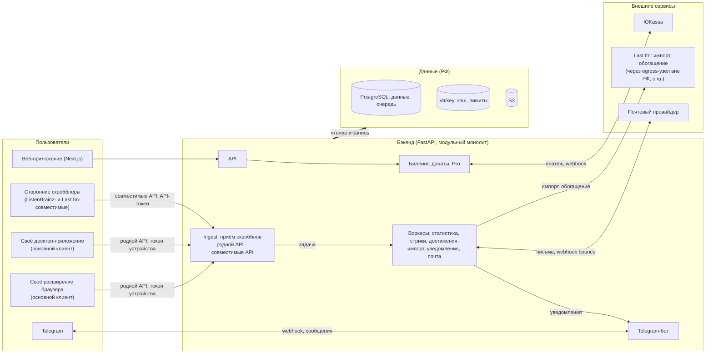

# Scrobb

**Scrobb** — сервис скробблинга (учёта прослушанной музыки) для российского рынка, аналог [Last.fm](https://www.last.fm/): история прослушиваний, статистика, стрики, достижения и сравнение с друзьями.

> Статус: **проектирование**. Кода пока нет, документы — черновики.

## Зачем

- **Last.fm с марта 2026 года недоступен из России**: по сообщениям пользователей, блокируются и сайт, и эндпоинты скробблинга (HTTP 403).
- **API ToS Last.fm разрешает только некоммерческое использование**, а данные из Last.fm ограничены лимитом в 100 MB и требуют атрибуции.

Поэтому ядро Scrobb — **собственный приём скробблов**, а Last.fm — дополнительный модуль, выключенный по умолчанию. Подробнее — [architecture.md](docs/architecture.md), §0 и §3.

## Этап 1 (MVP)

- **Свои скробблеры — основной способ подключения** (предложение): **расширение браузера** для Chrome/Chromium-браузеров и Firefox (коннекторы Яндекс Музыки, VK Музыки, Звука, YouTube Music) — в MVP; **десктоп-приложение** для Windows и Linux (читает системные медиасессии) — сразу после MVP, macOS позже. Вход — привязкой к аккаунту одной кнопкой, без ручных токенов; офлайн-очередь. Подробнее — [architecture.md](docs/architecture.md), §18.
- **Собственный приём скробблов** — родной API для своих клиентов, а для сторонних — API, совместимый с ListenBrainz, и эндпоинт `/2.0/`, совместимый с Last.fm (если не успеем в MVP — сразу после). Существующие клиенты (Web Scrobbler, Pano Scrobbler, rescrobbled, foobar2000 + foo_listenbrainz2, Navidrome) остаются поддерживаемым вторым вариантом и отправляют прослушивания по API-токену пользователя.
- **Веб-приложение** — сначала только веб: публичные профили, история, топы за периоды, графики, настройки приватности.
- **Импорт из Last.fm** — разовый перенос истории и, по желанию, постоянная синхронизация. По умолчанию выключено.
- **Мотивация и социальное:** стрики, достижения, друзья (подписки), лидерборды среди друзей за неделю, месяц и всё время.
- **Telegram-бот** — привязка аккаунта по одноразовой ссылке, команды со статистикой, уведомления. Бот ничего не продаёт и не используется для входа.
- **Донаты** — страница «Поддержать проект».
- **Email** — подтверждение и смена адреса, уведомления безопасности; сброс пароля — после ответа юриста; рассылки — только по согласию и позже ([architecture.md](docs/architecture.md), §17).
- Уникальный публичный **@username** и неизменяемый внутренний id.

## Этап 2

- **Рекомендации** — с объяснением, почему рекомендовано.
- **Scrobb Pro** — оплата на сайте через ЮKassa: 99 ₽ за 30 дней разовым платежом, без автопродления; годового тарифа пока нет. Оплата заранее добавляет 30 дней к текущему сроку. Ядро, собственные данные и стрики остаются бесплатными.

## Позже

- Скробблинг **видео** (фильмы, сериалы, ролики).
- Учёт **игр из Steam**.

## Стек

| Часть | Выбор |
|---|---|
| Бэкенд | Python 3.14 + FastAPI, модульный монолит |
| Фоновые задачи | procrastinate — очередь и периодические задачи в PostgreSQL, за тонким интерфейсом `jobs` |
| База данных | PostgreSQL 18, таблица прослушиваний секционирована по месяцам |
| Метаданные музыки | Локальная копия core-данных MusicBrainz (CC0), API MusicBrainz — только для нового |
| Кэш, лимиты, лидерборды | Valkey 9 (один экземпляр) |
| Фронтенд | Next.js (TypeScript) |
| Свои клиенты (предложение) | Расширение: TypeScript, WebExtension Manifest V3 (WXT); десктоп: Tauri 2 (альтернатива — Electron) |
| Файлы | S3-совместимое хранилище в РФ |
| Развёртывание | Docker Compose на хостинге в РФ (152-ФЗ), CI/CD — GitHub Actions |
| Наблюдаемость | Prometheus + Grafana, ошибки — self-hosted GlitchTip |

Почему именно так — [stack-rationale.md](docs/stack-rationale.md).

## Архитектура (упрощённо)

## Документация

- [docs/architecture.md](docs/architecture.md) — архитектура этапа 1: модель данных, приём скробблов, импорт Last.fm, инфраструктура, механики, экраны, дизайн-система, монетизация, Telegram-бот, email, свои клиенты-скробблеры, открытые вопросы.
- [docs/backend-core.md](docs/backend-core.md) — карта ядра бэкенда: путь скроббла, цепочка событий, чтение, модули и их таблицы.
- [docs/stack-rationale.md](docs/stack-rationale.md) — обоснование стека и сравнение с альтернативами и со стеком Last.fm.
- [docs/music-services-ru.md](docs/music-services-ru.md) — музыкальные сервисы в РФ и способы получить историю прослушиваний.
- [docs/ci-cd.md](docs/ci-cd.md) — CI/CD в экономном режиме на бесплатных минутах GitHub Free, деплой и откат.
- [docs/review.md](docs/review.md) — ревью проекта перед стартом разработки: риски, что пересмотреть и что добавить.

## Участие

Идеи, вопросы и предложения — через [Issues](../../issues).
