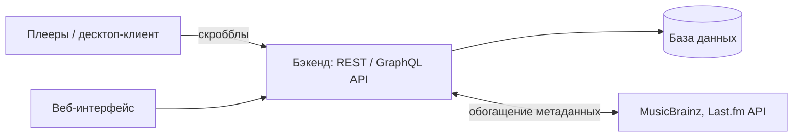

# Scrobb

**Scrobb** — сервис скробблинга (трекинга прослушанного аудио) для российского рынка, аналог [Last.fm](https://www.last.fm/).

> Статус: ранняя стадия, проектирование. Документ — черновик и будет дополняться.

## Содержание

- [Описание проекта](#описание-проекта)
- [Roadmap (черновик)](#roadmap-черновик)
- [Черновая архитектура](#черновая-архитектура)
- [Открытые вопросы](#открытые-вопросы)
- [Участие в проекте](#участие-в-проекте)

## Описание проекта

Scrobb собирает данные о том, что слушает пользователь (трек, артист, альбом, время прослушивания), сохраняет историю и строит на её основе профиль, статистику и, в перспективе, рекомендации.

Ключевая идея — дать российским пользователям удобный и доступный сервис скробблинга с поддержкой популярных у нас плееров и сервисов.

В будущем планируется расширение за пределы музыки:

- **видео** — учёт просмотренных фильмов, сериалов и роликов;
- **игры** — учёт игровой активности в Steam.

## Roadmap (черновик)

### Этап 1. MVP — скробблинг аудио

- Сбор данных о прослушивании: десктоп-клиент или интеграция с плеерами.
- Учёт прослушанных треков (история скробблов).
- Профиль пользователя.
- Статистика прослушиваний (топ артистов, альбомов, треков за период).

### Этап 2. Социальный слой

- Друзья и подписки.
- Лента активности.
- Рекомендации на основе прослушанного.

### Этап 3. Видео-скробблинг

- Учёт просмотренного видеоконтента.

### Этап 4. Скробблинг игр из Steam

- Учёт игровой активности через интеграцию со Steam.

### Этап 5. Аналитика и открытая платформа

- Расширенная аналитика и чарты.
- Возможно — публичный API для сторонних разработчиков.

## Черновая архитектура

### Клиентская часть

- Десктоп-приложение **или** плагины для популярных плееров (VLC, foobar2000, AIMP и т. п.) для сбора данных о прослушивании.

### Бэкенд

- REST API (или GraphQL).
- База данных для хранения треков, артистов, альбомов, истории прослушиваний и пользователей.

### Метаданные

- Интеграция с внешними источниками для обогащения данных: [MusicBrainz](https://musicbrainz.org/), [Last.fm API](https://www.last.fm/api).

### Фронтенд

- Веб-интерфейс профиля и статистики.

### Инфраструктура

- Docker.
- CI/CD через GitHub Actions.

## Открытые вопросы

Темы для обсуждения (можно заводить по ним issues):

1. **Стек технологий** — языки и фреймворки для бэкенда, фронтенда и клиента; выбор СУБД.
2. **Модель данных** — сущности (пользователь, трек, артист, альбом, скроббл), связи, сопоставление одних и тех же треков из разных источников.
3. **Монетизация** — бесплатный базовый функционал, подписка, другие варианты.
4. **Юридические аспекты** — авторские права и лицензии на метаданные, условия использования внешних API, хранение персональных данных пользователей.

## Участие в проекте

Проект на стадии проектирования. Идеи, вопросы и предложения — через [Issues](../../issues).
