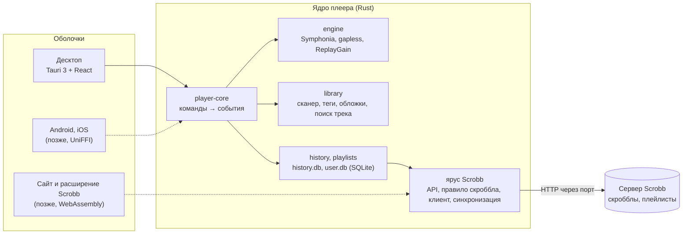

# Scrobb

**Scrobb** — сервис скробблинга (учёта прослушанной музыки) для российского рынка, аналог [Last.fm](https://www.last.fm/), и **свой музыкальный плеер**. Сейчас в работе плеер: ядро на Rust и десктоп-приложение. Сервис пока проектируется.

**Ядро плеера**

[](player/core/README.md)
[](https://github.com/pdeljanov/Symphonia)
[](https://github.com/RustAudio/cpal)
[](https://github.com/HEnquist/rubato)
[](https://github.com/Serial-ATA/lofty-rs)
[](https://github.com/rusqlite/rusqlite)
[](player/core/README.md#ярусы)

**Десктоп-приложение**

[](player/shells/desktop/README.md)
[](https://react.dev)
[](https://www.typescriptlang.org)
[](https://vite.dev)
[](https://tailwindcss.com)
[](https://ui.shadcn.com)
[](https://vitest.dev)
[](https://playwright.dev)

**Сервис Scrobb (проектируется)**

[](docs/stack-rationale.md)
[](docs/architecture.md)
[](docs/architecture.md)
[](docs/architecture.md)
[](docs/architecture.md)
[](docs/frontend-core.md)

> **Статус (25.10.2026).**
> - **Плеер — прототип.** Ядро и десктоп работают и покрыты тестами. Установщики для Windows, Linux и macOS собираются и проверяются на настоящих системах в GitHub Actions.
> - **Сервис** — документы и спецификации, кода бэкенда и сайта нет. Общий с ним код уже есть в ядре плеера: протокол, правило скроббла, ключ трека, синхронизация.

## Плеер

Свой плеер для локальной музыки со встроенным скробблингом в Scrobb. Зачем он и как устроен — [player-architecture.md](docs/player-architecture.md). Почему не только чужие плееры — [local-players-research.md](docs/local-players-research.md).

### Что уже умеет

- **Звук без компромиссов:**
  - бесшовные переходы (gapless) сэмпл в сэмпл;
  - ReplayGain по треку и альбому;
  - качественный ресемплинг и точная перемотка;
  - форматы MP3, AAC, FLAC, ALAC, Vorbis, WAV, AIFF.
- **Библиотека:**
  - папки-источники с фоновым сканированием, теги и обложки;
  - альбомы, артисты, поиск ⌘K без учёта регистра и «ё».
- **История и скробблинг:**
  - каждое прослушивание — в `history.db`, засчитанное — по правилу Scrobb;
  - офлайн-очередь с повторами;
  - привязка устройства кодом, без ручных токенов;
  - «сейчас играет».
- **Плейлисты:**
  - импорт и экспорт M3U8, XSPF, JSPF (ListenBrainz), CSV (TuneMyMusic, Soundiiz), TXT (Яндекс Музыка), импорт PLS;
  - перетаскивание треков;
  - трек, которого нет в библиотеке, остаётся в плейлисте и находится сам, когда файл появится.
- **Синхронизация плейлистов** между устройствами через аккаунт Scrobb:
  - правки по полям с гибридными часами, слияние без конфликтов;
  - клиент готов, эндпоинт сервера описан в спецификации.
- **Интерфейс** в духе Spotify и Deezer: тёмная и светлая темы, панель «Сейчас играет» с очередью, цвет обложки в шапках, узкое окно.
- **Установщики** — собираются в [GitHub Actions](.github/workflows/player-installers.yml) вручную или по тегу `v*`, тогда все файлы сразу в черновике релиза:
  - Windows — `setup.exe` без прав администратора, открывает плейлисты двойным щелчком, аудиофайлы не перехватывает;
  - Linux — deb и AppImage;
  - macOS — DMG для Apple Silicon.

Подробно — [README ядра](player/core/README.md) и [README десктопа](player/shells/desktop/README.md).

### Чего пока нет

- медиаклавиш и системной медиасессии;
- перемешивания;
- эквалайзера и Opus;
- подписи установщиков (Windows, Apple) и автообновления;
- мобильных оболочек (Android, iOS);
- сервера синхронизации — он появится вместе с бэкендом Scrobb.

Полный список — [README десктопа](player/shells/desktop/README.md#чего-пока-нет).

### Устройство



- **Одно ядро на Rust** для всех платформ. Оболочки — нативные: десктоп на Tauri, мобильные — позже, через UniFFI.
- **Ярус Scrobb** (протокол, правило скроббла, ключ трека, синхронизация) не зависит от плеера и собирается под WebAssembly. Тот же код получат сайт и расширение.
- **Ввод-вывод — через порты:** звук, файлы, сеть, секреты, часы. Поэтому ядро тестируется без звуковой карты и сети.

### Запуск

Нужны Rust 1.95+ (ядро — 1.89+), Node 22+ и pnpm. На Linux ещё WebKitGTK и ALSA — список в [README десктопа](player/shells/desktop/README.md#запуск).

```sh
# ядро: формат, clippy, тесты, сборка под wasm32
cd player/core && scripts/check.sh

# десктоп
cd player/shells/desktop
pnpm install
pnpm tauri dev          # приложение
pnpm dev                # только интерфейс в браузере, на подменном ядре (?demo=playing, ?demo=sync…)
scripts/check.sh        # типы, тесты, сборка; fmt, clippy, тесты Rust

# сервер Scrobb в памяти для разработки: привязка и синхронизация плейлистов
cd player/core && cargo run -p player-testkit --example scrobb-dev-server -- --port 8787
SCROBB_BASE_URL=http://127.0.0.1:8787 pnpm tauri dev
```

### Как проверено

- **Ядро — 152 теста**, clippy без предупреждений, сборка общего яруса под wasm32. Среди тестов:
  - бесшовные переходы сэмпл в сэмпл и ресемплинг;
  - история и скробблинг на поддельном сервере;
  - форматы плейлистов на живых образцах из foobar2000, AIMP, VLC, ListenBrainz, Exportify;
  - синхронизация двух «устройств» с расходящимися часами.
- **Десктоп** — vitest и Rust-тесты оболочки, сценарии Playwright на подменном ядре, собранное приложение под Xvfb. Синхронизация плейлистов проверена двумя настоящими экземплярами приложения через dev-сервер.
- **Мутационная проверка:** намеренно внесённые поломки ловятся тестами.

## Сервис Scrobb

### Зачем

- **Last.fm с марта 2026 года недоступен из России**: по сообщениям пользователей, блокируются и сайт, и эндпоинты скробблинга (HTTP 403).
- **API ToS Last.fm разрешает только некоммерческое использование**, а данные из Last.fm ограничены лимитом в 100 MB и требуют атрибуции.

Поэтому ядро Scrobb — **собственный приём скробблов**, а Last.fm — дополнительный модуль, выключенный по умолчанию. Подробнее — [architecture.md](docs/architecture.md), §0 и §3.

### Этап 1 (MVP)

- **Свои скробблеры — основной способ подключения** (предложение):
  - **расширение браузера** для Chrome/Chromium-браузеров и Firefox с коннекторами Яндекс Музыки, VK Музыки, Звука и YouTube Music — в MVP;
  - **десктоп-приложение** для Windows и Linux, читающее системные медиасессии, — сразу после MVP, macOS позже.

  Вход — привязкой к аккаунту одной кнопкой, без ручных токенов; есть офлайн-очередь. Подробнее — [architecture.md](docs/architecture.md), §18. Свой плеер — отдельная линия, тот же протокол.
- **Собственный приём скробблов:**
  - родной API для своих клиентов;
  - для сторонних — API, совместимый с ListenBrainz, и эндпоинт `/2.0/`, совместимый с Last.fm (если не успеем в MVP — сразу после).

  Существующие клиенты (Web Scrobbler, Pano Scrobbler, rescrobbled, foobar2000 + foo_listenbrainz2, Navidrome) остаются вторым вариантом и отправляют прослушивания по API-токену.
- **Веб-приложение** — публичные профили, история, топы за периоды, графики, приватность.
- **Импорт из Last.fm** — разовый перенос истории и, по желанию, постоянная синхронизация. По умолчанию выключен.
- **Мотивация и социальное** — стрики, достижения, подписки на друзей, лидерборды среди друзей.
- **Telegram-бот** — привязка по одноразовой ссылке, статистика, уведомления.
- **Донаты** и **email** — подтверждение адреса и уведомления безопасности ([architecture.md](docs/architecture.md), §17).
- Уникальный публичный **@username** и неизменяемый внутренний id.

### Этап 2 и позже

- **Синхронизация плейлистов** плеера и плейлисты на сайте — клиент готов, спецификация эндпоинта — [playlists.md](docs/playlists.md), §8.
- **Рекомендации** с объяснением, почему рекомендовано.
- **Scrobb Pro**: 99 ₽ за 30 дней разовым платежом через ЮKassa, без автопродления. Ядро, свои данные и стрики остаются бесплатными.
- Позже — скробблинг **видео** и **игр из Steam**.

### Стек

| Часть | Выбор |
|---|---|
| Бэкенд | Python 3.14 + FastAPI, модульный монолит |
| Фоновые задачи | procrastinate — очередь и периодические задачи в PostgreSQL, за тонким интерфейсом `jobs` |
| База данных | PostgreSQL 18, таблица прослушиваний секционирована по месяцам |
| Метаданные музыки | Локальная копия core-данных MusicBrainz (CC0), API MusicBrainz — только для нового |
| Кэш, лимиты, лидерборды | Valkey 9 (один экземпляр) |
| Фронтенд | Next.js (TypeScript) |
| Свои клиенты | Плеер: ядро на Rust, десктоп на Tauri 3 + React (в работе). Расширение: TypeScript, WebExtension Manifest V3 (WXT); десктоп-скробблер: Tauri (предложение) |
| Файлы | S3-совместимое хранилище в РФ |
| Развёртывание | Docker Compose на хостинге в РФ (152-ФЗ), CI/CD — GitHub Actions |
| Наблюдаемость | Prometheus + Grafana, ошибки — self-hosted GlitchTip |

Почему именно так — [stack-rationale.md](docs/stack-rationale.md).

### Архитектура (упрощённо)


## Код

| Путь | Что там |
|---|---|
| [player/core](player/core/README.md) | Ядро плеера на Rust: звуковой движок, очередь, библиотека, история и скробблинг, плейлисты и их синхронизация. Общий со Scrobb ярус (`scrobb-*`) собирается под WebAssembly |
| [player/shells/desktop](player/shells/desktop/README.md) | Десктоп-приложение: Tauri 3 (alpha) + React, Tailwind CSS 4, shadcn/ui |
| [contracts](contracts/README.md) | Языконезависимые тест-векторы для бэкенда, веба, расширения и Rust: правило скроббла, ключ трека, синхронизация плейлистов |

## Документация

**Плеер**
- [player-architecture.md](docs/player-architecture.md) — стек и архитектура плеера для Android, iOS, macOS, Windows и Linux: одно ядро на Rust, нативные оболочки.
- [player-history.md](docs/player-history.md) — история прослушиваний и скробблинг: формат, база, офлайн-очередь, привязка устройства, «сейчас играет».
- [playlists.md](docs/playlists.md) — плейлисты: стандарты (M3U, XSPF/JSPF, CSV), импорт и экспорт, хранение, синхронизация, спецификация эндпоинта для бэкенда.
- [local-players-research.md](docs/local-players-research.md) — локальные плееры для десктопа, Android и iOS: функции, сильные и слабые стороны, скробблинг с телефона.

**Сервис**
- [architecture.md](docs/architecture.md) — архитектура этапа 1:
  - модель данных и приём скробблов;
  - импорт Last.fm;
  - инфраструктура;
  - механики и экраны, дизайн-система;
  - монетизация;
  - Telegram-бот, email;
  - свои клиенты;
  - открытые вопросы.
- [backend-core.md](docs/backend-core.md) и [frontend-core.md](docs/frontend-core.md) — карты ядра бэкенда и фронтенда.
- [stack-rationale.md](docs/stack-rationale.md) — обоснование стека, сравнение с альтернативами и со стеком Last.fm.
- [music-services-ru.md](docs/music-services-ru.md) — музыкальные сервисы в РФ и способы получить историю прослушиваний.
- [ci-cd.md](docs/ci-cd.md) — CI/CD на бесплатных минутах GitHub Free, деплой и откат.
- [review.md](docs/review.md) — ревью проекта: риски, что пересмотреть, что уже сделано.

## Участие

Идеи, вопросы и предложения — через [Issues](../../issues).

Лицензия пока не выбрана ([architecture.md](docs/architecture.md), §16, п. 41).
