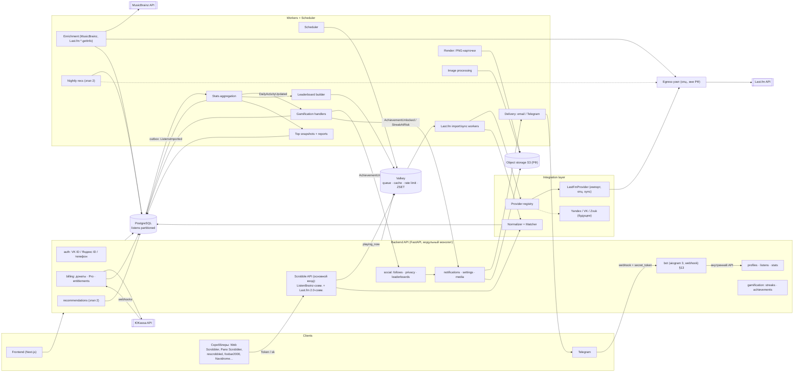
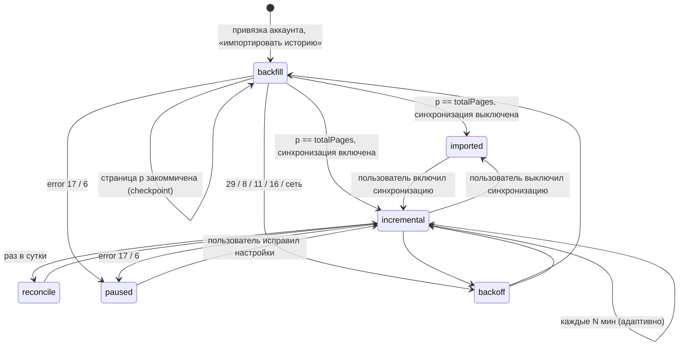
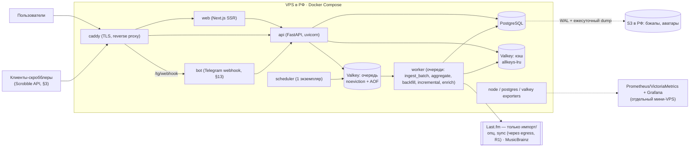
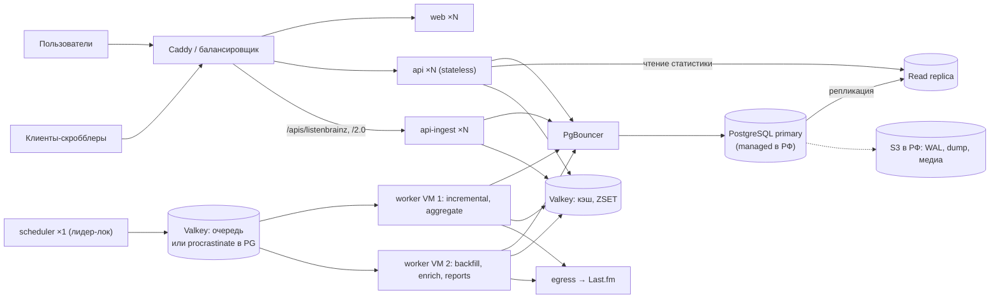
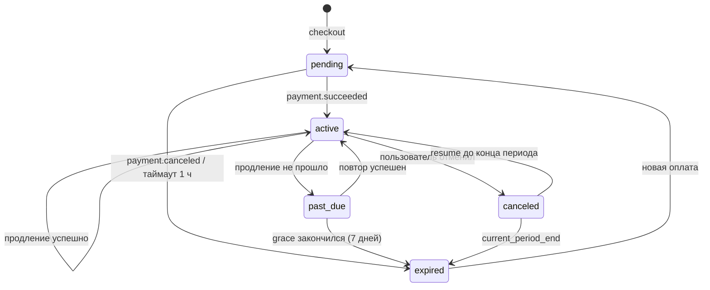
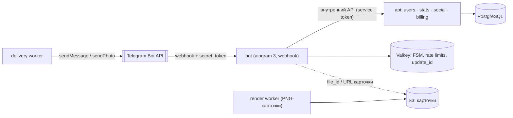

# Scrobb — архитектура веб-приложения (этап 1)

> Статус: **черновик-предложение** (03.10.2026). Решения по стеку и модели данных обсуждаемы, см. «Открытые вопросы».
> Исследование сервисов РФ: [music-services-ru.md](music-services-ru.md). Пометка **(не проверено)** — факт не подтверждён первоисточником.

## 0. Вводные и ключевые ограничения

**Этап 1:** пользователь регистрируется в Scrobb, создаёт API-токен и направляет свой плеер, браузерное расширение или приложение-скробблер **прямо в Scrobb**. Основа — **собственный приём скробблов** (ListenBrainz-совместимый API + Last.fm-совместимый эндпоинт, §3). По этим данным строятся профиль, статистика, стрики, достижения и сравнение с друзьями. **Last.fm — дополнительный модуль:** разовый импорт накопленной истории и, по желанию, постоянная синхронизация для тех, кто им ещё пользуется (§4). Почему так: Last.fm заблокирован в РФ (R1), его ToS запрещает коммерческое использование (R2), а свой приём даёт независимость и данные в реальном времени (§3.1). Архитектура рассчитана и на будущих провайдеров (§5).

Найденные в ходе исследования ограничения, которые прямо влияют на дизайн:

| # | Ограничение | Последствие |
|---|---|---|
| R1 | **Last.fm заблокировал доступ из РФ** с марта 2026: сайт и эндпоинты скробблинга, по сообщениям пользователей — HTTP 403 ([zona.media](https://zona.media/news/2026/03/24/fm), [web-scrobbler#6030](https://github.com/web-scrobbler/web-scrobbler/issues/6030)) | (а) Сервер Scrobb, размещённый в РФ, может не достучаться до `ws.audioscrobbler.com` (**не проверено из РФ-IP**). Закладываем *egress-узел* для запросов к Last.fm, его можно включить конфигом. (б) Новые скробблы у пользователей из РФ появляются только при включённом обходе блокировки. **Поэтому основной источник — собственный приём скробблов (§3)**, а Last.fm — импорт истории и опциональная синхронизация (§4). Если Last.fm недоступен, ядро продолжает работать |
| R2 | **API ToS Last.fm** ([tos](https://www.last.fm/api/tos)): только некоммерческое использование (п. 3.1); «Reasonable Usage Cap» — **100 MB** данных Last.fm, больше — только с письменного согласия (п. 4.3.4); обязательны атрибуция «powered by AudioScrobbler» и ссылки на страницы Last.fm (п. 2.7); публичные страницы на данных API — по письменному одобрению (п. 2.7); кэширование по HTTP-заголовкам; запрет обходить лимиты (п. 4.4); после расторжения договора данные Last.fm нужно удалить (п. 9.3) | Полные истории даже сотни пользователей превысят 100 MB. **До публичного запуска написать на partners@last.fm.** Ограничения касаются только данных, полученных из Last.fm (`listens.source = lastfm`); данные собственного приёма (§3) под ToS Last.fm не подпадают. Монетизация с учётом п. 3.1 — §12.5. Скробблы храним с полем `source`, чтобы при необходимости выборочно удалить данные из Last.fm (п. 9.3) |
| R3 | **149-ФЗ ст. 8 ч. 10** (в ред. 406-ФЗ): авторизация пользователей из РФ — только через российский номер телефона, Госуслуги, ЕБС или российскую систему (VK ID, Яндекс ID, Сбер ID). С **07.07.2026** действует штраф по ст. 13.55 КоАП (юрлица — 500–700 тыс. ₽) ([Гарант](https://www.garant.ru/article/2136195/)) | **Не делаем «Войти через Telegram/Google/Apple»** — по оценке юристов, вход через Telegram попадает в зону риска. Вход: VK ID, Яндекс ID, телефон. Допустимость голого email+пароль — открытый вопрос (§16) |
| R4 | **152-ФЗ ст. 18 ч. 5** (с 01.07.2025): первичный сбор и хранение ПДн граждан РФ — только в базах на территории РФ ([law.ru](https://www.law.ru/article/28545-zapret-na-hranenie-personalnyh-dannyh-za-granitsey-s-1-iyulya-2025-goda), [comply.ru](https://comply.ru/tpost/c43ezsout1-lokalizatsiya-i-transgranichnaya-peredac)) | БД и бэкапы — у хостера в РФ. Запросы к Last.fm (передаётся username; только у тех, кто включил импорт) и egress-узел за рубежом — это, вероятно, трансграничная передача: нужно уведомление РКН (ст. 12). **Юридический вопрос** |
| R5 | **Рекомендательные технологии** (ст. 13.56 КоАП с 07.07.2026) | Для этапа 2 (рекомендации) понадобятся уведомление пользователей и опубликованные правила работы рекомендаций |

---

## 1. Слои

| Слой | Назначение |
|---|---|
| **Frontend** (Next.js, SSR + клиентская интерактивность) | Публичные профили (SSR ради шаринга и SEO), личный кабинет, статистика и графики, стрики, достижения, друзья, настройки приватности. Работает только через Backend API |
| **Backend API** (модульный монолит) | REST/JSON + OpenAPI. Модули: `auth`, `users/profiles`, `library` (артисты/альбомы/треки), `listens` (история), `stats`, `social` (подписки, приватность, лидерборды), `gamification` (стрики, достижения), `ingest` (Scrobble API, токены клиентов, §3), `integrations` (импорт и привязка внешних аккаунтов), `notifications`, `media` (аватары/баннеры), `settings` (`user_preferences`), `billing` (донаты, Pro, §12), позже `recommendations`. Единая политика доступа (privacy guard) |
| **Integration layer** | Провайдеры источников: **основной — push-приём от клиентов** (`PushScrobbleProvider`, §3), дополнительный — `LastFmProvider` (импорт и опциональная синхронизация, §4), позже Yandex/VK/Zvuk. Нормализация в `ListenEvent`, сопоставление с каноническими треками (matcher), клиенты Last.fm и MusicBrainz с rate limiter |
| **Background workers + scheduler** | Разбор больших пакетов `import` от клиентов, импорт и опциональная синхронизация Last.fm (backfill/incremental/reconcile), обогащение метаданных, агрегаты (daily_activity, месячные rollup'ы), обработчики геймификации, пересчёт лидербордов, снапшоты топов и отчёты (§9), доставка уведомлений, обработка изображений, позже ночные рекомендации |
| **Storage** | PostgreSQL — источник истины, `listens` секционированы по времени. Valkey (два экземпляра — очередь и кэш, §7.1) — очередь задач, лимиты частоты (токены клиентов, Last.fm, MusicBrainz), кэш, горячие лидерборды (sorted sets), now playing с TTL. Объектное хранилище S3 в РФ — аватары и баннеры, выгрузки данных |

Внутренние события через **transactional outbox**: событие пишется в таблицу `outbox` в той же транзакции, что и данные, а воркер-диспетчер раздаёт его обработчикам. Это даёт «at-least-once» доставку, поэтому все обработчики идемпотентны.



---

## 2. Модель данных

### 2.1 Принципы

- **«Своя база» пользователя — логически, а не физически.** Все пользователи хранятся в общей БД, данные изолированы по `user_id` (каждый запрос фильтруется по нему, это обеспечивает privacy guard). Отдельная БД на пользователя не нужна: каталог артистов и треков общий, без общей базы невозможны сравнение с друзьями и лидерборды, а миграции, бэкапы и пул соединений для тысяч баз — непосильная нагрузка для маленькой команды.
- **Время — только UTC** (`timestamptz`; источник — `listened_at` от клиента или `date.uts` из Last.fm). Таймзона пользователя (`users.timezone`, IANA, по умолчанию `Europe/Moscow`) применяется только при агрегации «по дням» и при отображении.
- **Сырые строки источника** (`artist/track/album` как пришли) сохраняются в `track_aliases`. Если позже исправить сопоставление (merge, исправление матчинга), историю не нужно импортировать заново.
- Внешние идентификаторы (MBID, URL Last.fm, будущие id Яндекса, VK, Звука, ISRC) лежат в одной таблице `external_ids`, а не в колонках.
- **У каждого прослушивания есть источник** (`listens.source`: собственный приём по ListenBrainz- или 2.0-протоколу, импорт Last.fm, будущие провайдеры) и, для собственного приёма, токен-устройство (`token_id`). Это нужно для дедупликации (§5.4), для выборочного удаления данных Last.fm (R2, п. 9.3) и для разделения «наших» и «Last.fm-данных» в монетизации (§12.5).
- **Пользователь — внутренний id + публичный @username** (§2.5).

### 2.2 ER-диаграмма

```mermaid
erDiagram
  users ||--o{ auth_identities : "входит через"
  users ||--o{ username_history : "прежние имена (hold)"
  users ||--o| telegram_links : "бот (не вход)"
  notifications ||--o{ notification_deliveries : "каналы"
  users ||--o{ subscriptions : "оформляет"
  plans ||--o{ subscriptions : "тариф"
  users ||--o{ payments : "платит"
  subscriptions ||--o{ payments : "продления"
  users ||--o{ entitlements : "имеет права"
  users ||--|| privacy_settings : has
  users ||--o{ external_accounts : "привязывает"
  external_accounts ||--|| sync_state : has
  users ||--o{ listens : "слушает"
  tracks ||--o{ listens : ""
  track_aliases ||--o{ listens : "как пришло"
  track_aliases }o--|| tracks : "сопоставлен с"
  artists ||--o{ tracks : "основной артист"
  albums ||--o{ tracks : ""
  artists ||--o{ albums : ""
  external_ids }o--|| artists : "entity_type=1"
  external_ids }o--|| albums : "entity_type=2"
  external_ids }o--|| tracks : "entity_type=3"
  tags ||--o{ entity_tags : ""
  users ||--o{ daily_activity : "по локальным датам"
  users ||--o{ streaks : ""
  users ||--o{ user_period_stats : "rollup"
  users ||--|| users_stats : "счётчики"
  achievements ||--o{ user_achievements : ""
  users ||--o{ user_achievements : ""
  users ||--o{ follows : "follower"
  users ||--o{ follows : "followee"
  users ||--|| profiles : has
  users ||--|| user_preferences : has
  users ||--o{ favorites : "любимое"
  users ||--o{ notifications : ""
  users ||--o{ api_tokens : "клиенты-скробблеры (MVP)"
  api_tokens ||--o{ listens : "token_id"
  users ||--o{ ingest_batches : "большие import"
  api_tokens ||--o{ ingest_batches : "token_id"
  listens ||--o| listen_dedup : "скрытый дубль"
  listens ||--o{ listen_dedup : "оставленная строка"
  users ||--o{ user_entity_totals : "счётчики"
  users ||--o{ user_entity_monthly : "месячный rollup"
  users ||--o{ user_top_snapshots : "топы"
  users ||--o{ listening_reports : "отчёты"
  users ||--o{ recommendation_items : "этап 2"
  users ||--o{ recommendation_feedback : "этап 2"
  artists ||--o{ artist_similarity : "похожие"
  users ||--o{ shouts : "автор (этап 2)"

  users {
    bigint id PK "внутренний, неизменяемый"
    uuid public_id UK
    citext username UK "@username, 3-30"
    timestamptz username_changed_at
    text timezone
    timestamptz created_at
  }
  username_history {
    citext old_username PK
    bigint user_id FK
    timestamptz hold_until
  }
  telegram_links {
    bigint user_id PK
    bigint telegram_user_id UK
    bigint chat_id
    timestamptz blocked_at
  }
  notification_deliveries {
    bigint notification_id PK
    text channel PK "email|telegram"
    text status
  }
  auth_identities {
    bigint id PK
    bigint user_id FK
    text provider "vkid|yandex|phone|email"
    text subject UK
    timestamptz created_at
  }
  privacy_settings {
    bigint user_id PK
    text profile_visibility "public|followers|private"
    jsonb sections "history, top, streaks, achievements"
    bool hide_from_leaderboards
    bool hide_now_playing
  }
  external_accounts {
    bigint id PK
    bigint user_id FK
    text provider "lastfm|yandex|vk|zvuk"
    text external_username
    bool verified
    text status "active|private|not_found|revoked"
    bytea secret_enc "по необходимости"
  }
  sync_state {
    bigint account_id PK
    text phase "backfill|imported|incremental|paused|error"
    bool sync_enabled
    bigint backfill_to_uts
    int backfill_page
    bigint last_synced_uts
    timestamptz next_run_at
    int error_count
  }
  artists {
    bigint id PK
    text name
    text norm_name
  }
  albums {
    bigint id PK
    bigint artist_id FK
    text title
    text norm_title
  }
  tracks {
    bigint id PK
    bigint artist_id FK
    bigint album_id FK
    text title
    int duration_ms
    text isrc
  }
  track_aliases {
    bigint id PK
    bytea match_key UK
    text raw_artist
    text raw_track
    text raw_album
    bigint track_id FK
  }
  external_ids {
    text provider PK
    smallint entity_type PK "1=artist|2=album|3=track"
    text external_id PK
    bigint entity_id
  }
  listens {
    bigint user_id PK
    timestamptz played_at PK
    bigint alias_id PK
    bigint track_id
    smallint source "1=scrobb_lb|2=scrobb_as2|3=lastfm"
    bigint token_id FK
    timestamptz deleted_at
  }
  tags {
    bigint id PK
    text name UK
  }
  entity_tags {
    smallint entity_type PK "1|2|3"
    bigint entity_id PK
    bigint tag_id PK
    real weight
  }
  daily_activity {
    bigint user_id PK
    date local_date PK
    int listens
    int minutes
    int distinct_tracks
  }
  streaks {
    bigint user_id PK
    date start_date PK
    date end_date
    int length
  }
  user_period_stats {
    bigint user_id PK
    text period PK "week|month|all"
    date period_start PK
    int listens
    int distinct_artists
    int max_streak
  }
  users_stats {
    bigint user_id PK
    int total_listens
    int distinct_artists
    int distinct_albums
    int current_streak
    int longest_streak
  }
  profiles {
    bigint user_id PK
    text display_name
    text country
    text about
    text avatar_key
    text banner_key
  }
  user_preferences {
    bigint user_id PK
    jsonb prefs "display, notifications, streak_rule"
  }
  favorites {
    bigint user_id PK
    smallint entity_type PK "1=artist|2=album|3=track"
    bigint entity_id PK
    text source "lastfm|scrobb"
  }
  notifications {
    bigint id PK
    bigint user_id FK
    text type
    jsonb payload
    text dedup_key
    timestamptz read_at
  }
  api_tokens {
    bigint id PK
    bigint user_id FK
    text kind "api|as2_session"
    bigint parent_id
    bytea token_hash UK
    text last_client
    timestamptz revoked_at
  }
  ingest_batches {
    bigint id PK
    bigint user_id FK
    bigint token_id FK
    jsonb payload
    text status "queued|processing|done|failed"
    int listens_count
    timestamptz created_at
  }
  listen_dedup {
    bigint user_id PK
    timestamptz dup_played_at PK "FK listens"
    bigint dup_alias_id PK "FK listens"
    timestamptz kept_played_at "FK listens"
    bigint kept_alias_id "FK listens"
    int delta_s
  }
  reserved_usernames {
    citext name PK
    text reason
  }
  outbox {
    bigint id PK
    text event
    bigint aggregate_id "обычно user_id"
    jsonb payload
    timestamptz created_at
    timestamptz dispatched_at
  }
  jobs_dead {
    bigint id PK
    text name
    text unique_key
    text queue
    jsonb payload
    text error
    int attempts
    timestamptz failed_at
  }
  user_entity_totals {
    bigint user_id PK
    smallint entity_type PK
    bigint entity_id PK
    int plays
    timestamptz first_played_at
    timestamptz last_played_at
  }
  user_entity_monthly {
    bigint user_id PK
    date month PK
    smallint entity_type PK
    bigint entity_id PK
    int plays
  }
  user_top_snapshots {
    bigint user_id PK
    text period PK "7d|30d|90d|180d|365d"
    smallint entity_type PK
    jsonb items
  }
  listening_reports {
    bigint user_id PK
    text kind PK "week|month|year"
    date period_start PK
    jsonb data
  }
  artist_similarity {
    bigint src_artist_id PK
    bigint dst_artist_id PK
    real score
    text source
  }
  recommendation_items {
    bigint user_id PK
    date batch_date PK
    bigint entity_id PK
    real score
    jsonb reason
    text algo
  }
  recommendation_feedback {
    bigint user_id PK
    bigint entity_id PK
    text action PK "hide|like|clicked"
  }
  shouts {
    bigint id PK
    bigint author_id FK
    text target_type
    bigint target_id
    text body
  }
  achievements {
    bigint id PK
    text code UK
    text type
    int threshold
    jsonb params
  }
  user_achievements {
    bigint user_id PK
    bigint achievement_id PK
    timestamptz unlocked_at
    int progress
  }
  follows {
    bigint follower_id PK
    bigint followee_id PK
    text status "pending|accepted"
    timestamptz created_at
  }
  plans {
    text code PK "pro_month|pro_year"
    interval period
    int price_kopecks
  }
  subscriptions {
    bigint id PK
    bigint user_id FK
    text plan_code FK
    text status "pending|active|past_due|canceled|expired"
    timestamptz current_period_end
    timestamptz grace_until
    bool cancel_at_period_end
    text yk_payment_method_id
  }
  payments {
    bigint id PK
    bigint user_id FK
    bigint subscription_id FK
    text kind "subscription_initial|subscription_renewal|donation"
    text yk_payment_id UK
    text idempotence_key UK
    text status
    int amount_kopecks
  }
  entitlements {
    bigint user_id PK
    text feature PK
    text source PK "subscription|donation|grant"
    bigint source_id PK
    timestamptz valid_until
  }
  webhook_events {
    bigint id PK
    text event
    text object_id
    timestamptz processed_at
  }
```



### 2.3 DDL-эскиз ключевых таблиц (PostgreSQL 16+)

**Коды `entity_type`** — `smallint`, одни и те же во всех таблицах (`external_ids`, `entity_tags`, `favorites`, `user_entity_totals`, `user_entity_monthly`, `user_top_snapshots`, `recommendation_items`, `recommendation_feedback`):

| Код | Сущность | Таблица |
|---|---|---|
| `1` | Артист | `artists` |
| `2` | Альбом | `albums` |
| `3` | Трек | `tracks` |
| `4` | Новый релиз (только рекомендации, §9.10) | `albums` |

В коде — enum `EntityType(IntEnum)`, в SQL-примерах рядом с числом пишем комментарий: `entity_type = 3 /* трек */`.

```sql
CREATE TABLE users (
  id           bigserial PRIMARY KEY,
  username     citext UNIQUE NOT NULL,   -- имя, аватар и пр. — в profiles (§9.9)
  timezone     text NOT NULL DEFAULT 'Europe/Moscow',   -- IANA
  created_at   timestamptz NOT NULL DEFAULT now()
);

CREATE TABLE external_accounts (
  id                bigserial PRIMARY KEY,
  user_id           bigint NOT NULL REFERENCES users ON DELETE CASCADE,
  provider          text NOT NULL,                 -- 'lastfm' | 'yandex' ... (push-приём аккаунта не требует, только api_tokens)
  external_username text,
  verified          boolean NOT NULL DEFAULT false, -- подтверждено через Last.fm web auth
  status            text NOT NULL DEFAULT 'active',
  secret_enc        bytea,                          -- токены будущих провайдеров, шифровано
  UNIQUE (provider, external_username)            -- один Last.fm — одному пользователю Scrobb
);

CREATE TABLE sync_state (
  account_id       bigint PRIMARY KEY REFERENCES external_accounts ON DELETE CASCADE,
  phase            text NOT NULL DEFAULT 'backfill',  -- backfill|imported|incremental|paused|error
  sync_enabled     boolean NOT NULL DEFAULT false,    -- постоянная синхронизация (по умолчанию — только импорт)
  backfill_to_uts  bigint,          -- фиксированная верхняя граница backfill
  backfill_page    int  NOT NULL DEFAULT 0,  -- последняя закоммиченная страница
  backfill_total   int,
  last_synced_uts  bigint,          -- max(uts) успешно импортированных
  last_success_at  timestamptz,     -- для метрики лага (§7.4)
  last_reconcile_at timestamptz,
  next_run_at      timestamptz NOT NULL DEFAULT now(),
  error_count      int NOT NULL DEFAULT 0,
  last_error       text
);

CREATE TABLE track_aliases (
  id         bigserial PRIMARY KEY,
  match_key  bytea UNIQUE NOT NULL,   -- sha256(norm(artist) || 0x1f || norm(title))
  raw_artist text NOT NULL,
  raw_track  text NOT NULL,
  raw_album  text,
  track_id   bigint NOT NULL REFERENCES tracks
);

CREATE TABLE external_ids (
  provider    text NOT NULL,   -- 'mb_recording','mb_artist','mb_release','lastfm_url','lastfm_mbid','isrc','yandex','vk','zvuk'
  entity_type smallint NOT NULL,   -- 1 = артист | 2 = альбом | 3 = трек (коды — выше)
  external_id text NOT NULL,
  entity_id   bigint NOT NULL,
  PRIMARY KEY (provider, entity_type, external_id)
);
CREATE INDEX ON external_ids (entity_type, entity_id);

CREATE TABLE listens (
  user_id     bigint      NOT NULL,
  played_at   timestamptz NOT NULL,          -- начало проигрывания, UTC (listened_at клиента или date.uts Last.fm)
  alias_id    bigint      NOT NULL,          -- нормализованный (artist, track)
  track_id    bigint      NOT NULL,          -- денормализация для статистики
  album_id    bigint,
  source      smallint    NOT NULL,          -- 1=scrobb_lb, 2=scrobb_as2 (собственный приём), 3=lastfm (импорт/sync), 4+ — будущие провайдеры
  token_id    bigint,                        -- api_tokens.id для собственного приёма (какое устройство прислало)
  account_id  bigint,                        -- external_accounts.id для импорта
  loved       boolean,
  deleted_at  timestamptz,                   -- мягкое удаление (reconcile Last.fm, удаление пользователем)
  ingested_at timestamptz NOT NULL DEFAULT now(),
  PRIMARY KEY (user_id, played_at, alias_id) -- ключ дедупликации, включает ключ секционирования
) PARTITION BY RANGE (played_at);
-- Месячные секции (pg_partman или своя задача), отдельная секция для «древних» дат.
CREATE INDEX ON listens (user_id, track_id);
-- (user_id, played_at) покрывается префиксом PK: этого хватает и для окна дедупликации ±N с (§5.4).

-- Межисточниковые дубли (§5.4): какая строка скрыта (deleted_at) и в пользу какой.
-- У listens составной PK, поэтому обе ссылки составные. FK на секционированную таблицу PostgreSQL поддерживает с версии 12.
CREATE TABLE listen_dedup (
  user_id        bigint      NOT NULL,
  dup_played_at  timestamptz NOT NULL,     -- скрытая строка (обычно source = 3, импорт Last.fm)
  dup_alias_id   bigint      NOT NULL,
  kept_played_at timestamptz NOT NULL,     -- оставленная строка (собственный приём)
  kept_alias_id  bigint      NOT NULL,
  delta_s        int         NOT NULL,     -- |Δt| в секундах, для калибровки окна (§7.4)
  created_at     timestamptz NOT NULL DEFAULT now(),
  PRIMARY KEY (user_id, dup_played_at, dup_alias_id),
  FOREIGN KEY (user_id, dup_played_at, dup_alias_id)   REFERENCES listens (user_id, played_at, alias_id) ON DELETE CASCADE,
  FOREIGN KEY (user_id, kept_played_at, kept_alias_id) REFERENCES listens (user_id, played_at, alias_id) ON DELETE CASCADE
);
CREATE INDEX ON listen_dedup (user_id, kept_played_at, kept_alias_id);

-- Большие пакеты listen_type = import от клиентов (§11.1, шаг 10).
CREATE TABLE ingest_batches (
  id            bigserial PRIMARY KEY,
  user_id       bigint NOT NULL REFERENCES users ON DELETE CASCADE,
  token_id      bigint REFERENCES api_tokens ON DELETE SET NULL,   -- api_tokens — §9.9
  payload       jsonb,                      -- тело запроса как пришло; обнуляется после разбора
  status        text NOT NULL DEFAULT 'queued',   -- queued|processing|done|failed
  listens_count int  NOT NULL,
  accepted int, duplicates int, rejected int,     -- итог разбора (метрики §7.4)
  error         text,
  created_at    timestamptz NOT NULL DEFAULT now(),
  processed_at  timestamptz
);
CREATE INDEX ON ingest_batches (status, created_at) WHERE status IN ('queued', 'processing');
-- После рестарта планировщик заново ставит в очередь queued/processing (§7.2).

CREATE TABLE daily_activity (
  user_id         bigint NOT NULL,
  local_date      date   NOT NULL,           -- дата в TZ пользователя
  listens         int    NOT NULL,
  minutes         int    NOT NULL,           -- по duration_ms, если известна
  distinct_tracks int    NOT NULL,
  PRIMARY KEY (user_id, local_date)
);

CREATE TABLE users_stats (            -- счётчики профиля и достижений
  user_id bigint PRIMARY KEY, total_listens int, distinct_artists int, distinct_albums int,
  loved_count int, current_streak int, longest_streak int, updated_at timestamptz
);

-- Счётчики «за всё время» и снапшоты топов/отчётов для экранов профиля (§9.1, §9.5).
CREATE TABLE user_entity_totals (
  user_id bigint, entity_type smallint, entity_id bigint, plays int NOT NULL,
  first_played_at timestamptz NOT NULL, last_played_at timestamptz NOT NULL,
  PRIMARY KEY (user_id, entity_type, entity_id)
);
CREATE INDEX ON user_entity_totals (user_id, entity_type, plays DESC);   -- топ «за всё время» (§11.4)
CREATE TABLE user_top_snapshots (
  user_id bigint, period text, entity_type smallint, computed_at timestamptz NOT NULL,
  window_end_date date NOT NULL,         -- today_local на момент расчёта (§11.4)
  items jsonb NOT NULL,                  -- [{entity_id, plays, rank}] топ-100
  PRIMARY KEY (user_id, period, entity_type)
);
CREATE TABLE listening_reports (
  user_id bigint, kind text, period_start date, generated_at timestamptz NOT NULL,
  data jsonb NOT NULL,                   -- итоги, Δ, топ-5, новые артисты, часы прослушивания
  PRIMARY KEY (user_id, kind, period_start)
);

-- Месячный rollup для топов (артист/альбом/трек) — быстрые «топ за месяц/год/всё время».
CREATE TABLE user_entity_monthly (
  user_id bigint, month date, entity_type smallint, entity_id bigint, plays int,
  PRIMARY KEY (user_id, month, entity_type, entity_id)
);

-- Transactional outbox (§1): событие пишется в той же транзакции, что и данные.
CREATE TABLE outbox (
  id            bigserial PRIMARY KEY,
  event         text  NOT NULL,           -- 'ListensImported', 'StreakUpdated', 'AchievementUnlocked', …
  aggregate_id  bigint,                   -- обычно user_id: порядок событий одного пользователя
  payload       jsonb NOT NULL,
  created_at    timestamptz NOT NULL DEFAULT now(),
  dispatched_at timestamptz               -- NULL = ещё не роздано обработчикам
);
CREATE INDEX ON outbox (id) WHERE dispatched_at IS NULL;
-- Диспетчер: SELECT … WHERE dispatched_at IS NULL ORDER BY id LIMIT 500 FOR UPDATE SKIP LOCKED → enqueue → dispatched_at = now().
-- Розданные события старше 7 дней удаляются фоновой задачей.

-- Dead-letter интерфейса jobs (§6.3, §11.6): не зависит от брокера очереди.
CREATE TABLE jobs_dead (
  id          bigserial PRIMARY KEY,
  name        text  NOT NULL,             -- 'sync', 'enrich', 'ingest_batch', 'billing.apply', …
  unique_key  text,                       -- например 'sync:42'
  queue       text  NOT NULL,
  payload     jsonb NOT NULL,
  error       text  NOT NULL,
  attempts    int   NOT NULL,
  failed_at   timestamptz NOT NULL DEFAULT now(),
  requeued_at timestamptz                 -- «перезапустить» из админки
);
```

Остальные DDL-эскизы: `reserved_usernames` и `username_history` — в §2.5, `api_tokens`, `profiles`, `favorites` — в §9.9, `notifications` — в §9.8, достижения — в §8.2, биллинг — в §12.4, Telegram — в §13.8.

**Объём.** При допущении (не измерено) 30 скробблов в день на активного пользователя 10 тыс. пользователей дают около 110 млн строк в год. Для PostgreSQL с месячными секциями это немного. TimescaleDB (hypertable + continuous aggregates) — вариант на потом, если ручные rollup'ы станут болью (§6).

### 2.4 Нормализация ответа `user.getRecentTracks` (импорт Last.fm)

Для собственного приёма формат входа — ListenBrainz JSON (`track_metadata.artist_name`, `track_name`, `release_name`, `additional_info.*`, §3.2) или параметры `track.scrobble`. Они проще и сразу приводятся к `ListenEvent` (§5.1). Ниже — разбор ответа Last.fm для импорта.

Реальная структура ответа (JSON, `extended=1`). Поля сверены с [официальной страницей метода](https://www.last.fm/api/show/user.getRecentTracks) (там XML) и с JSON-примерами [неофициальной документации](https://lastfm-docs.github.io/api-docs/user/getRecentTracks/):

```json
{ "recenttracks": {
    "@attr": { "user": "frikandel_", "page": "1", "perPage": "200", "totalPages": "474", "total": "94613" },
    "track": [
      { "@attr": { "nowplaying": "true" },              // ← только у играющего сейчас; нет "date"
        "artist": { "name": "Tame Impala", "mbid": "", "url": "https://www.last.fm/music/Tame+Impala", "image": [] },
        "name": "Apocalypse Dreams", "mbid": "08b8e930-…",
        "album": { "#text": "Lonerism", "mbid": "0d2cb66c-…" },
        "loved": "0", "url": "https://www.last.fm/music/Tame+Impala/_/Apocalypse+Dreams",
        "image": [ { "size": "small", "#text": "https://…/34s/….jpg" }, { "size": "extralarge", "#text": "…" } ],
        "streamable": "0" },
      { "artist": { "name": "Tame Impala", "mbid": "", "url": "…" },
        "name": "Endors Toi", "mbid": "0632aa27-…",
        "album": { "#text": "Lonerism", "mbid": "0d2cb66c-…" },
        "date": { "uts": "1603186824", "#text": "20 Oct 2020, 09:40" },
        "loved": "0", "url": "…", "image": [ … ], "streamable": "0" } ] }
  }
```

Без `extended`: `artist` = `{ "#text": "Tame Impala", "mbid": "…" }`, нет `loved` и `artist.url`.

Правила маппинга в `ListenEvent`:

| Поле Last.fm | Куда | Правило |
|---|---|---|
| `@attr.nowplaying == "true"` | — | **Не скроббл**, в `listens` не пишем. Если у пользователя нет живого `playing_now` от собственных клиентов — в Valkey `np:{user}` с TTL ≈ 10 мин |
| `date.uts` (строка!) | `played_at` | `int()` → UTC. Нет `date` → пропуск |
| `artist['#text']` / `artist.name` (extended) | `raw_artist` | Поддерживаем обе формы |
| `artist.mbid`, `mbid`, `album.mbid` | `external_ids` | `""` → `NULL`. MBID трека из Last.fm пишем как `lastfm_mbid` и не считаем его заведомо recording MBID (**не проверено**, насколько они совпадают) |
| `name` | `raw_track` | |
| `album['#text']` | `raw_album` | `""` → `NULL` |
| `url` | `external_ids(provider='lastfm_url')` | Нужен и для атрибуции (ToS п. 2.7) |
| `image[]` | — | Не храним бинарно: ToS п. 5.1.8 исключает изображения из лицензии. Обложки — через Cover Art Archive по MBID |
| `loved` | `listens.loved` | `"1"` → true |
| `@attr.totalPages` | `sync_state.backfill_total` | строка → int |

Защитно: `track` может прийти объектом, а не массивом (известная особенность JSON-сериализации Last.fm у ряда методов, для этого метода **не проверено**). Числа приходят строками.

**Нормализация имён** (только для `match_key`, отображается оригинал):

```python
import re, unicodedata, hashlib
FEAT = re.compile(r"\s*[\(\[]?\s*(feat\.?|ft\.?|featuring|при уч\.?|при участии)\s+[^\)\]]*[\)\]]?", re.I)

def norm(s: str) -> str:
    s = unicodedata.normalize("NFKC", s).replace("ё", "е").replace("Ё", "Е")
    s = re.sub(r"\s+", " ", s).strip().casefold()
    return s

def match_key(artist: str, title: str) -> bytes:
    primary = re.split(r"\s+(feat\.?|ft\.?|&|,|x)\s+", artist, maxsplit=1, flags=re.I)[0]
    return hashlib.sha256(f"{norm(primary)}\x1f{norm(FEAT.sub('', title))}".encode()).digest()
```

Деление артиста по `&`, `,` и `x` агрессивное (ломает «Simon & Garfunkel»). Поэтому в MVP режем только `feat./ft.`, а разбор мультиартистов делается позже, по MusicBrainz artist credits.

**Сопоставление** (matcher, по приоритету): (1) MBID → `external_ids`; (2) `match_key` → `track_aliases`; (3) иначе создать «временные» artist/track и поставить в очередь обогащение. Нечёткий поиск (pg_trgm по `norm_name`) только *предлагает* слияния в фоне и никогда не применяется автоматически в горячем пути.

**Идемпотентная запись:**

```sql
INSERT INTO listens (user_id, played_at, alias_id, track_id, album_id, source, token_id, account_id, loved)
SELECT * FROM unnest($1::bigint[], $2::timestamptz[], $3::bigint[], $4::bigint[], $5::bigint[], $6::smallint[], $7::bigint[], $8::bigint[], $9::bool[])
ON CONFLICT (user_id, played_at, alias_id) DO NOTHING
RETURNING played_at, track_id, album_id;   -- только новые строки → счётчики и затронутые даты (§11.2)
```

Запрос общий для собственного приёма (§11.1) и импорта Last.fm (§11.2). Повторный импорт той же страницы или повторная отправка клиентом ничего не меняет. `loved` и «воскрешение» строк, которые reconcile ошибочно удалил, обновляются отдельным `UPDATE` (§11.2, шаг 9). Один и тот же трек в одну секунду считается одним прослушиванием.

### 2.5 Пользователь: внутренний ID и публичный @username

| Идентификатор | Что это | Где используется |
|---|---|---|
| `users.id` (`bigint`) | Внутренний, **неизменяемый**, никогда не показывается и не переиспользуется | Все внешние ключи, очереди, кэш, `telegram_links` |
| `users.public_id` (`uuid`) | Внешний неизменяемый id, не раскрывает число пользователей | Экспорт данных, внешние ссылки на объекты, поддержка |
| `users.username` (`citext`, UNIQUE) | Публичное имя **@username** в Scrobb, может меняться по правилам ниже | URL профиля `scrobb.ru/@username`, `/compare @username` в боте (§13.3), упоминания, лидерборды, логин в `auth.getMobileSession` (§3.2) |
| `profiles.display_name` | Отображаемое имя: любой Unicode, до 50 символов, **не уникально** | Шапка профиля, карточки |
| `telegram_user_id` | Идентификатор в Telegram, **не наш @username** | Только `telegram_links` → `users.id` (§13.2). Telegram-ник для поиска пользователей не используется |

**Правила @username:**
- **Символы:** латиница `a–z`, цифры `0–9`, `_` и `.`. Начинается и заканчивается буквой или цифрой, без двух спецсимволов подряд и не только из цифр. Длина **3–30**. Регулярное выражение: `^(?=.{3,30}$)(?!\d+$)[a-z0-9](?:[a-z0-9]|[._](?=[a-z0-9]))*$`. Кириллица не допускается — из-за похожих букв (подмены «а»/«a») и URL; кириллица есть в `display_name`.
- **Регистр не важен:** ввод приводится к нижнему регистру, уникальность — `citext UNIQUE`. `Ivan` и `ivan` — одно имя.
- **Зарезервированные имена** (таблица `reserved_usernames` + список в конфиге): системные маршруты и роли — `admin`, `administrator`, `root`, `api`, `apis`, `app`, `apps`, `auth`, `login`, `logout`, `signup`, `register`, `settings`, `me`, `help`, `support`, `about`, `terms`, `privacy`, `legal`, `pro`, `billing`, `donate`, `pay`, `webhooks`, `static`, `assets`, `cdn`, `www`, `mail`, `status`, `blog`, `docs`, `dev`, `bot`, `telegram`, `scrobb`, `official`, `team`, `moderator`, `null`, `undefined`, `user`, `users`, `search`, `explore`, `charts`, `artist`, `album`, `track`, `music`. Плюс шаблоны против выдачи себя за команду (`scrobb*`, `*_support`, `*official*`) и модерационный список нецензурных слов.
- **Смена — не чаще раза в 30 дней.** Старое имя уходит в `username_history(old_username, user_id, released_at, hold_until)` и **90 дней** остаётся за владельцем: `scrobb.ru/@old` отвечает `301` на новое имя, бот на `/compare @old` находит пользователя с пометкой «теперь @new». Занять старое имя другой пользователь в этот период не может — это защита от перехвата чужих ссылок и упоминаний. Владелец может вернуть старое имя в течение hold-периода. После него имя освобождается, редирект снимается. Принудительное переименование (жалоба на имя) делает администратор, с той же историей.
- **Маршруты API:** `GET /api/v1/users/{username}` (если имя в hold — `301` и `{"moved_to": "…"}`), `GET /api/v1/usernames/{username}/availability` → `{available, reason: taken|reserved|invalid|held}`, `PATCH /api/v1/me/username` → `409` (занято/зарезервировано) или `429` (меньше 30 дней с прошлой смены). После разрешения имени все внутренние запросы идут по `users.id`.

```sql
ALTER TABLE users ADD COLUMN public_id uuid NOT NULL DEFAULT gen_random_uuid() UNIQUE,
                  ADD COLUMN username_changed_at timestamptz,
                  ADD CONSTRAINT username_format CHECK (username ~ '^[a-z0-9._]{3,30}$');  -- полная проверка — в приложении
CREATE TABLE username_history (
  old_username citext PRIMARY KEY, user_id bigint NOT NULL REFERENCES users ON DELETE CASCADE,
  released_at timestamptz NOT NULL DEFAULT now(), hold_until timestamptz NOT NULL
);
CREATE TABLE reserved_usernames (name citext PRIMARY KEY, reason text);
```

При регистрации свободное имя проверяется по трём источникам сразу: `users`, `username_history` с `hold_until > now()` и `reserved_usernames`.

---

## 3. Собственный приём скробблов (Scrobble API) — основной источник

### 3.1 Почему ядро — свой приём

Плеер, браузерное расширение или приложение-скробблер **само отправляет прослушивания в Scrobb** по API-токену пользователя. Last.fm — только дополнительный модуль: разовый импорт накопленной истории и, по желанию, постоянная синхронизация для тех, кто продолжает им пользоваться (§4).

Почему так:
- **Last.fm заблокирован в РФ** (R1): без обхода блокировки новые скробблы туда не доходят. Строить ядро на опросе Last.fm — значит строить его на источнике, который у основной аудитории не работает.
- **ToS Last.fm — только некоммерческое использование** (R2). Данные, которые клиенты присылают напрямую, — наши и пользователя. На них можно строить в том числе Pro (§12.5).
- **Независимость:** нет внешнего лимита запросов (§4.1), нет потолка 100 MB, задержка — секунды, а не интервал опроса. Now playing приходит сразу.

### 3.2 Протоколы

Свой протокол не изобретаем: принимаем то, что уже умеют существующие клиенты.

| Протокол | Эндпоинты Scrobb | Статус |
|---|---|---|
| **ListenBrainz-совместимый JSON API** ([core](https://listenbrainz.readthedocs.io/en/latest/users/api/core.html), [JSON](https://listenbrainz.readthedocs.io/en/latest/users/json.html)) | База `https://scrobb.ru/apis/listenbrainz/1/`: `POST submit-listens` (`listen_type` = `single` \| `playing_now` \| `import`), `GET validate-token`, `POST playing-now/delete`. Заголовок `Authorization: Token <токен>` | **MVP**, основной |
| **Last.fm / Audioscrobbler 2.0-совместимый** (подмножество [Scrobbling 2.0](https://www.last.fm/api/scrobbling)) | `https://scrobb.ru/2.0/`: `auth.getMobileSession` (логин = наш @username, пароль = API-токен) → `sk`; `track.updateNowPlaying`; `track.scrobble` (до **50** скробблов в пакете, [track.scrobble](https://www.last.fm/api/show/track.scrobble)). Ответы — в формате Last.fm (XML или JSON по `format`) | **MVP**, если хватит времени, иначе сразу после. Для клиентов, которые умеют только «Last.fm-совместимый сервер» (GNU FM) |
| Audioscrobbler 1.2 (handshake) | — | Не планируем: устаревший протокол. Например, модуль VLC 3 формирует handshake с жёстко заданным `http://` ([исходник](https://github.com/videolan/vlc/blob/3.0.x/modules/misc/audioscrobbler.c)), то есть токен уйдёт без TLS |

Лимиты ListenBrainz перенимаем как есть: не больше **1 000** прослушиваний в запросе, одно прослушивание — не больше **10 240 байт**, `listened_at` — не раньше `1033430400` (константы `MAX_LISTENS_PER_REQUEST`, `MAX_LISTEN_SIZE`, `LISTEN_MINIMUM_TS` в [core](https://listenbrainz.readthedocs.io/en/latest/users/api/core.html)). Тогда клиенты, написанные под ListenBrainz, не упрутся в неожиданные ограничения.

**Особенности 2.0-совместимого эндпоинта.** Клиент подписывает запросы (`api_sig`) секретом *своего* приложения, а этот секрет нам неизвестен. Поэтому подпись не проверяем: аутентификация — только по нашему `sk`, `api_key` принимаем любой (так поступают и другие совместимые серверы — **не проверено** в деталях). Для Pano Scrobbler, по словам его автора, нужны ровно `auth.getMobileSession`, `track.updateNowPlaying` и `track.scrobble` ([#470](https://github.com/kawaiiDango/pano-scrobbler/issues/470)).

### 3.3 Клиенты, которые умеют свой адрес сервера

| Клиент | Платформа | Как направить в Scrobb | Источник |
|---|---|---|---|
| **Web Scrobbler** | Расширение браузера (веб-версии Яндекс Музыки, VK, Звука и др., [music-services-ru.md](music-services-ru.md)) | ListenBrainz → своя инстанция: **полный** URL `…/apis/listenbrainz/1/submit-listens` (базовый адрес не дополняется автоматически) + токен. Альтернатива — Webhook (с v3.2.0, свой формат JSON, события `nowplaying` и `scrobble`) | [#5795](https://github.com/web-scrobbler/web-scrobbler/issues/5795), [Webhook API](https://github.com/web-scrobbler/web-scrobbler/wiki/Webhook-API) |
| **Pano Scrobbler** | Android (скробблит всё, что видно в медиасессии/уведомлении), Windows, Linux | «Custom ListenBrainz» (API URL + токен) или GNU FM (Last.fm-совместимый) | [#470](https://github.com/kawaiiDango/pano-scrobbler/issues/470), [README](https://github.com/kawaiiDango/pano-scrobbler) |
| **rescrobbled** | Linux, любые MPRIS-плееры | `[[listenbrainz]]` с `url` и `token` в `config.toml` | [README](https://github.com/InputUsername/rescrobbled) |
| **foobar2000 + foo_listenbrainz2** | Windows | Свой URL сервера с `/submit-listens` на конце + токен | [README](https://github.com/phw/foo_listenbrainz2) |
| **Navidrome** | Свой музыкальный сервер | `ListenBrainz.BaseURL` (`ND_LISTENBRAINZ_BASEURL`) = `…/apis/listenbrainz/1/`, токен — в личных настройках | [options](https://www.navidrome.org/docs/usage/configuration/options/), [scrobbling](https://www.navidrome.org/docs/usage/features/scrobbling/) |
| **multi-scrobbler** | Мост: забирает прослушивания из медиасерверов и сервисов и пересылает дальше | ListenBrainz-клиент со своим URL | [docs](https://docs.multi-scrobbler.app/configuration/clients/listenbrainz/) (детали **не проверены**) |
| Simple Last.fm Scrobbler | Android | GNU FM-сервер | Официальная документация Maloja ([README](https://github.com/krateng/maloja#how-to-scrobble), [API.md](https://github.com/krateng/maloja/blob/master/API.md)) описывает приём от любых скробблеров, где можно указать свой GNU FM- или ListenBrainz-сервер. Есть ли такая настройка в Simple Last.fm Scrobbler — **не проверено** |
| VLC 3 | Desktop | Встроенный модуль: свой хост в `scrobbler-url`, но протокол 1.2 и `http://` | [исходник](https://github.com/videolan/vlc/blob/3.0.x/modules/misc/audioscrobbler.c); не поддерживаем (§3.2) |
| AIMP | Windows, Android | Встроенный скробблинг в Last.fm; поддержка своего сервера **не проверена** | — |

Тем же путём уже работают самостоятельные сервисы-скробблеры (Maloja, Koito): ListenBrainz- и GNU FM-совместимые эндпоинты — проверенный способ получить много клиентов без своих плагинов.

### 3.4 Токены и подключение клиента

- **Токен на устройство или клиент**, создаётся в «Настройки → Приложения» (§9.9) и показывается **один раз**. Формат — `scr_` + 32 случайных байта (base62). Храним только `sha256` и первые символы для списка (`api_tokens`, §9.9). Область — `listens:write`. Отзыв моментальный. `last_used_at` и `last_client` (`submission_client` из запроса) — чтобы пользователь видел, какое устройство пишет.
- Для 2.0-совместимого протокола `auth.getMobileSession` выдаёт отдельный `sk`, привязанный к тому же токену (`api_tokens.kind = 'as2_session'`, `parent_id`). Отзыв токена отзывает и сессии.
- **Онбординг «Как подключить плеер»** — страница `/settings/apps/connect/{client}` для каждого клиента из §3.3: короткая инструкция со скриншотами, кнопки «скопировать URL» и «скопировать токен» (URL уже в нужной клиенту форме, например с `/submit-listens` для Web Scrobbler и foobar2000), затем **«Проверить подключение»**: страница ждёт первого `playing_now` или скроббла с этим токеном и показывает «Готово, видим: <трек>». Первым экраном после регистрации предлагаем «Подключить плеер», а «Импортировать историю из Last.fm» — вторым, необязательным шагом.
- Приём, валидация, лимиты и запись — алгоритм §11.1.

---

## 4. Last.fm: импорт истории и опциональная синхронизация

**Роль — дополнительный модуль**, ядро от него не зависит (§3.1). Два режима, оба по желанию пользователя:
1. **Разовый импорт истории** (backfill) — основной сценарий: перенести накопленные годы скробблов, чтобы статистика, стрики и достижения сразу были полными.
2. **Постоянная синхронизация** (incremental + reconcile) — для тех, кто продолжает скробблить в Last.fm и не может (или не хочет) направить клиента в Scrobb. Лучший вариант для таких пользователей — скробблить **одновременно** в Last.fm и Scrobb: Web Scrobbler, Pano Scrobbler и rescrobbled поддерживают несколько получателей (§3.3), а дубли снимаются по окну времени (§5.4).

Если Last.fm недоступен с сервера (R1) или откажет в согласии (R2), отключается только этот модуль.

### 4.1 Методы (сверено с https://www.last.fm/api)

Корень: `https://ws.audioscrobbler.com/2.0/?method=…&api_key=…&format=json`. Все методы ниже **не требуют аутентификации**: для чтения публичных данных хватает `api_key` и `user`.

| Метод | Параметры | Для чего |
|---|---|---|
| [`user.getRecentTracks`](https://www.last.fm/api/show/user.getRecentTracks) | `user`, `limit` (по умолч. 50, **макс. 200**), `page`, `from`, `to` (UNIX UTC), `extended` (0/1) | Источник истории для импорта и синхронизации |
| [`user.getInfo`](https://www.last.fm/api/show/user.getInfo) | `user` | Проверка существования, `playcount` (оценка объёма backfill), `registered` |
| [`user.getTopTracks`](https://www.last.fm/api/show/user.getTopTracks) / `getTopArtists` / `getTopAlbums` | `user`, `period` = `overall` \| `7day` \| `1month` \| `3month` \| `6month` \| `12month`, `limit`, `page` | Быстрый предпросмотр профиля до окончания backfill; сверка своих агрегатов. Значения `period` проверены для getTopTracks, для Artists/Albums предполагаются те же |
| [`user.getLovedTracks`](https://www.last.fm/api/show/user.getLovedTracks) | `user`, `limit`, `page` | «Любимые» с `date.uts` |
| [`user.getFriends`](https://www.last.fm/api/show/user.getFriends) | `user`, `recenttracks`, `limit`, `page` | Поиск друзей среди пользователей Scrobb (§8.3) |
| [`track.getInfo`](https://www.last.fm/api/show/track.getInfo) | `artist`+`track` или `mbid`, `autocorrect`, `username` | `duration` (мс) для минут прослушивания, `toptags` → `entity_tags` |
| `artist.getInfo`, `album.getInfo` | `artist`(/`album`) или `mbid`, `autocorrect` | Теги, MBID, URL |
| [`auth.getSession`](https://www.last.fm/api/webauth) | `token`, `api_sig` | Только **подтверждение владения** аккаунтом Last.fm |

**Привязка Last.fm:** для чтения хватает `username`. Но чтобы никто не мог привязать чужой профиль (это важно для лидербордов и достижений), используем web auth: `https://www.last.fm/api/auth/?api_key=…&cb=…` → `token` (живёт 60 мин) → `auth.getSession` (подпись: md5 от отсортированных параметров + secret). Из сессии берём имя пользователя и ставим `verified=true`. Session key бессрочный; если он не нужен, **не храним** (минимизация данных). Читает ли `sk` собственную скрытую историю пользователя — **не проверено**.

**Приватные профили:** при включённой настройке «Hide recent listening information» `getRecentTracks` возвращает HTTP 403 `{"error":17,"message":"Login: User required to be logged in"}` ([пример](https://lastfm-docs.github.io/api-docs/user/getRecentTracks/), [обсуждение MetaBrainz](https://community.metabrainz.org/t/last-fm-not-importing-listens-to-listenbrainz/797234)). Ставим `status='private'` и показываем пользователю инструкцию: last.fm/settings/privacy → снять галочку.

**Лимиты и правила:**
- Численного лимита в документации нет. [Intro](https://www.last.fm/api/intro): аккаунт могут заблокировать, если приложение «постоянно делает несколько запросов в секунду». Нужен идентифицируемый `User-Agent`. Нельзя дёргать API при загрузке страницы. Часто упоминаемые «5 запросов/с» — **не найдено в официальных источниках**.
- ToS: кэшировать по HTTP-заголовкам, лимиты не обходить (п. 4.4). Раскидывать запросы по многим IP, чтобы обойти лимит, **нельзя**.
- Ошибки ([errorcodes](https://www.last.fm/api/errorcodes)): `29` rate limit; `8`, `11`, `16` — временные; `6` — в т. ч. «User not found»; `10`, `26` — проблемы ключа; `17` — приватный профиль.

**Бюджет запросов.** Глобальный token bucket в Valkey на egress-IP, консервативно **2–3 запроса/с** (настраивается) — это около 170–260 тыс. запросов в сутки.
- Backfill пользователя со 100 тыс. скробблов: 500 запросов, то есть 3–4 минуты чистого времени.
- Импорт: средняя история в 30 тыс. скробблов = 150 запросов, то есть бюджет 3 req/s — это примерно **1 700 импортов в сутки**. Очередь импорта — FIFO с прогрессом, этого хватает даже при наплыве регистраций.
- Incremental (только у включивших синхронизацию): при опросе раз в 10 минут бюджет 3 req/s обслуживает около 1 800 аккаунтов. Поэтому опрос **адаптивный** (см. ниже), а пользователям постоянной синхронизации предлагаем перейти на прямую отправку в Scrobb (§3). Бюджет Last.fm больше **не ограничивает рост сервиса** — только скорость импорта.

### 4.2 Дизайн импорта и синхронизации



- **Задачи по пользователю.** Одна активная sync-задача на `account_id` (Valkey-лок/уникальный job id), чтобы не было гонок. Планировщик раз в минуту выбирает `sync_state WHERE next_run_at <= now()` и ставит задачи в очередь. Отдельные очереди с приоритетами: `incremental` > `backfill` > `enrich`, чтобы большой backfill не блокировал обновления у остальных.
- **Backfill (возобновляемый, от новых к старым).** При старте фиксируем `backfill_to_uts = now()`, затем `getRecentTracks(limit=200, to=backfill_to_uts, page=p)` для `p = backfill_page+1 … totalPages`. Фиксированный `to` не даёт страницам «съезжать» от новых скробблов. После коммита страницы сохраняем `backfill_page = p`, и после падения работа продолжается с этого места. Удаление скробблов во время backfill может сдвинуть страницу на несколько элементов: это закрывается идемпотентной записью и перечитыванием одной предыдущей страницы при возобновлении. Новые к старым — потому что пользователь сразу видит свежую статистику. Геймификацию за прошлое начисляем один раз, когда backfill завершён (§8.2).
- **Incremental** (только при включённой синхронизации, `sync_enabled = true`). `getRecentTracks(from=last_synced_uts, limit=200)`, листаем страницы до конца. Включается ли граница `from` — **не проверено**, поэтому берём её с нахлёстом и полагаемся на идемпотентность. `last_synced_uts = max(uts)` обновляется **после** коммита. Опрос адаптивный: недавно активные (now playing или скробблы за последний час) — каждые 3–5 минут; прочие — каждые 30–60 минут; неактивные больше 30 дней — раз в сутки; плюс кнопка «Обновить сейчас» с rate limit.
- **Reconcile (поздние, удалённые и отредактированные скробблы).** Клиенты отправляют кэшированные скробблы с прошлыми timestamp'ами (Last.fm отбрасывает слишком старые — код «Timestamp too far in the past» в [scrobbling docs](https://www.last.fm/api/scrobbling); точное окно, по распространённому мнению около 14 дней, **не проверено**). Такие скробблы `from=last_synced_uts` пропустит. Поэтому раз в сутки перечитываем окно **последних 14 дней** `[now-14d, last_synced_uts]`: недостающее добавляем, а то, чего в Last.fm больше нет, мягко удаляем (`deleted_at`). Затронутые даты пересчитываем. Возможность редактировать скробблы (Last.fm Pro) — **не проверено**; для нас правка выглядит как удаление + новая запись.
- **Ошибки и backoff.** `29` → глобальная пауза bucket'а (экспоненциально от 30 с) и повтор задачи; `8`, `11`, `16`, 5xx и сеть → экспоненциальный backoff с jitter, до 6 попыток, затем `phase=error` и `next_run_at` через 1 час; `17` → `paused/private`; `6` «User not found» → `not_found` (переименование или удаление аккаунта), уведомить пользователя; `10`, `26` или HTTP 403 без JSON (гео-блок) → **алерт** и стоп всей синхронизации Last.fm.
- **Now playing** — основной источник `playing_now` от собственных клиентов (§11.1). Из Last.fm — только при включённой синхронизации: первый элемент `getRecentTracks` с `@attr.nowplaying` уже есть в incremental-запросе, отдельный поллинг не нужен.
- После каждой успешной партии в той же транзакции пишется событие `ListensImported{user_id, account_id, min_played_at, max_played_at, count, phase}` в outbox.

---

## 5. Интерфейс провайдеров

Цель — чтобы любой источник добавлялся **новым классом и записью в реестре**, без изменений ядра (`listens`, matcher, статистика, геймификация). На этапе 1 провайдеров два: **основной — `PushScrobbleProvider`** (клиенты сами присылают данные, §3) и **дополнительный — `LastFmProvider`** (мы забираем историю, §4). Позже — Яндекс Музыка, VK, Звук.

### 5.1 Нормализованное событие

```python
from dataclasses import dataclass, field
from datetime import datetime
from enum import Flag, auto
from typing import AsyncIterator, Protocol

@dataclass(frozen=True, slots=True)
class ListenEvent:
    played_at: datetime                 # UTC, начало прослушивания
    artist: str                         # как пришло из источника
    track: str
    album: str | None = None
    album_artist: str | None = None
    duration_ms: int | None = None
    loved: bool | None = None
    # внешние id: {"mb_recording": "...", "mb_artist": "...", "lastfm_url": "...", "isrc": "...", "yandex": "..."}
    ext_ids: dict[str, str] = field(default_factory=dict)
    source: str = "scrobb_lb"           # scrobb_lb | scrobb_as2 | lastfm | …
    client: str | None = None           # submission_client от клиента (Web Scrobbler, Pano Scrobbler…)
    token_id: int | None = None         # какой токен/устройство прислало (только push)

@dataclass(slots=True)
class FetchResult:
    events: list[ListenEvent]
    next_cursor: dict | None            # None — догнали; иначе opaque checkpoint для sync_state
    now_playing: ListenEvent | None = None
```

### 5.2 Контракт провайдера

```python
class Capability(Flag):
    HISTORY = auto()        # можно выкачать историю (backfill)
    INCREMENTAL = auto()    # можно получать новое по курсору/времени
    NOW_PLAYING = auto()
    PUSH = auto()           # данные присылает клиент, а не мы забираем
    DELETIONS = auto()      # источник позволяет заметить удалённые прослушивания
    OAUTH = auto()          # привязка через OAuth/redirect

class ListeningSourceProvider(Protocol):
    code: str                           # "scrobb_lb", "scrobb_as2", "lastfm", "yandex", ...
    capabilities: Capability

    async def start_connect(self, user_id: int, redirect_uri: str) -> str: ...     # URL для redirect (или "" для push)
    async def complete_connect(self, user_id: int, params: dict) -> "AccountLink": ...  # проверка владения
    async def fetch_listens(self, account: "AccountLink", *, since: datetime | None,
                            until: datetime | None, cursor: dict | None) -> FetchResult: ...
    async def health(self, account: "AccountLink") -> "AccountStatus": ...         # active/private/revoked/...

class ProviderRegistry:
    def __init__(self) -> None:
        self._p: dict[str, ListeningSourceProvider] = {}
    def register(self, p: ListeningSourceProvider) -> None:
        self._p[p.code] = p
    def get(self, code: str) -> ListeningSourceProvider:
        return self._p[code]
```

`PushScrobbleProvider` (`capabilities = PUSH | NOW_PLAYING`): `start_connect` выдаёт API-токен вместо redirect, `fetch_listens` не используется — события приходят из HTTP-обработчика Scrobble API прямо в `IngestService` (§11.1).

`LastFmProvider`: `capabilities = HISTORY | INCREMENTAL | NOW_PLAYING | DELETIONS | OAUTH`, а `cursor` = `{"to": backfill_to_uts, "page": p}` или `{"from": last_synced_uts}`. Ядро (`SyncService`) не знает про Last.fm: оно вызывает `fetch_listens`, отдаёт события в `IngestService.ingest(user_id, events)` (matcher → upsert → outbox) и сохраняет `next_cursor`.

### 5.3 Слой сопоставления

`IngestService` у всех провайдеров общий: `ListenEvent` → `norm/match_key` → поиск по `ext_ids` (MBID, ISRC, `yandex:<id>` и т. д.) → `track_aliases` → создание временной записи + обогащение. Будущие id Яндекса, VK и Звука ложатся в `external_ids` и помогают склеить один трек из разных источников.

### 5.4 Дедупликация между источниками (MVP)

Нужна уже в MVP: пользователь скробблит одновременно в Last.fm и в Scrobb, а потом импортирует историю Last.fm, или включает синхронизацию. Одно и то же прослушивание приходит дважды, с одинаковым или чуть разным временем: клиенты по-разному берут «начало трека», бывают округления и рассинхрон часов.

- **Точный дубль** (тот же `played_at` и `alias_id`) снимает первичный ключ (§2.4).
- **Окно времени.** Перед вставкой пакета одним запросом выбираем уже имеющиеся прослушивания пользователя из **другого** источника в диапазоне `[min(played_at) − 90 с, max(played_at) + 90 с]` (индекс по PK). В памяти: тот же `track_id` (или тот же `alias_id`, пока трек не сопоставлен) и `|Δt| ≤ 90 с` → дубль, не вставляем; счётчик `ingest_listens_total{result=duplicate}`. Окно 90 с — стартовое значение (**не проверено** на реальных данных).
- **Приоритет — у собственного приёма.** Он первичен и обычно богаче метаданными (`duration_ms`, MBID, `submission_client`). Если первым пришёл импорт Last.fm, а потом тот же скроббл прислал клиент (офлайн-кэш), строка Last.fm мягко помечается `deleted_at`, вставляется наша, а в `listen_dedup` (§2.3) записывается пара «скрытая строка → оставленная» по составным ключам `(user_id, played_at, alias_id)` — у `listens` составной PK, поэтому ссылка тоже составная. По этой записи дубль можно объяснить пользователю и откатить. Счётчики и затронутые даты пересчитываются как при reconcile.
- **Повторы одного трека подряд** (одна песня на повторе) не склеиваются: соседние прослушивания одного трека из **одного** источника отстоят не меньше чем на длительность трека, а склейка применяется только между разными источниками.
- **Импорт истории до начала скробблинга в Scrobb** почти не пересекается с собственными данными, поэтому проверка дешёвая.

### 5.5 Push-приём — основной провайдер

Полное описание протоколов, клиентов и токенов — §3, алгоритм приёма — §11.1. Здесь — кратко, как он ложится в интерфейс провайдеров.

`PushScrobbleProvider` (`capabilities = PUSH | NOW_PLAYING`) реализует подмножество ListenBrainz API ([формат](https://listenbrainz.readthedocs.io/en/latest/users/json.html)):
- `POST /apis/listenbrainz/1/submit-listens` — `listen_type: single | playing_now | import`, заголовок `Authorization: Token <user-token>`;
- `GET /apis/listenbrainz/1/validate-token`;
- `POST /apis/listenbrainz/1/playing-now/delete`.

Второй вход — подмножество Last.fm Scrobbling 2.0 (`/2.0/`: `auth.getMobileSession`, `track.updateNowPlaying`, `track.scrobble`). Так уже работают Maloja и Koito. Через Web Scrobbler и Pano Scrobbler в Scrobb попадают прослушивания из Яндекс Музыки, VK, Звука и КИОН без неофициальных API (подробнее — в [music-services-ru.md](music-services-ru.md)).

---

## 6. Технологический стек

### 6.1 Рекомендация (один конкретный стек)

| Часть | Выбор | Почему |
|---|---|---|
| Язык / бэкенд | **Python 3.12 + FastAPI**, Pydantic v2, SQLAlchemy 2 (async) + Alembic | Асинхронный I/O под много мелких запросов приёма скробблов и под импорт из внешних API; OpenAPI из коробки → сгенерированный TS-клиент для фронта. Главное: неофициальные библиотеки будущих провайдеров **на Python** ([yandex-music](https://ym.marshal.dev/) с Ynison, [zvuk-music](https://pypi.org/project/zvuk-music/)), и их можно подключить без отдельного сервиса |
| Очередь / планировщик | **arq** (asyncio-очередь по протоколу Redis — работает на Valkey, cron-задачи, уникальные job id) | Легче Celery, один процесс-воркер, тот же async-код. **Важно:** arq с октября 2025 года в режиме поддержки — только критические исправления ([issue #510](https://github.com/python-arq/arq/issues/510)). Поэтому задачи прячем за тонкий внутренний интерфейс (см. §6.3) и до продакшена выбираем замену: Dramatiq, SAQ или procrastinate (очередь на Postgres) |
| БД | **PostgreSQL 16** с декларативным секционированием `listens` по месяцам (pg_partman), `pg_trgm`, `citext` | Один движок для OLTP и агрегатов, оконные функции для стриков (gaps-and-islands), `ON CONFLICT` для идемпотентности. TimescaleDB — опция позже |
| Кэш / лидерборды / rate limit / брокер | **Valkey** — два экземпляра: очередь и кэш (§7.1) | Token bucket для лимитов на токены клиентов (§11.1), Last.fm и MusicBrainz (у MusicBrainz жёстко ≤1 req/s с IP и обязательный User-Agent, [rate limiting](https://musicbrainz.org/doc/MusicBrainz_API/Rate_Limiting)), sorted sets для лидербордов, now playing с TTL, брокер очереди. **Почему Valkey, а не Redis:** в 2024 году Redis сменил лицензию BSD на RSALv2 / SSPLv1 (с версии 7.4, [анонс](https://redis.io/blog/redis-adopts-dual-source-available-licensing/)), в Redis 8 добавлен вариант AGPLv3 ([анонс](https://redis.io/blog/agplv3/)). Valkey — форк Redis под эгидой Linux Foundation, лицензия BSD 3-Clause, совместимый протокол ([Linux Foundation](https://www.linuxfoundation.org/press/linux-foundation-launches-open-source-valkey-community), [valkey.io](https://valkey.io/)); подробнее — §6.3 |
| Фронтенд | **Next.js (App Router, TypeScript)**, TanStack Query, графики — ECharts или Recharts, UI — Tailwind + shadcn/ui | SSR для публичных профилей (превью ссылок, SEO), большая экосистема. Tailwind и shadcn/ui настраиваются на дизайн-токены (CSS-переменные) из §10, цвета серий графиков берутся из тех же токенов |
| Авторизация | Свои сессии (httpOnly cookie) + OAuth-клиенты **VK ID** (OAuth 2.1 + PKCE, [docs](https://id.vk.com/about/business/go/docs/ru/vkid/latest/vk-id/connection/start-integration/auth-without-sdk/auth-without-sdk-web)), **Яндекс ID** ([docs](https://yandex.com/dev/id/doc/ru/register-auth)), вход по телефону (SMS-провайдер РФ) | Соответствует 149-ФЗ ст. 8 ч. 10 (R3). Telegram — только как канал уведомлений, не для входа |
| Деплой | **Docker Compose** на VPS или в облаке **в РФ** (Selectel / Yandex Cloud / VK Cloud / Timeweb — выбрать). Сервисы: `api`, `worker`, `scheduler`, `web`, `bot` (Telegram, §13), `postgres`, `valkey` (два экземпляра — очередь и кэш, §7.1), `caddy` (TLS). Опционально — egress-прокси за пределами РФ только для `ws.audioscrobbler.com` (R1/R4) | Один человек поднимет всё за вечер. Managed PostgreSQL у того же провайдера снимает бэкапы и PITR |
| CI/CD | **GitHub Actions**: lint (ruff, eslint), тесты (pytest + testcontainers-postgres), сборка образов → GHCR → деплой по SSH (`docker compose pull && up -d`), миграции Alembic отдельным шагом | Доступен в репозитории уже сейчас |
| Наблюдаемость | Структурные JSON-логи; Prometheus-метрики (латентность и доля `5xx` приёма скробблов, «замолчавшие» токены, глубина очередей; для импорта Last.fm — лаг синхронизации, частота ошибок `29` и `17`, запросов в секунду к Last.fm; полный список — §7.4) + Grafana; ошибки — **self-hosted GlitchTip** (Sentry-совместимый). SaaS-Sentry — это передача ПДн за рубеж (R4); uptime-проверки | Главный риск — тихо сломавшийся приём или импорт, отсюда алерты на `5xx` приёма (> 0,5%) и «лаг > 1 ч у >5% аккаунтов» с синхронизацией (§7.4) |

### 6.2 Альтернативы

| Стек | Плюсы | Минусы |
|---|---|---|
| **Full TypeScript**: NestJS или Fastify + Drizzle + BullMQ, Next.js | Один язык на фронте и бэке, общие типы DTO; BullMQ — зрелые очереди с UI | Python-библиотеки Яндекса и Звука пришлось бы портировать или выносить в сайдкар; меньше удобства для обработки данных |
| **Go** (chi/echo + sqlc + River-очередь на Postgres) + SvelteKit | Один бинарник, низкое потребление ресурсов, очередь в Postgres без отдельного брокера; так написан Koito | Больше шаблонного кода, медленнее итерации для одного разработчика; нет готовых клиентов RU-сервисов |
| **Django + HTMX** (+ Celery) монолит | Самый быстрый путь к MVP: админка, auth, ORM, миграции из коробки | Интерактивные графики и сравнения на HTMX сложнее; меньше async (I/O-воркеры на Celery) |


### 6.3 Очереди задач и Valkey: риски зависимостей

- **Тонкий интерфейс задач.** Код приложения не импортирует arq напрямую. Вместо этого — внутренний модуль `jobs` с двумя-тремя функциями (`enqueue(name, payload, *, unique_key=None, queue="default", defer_until=None)`, регистрация обработчиков и cron-расписаний). Обработчики — обычные async-функции без зависимости от конкретной очереди. Тогда замена arq на Dramatiq, SAQ или procrastinate сводится к новому адаптеру и не трогает синхронизацию, агрегаторы и геймификацию.
- **Выбор замены до продакшена.** Критерии: уникальные задачи (одна синхронизация на аккаунт), приоритетные очереди (`incremental` > `backfill` > `enrich`), cron, повторы с backoff, поддержка asyncio, активная разработка. procrastinate интересен тем, что живёт в PostgreSQL и убирает зависимость очереди от Valkey.
- **Почему Valkey, а не Redis.** 20.03.2024 Redis объявил переход с BSD 3-Clause на RSALv2 / SSPLv1 начиная с версии 7.4 ([анонс](https://redis.io/blog/redis-adopts-dual-source-available-licensing/)); в Redis 8 добавлен третий вариант — AGPLv3 ([анонс](https://redis.io/blog/agplv3/)). RSALv2 и SSPLv1 не являются OSI-лицензиями, а AGPLv3 — сильный копилефт: это лишние юридические вопросы (политика хостинга, проверка лицензий). **Valkey** — форк Redis 7.2.4, созданный в марте 2024 года под эгидой Linux Foundation, лицензия BSD 3-Clause, протокол и команды совместимы ([Linux Foundation](https://www.linuxfoundation.org/press/linux-foundation-launches-open-source-valkey-community), [лицензия](https://github.com/valkey-io/valkey/blob/unstable/COPYING)). Клиенты, говорящие на протоколе Redis (redis-py, через него arq и FSM-хранилище aiogram), подключаются к Valkey без изменений кода; это подтверждаем интеграционными тестами в CI на образе Valkey (**не проверено** на нашей связке). Экземпляров два — очередь и кэш (§7.1).

---

## 7. Инфраструктура и масштабирование

### 7.1 Стартовая конфигурация: один VPS

**Сервер:** 2–4 vCPU, 4–8 GB RAM, SSD/NVMe 100–200 GB, хостинг **в РФ** (провайдеры — §6.1; требование локализации — R4). Docker Compose, один образ приложения, разные команды запуска:



**Очередь и кэш — два экземпляра Valkey** (или как минимум разные политики вытеснения). Политика вытеснения задаётся на весь экземпляр. Кэшу нужна `allkeys-lru`, а очередь при вытеснении **теряет задачи**, поэтому ей нужна `noeviction` с AOF `everysec`. Лидерборды можно восстановить из SQL (§11.7), поэтому они живут в кэш-экземпляре.

**Бюджет памяти (оценка для 8 GB; для 4 GB значения в скобках):**

| Сервис | RAM | Заметки |
|---|---|---|
| PostgreSQL | 2,5–3 GB (1,5 GB) | `shared_buffers` = 2 GB (1 GB), `work_mem` 16 MB, `maintenance_work_mem` 256 MB, `effective_cache_size` 4 GB (2 GB), `max_connections` 100 |
| Valkey-очередь | 128–256 MB | `maxmemory` 256 MB, `noeviction` |
| Valkey-кэш | 256–512 MB (256 MB) | `allkeys-lru` |
| api | 0,5–1 GB (0,4 GB) | 2–4 uvicorn-воркера × ~150–250 MB |
| web (Next.js) | 300–500 MB | |
| worker | 0,4–0,6 GB (0,3 GB) | 1–2 процесса, async-конкурентность 20–50 задач |
| scheduler, bot | ~100 MB каждый | |
| caddy + exporters | ~150 MB | |
| ОС + page cache | остаток, ≥1,5 GB (≥0,8 GB) | Page cache важен для PostgreSQL |

Prometheus, Grafana и GlitchTip (это ещё один PostgreSQL) лучше вынести на отдельный мини-VPS за 1–2 GB, чтобы мониторинг не падал вместе с основным сервером и не съедал его память.

### 7.2 Бэкапы

- **WAL-архив + базовые бэкапы** (WAL-G или pgBackRest) в S3-хранилище **в РФ**, `archive_timeout = 60s` → восстановление на момент времени (PITR), RPO ≈ 1–5 мин.
- **Ежесуточный `pg_dump -Fc`** — второй, логический уровень защиты, в отдельный бакет. Хранение: 7 ежедневных, 4 еженедельных, 6 ежемесячных копий. Шифрование на стороне клиента.
- **Ежемесячная проверка восстановления** на временном VPS (скрипт в CI по расписанию): поднять, применить, сверить `count(*)` по ключевым таблицам.
- Valkey не бэкапим: очередь пересобирается планировщиком из `sync_state.next_run_at` и `ingest_batches.status`, кэш и лидерборды — из PostgreSQL, now playing просто истекает. На S3-бакете аватаров включено версионирование.
- С managed PostgreSQL бэкапы и PITR делает провайдер, свою проверку восстановления всё равно оставляем.

### 7.3 Оценка объёма хранения (оценка, не измерено)

**Строка `listens`** (§2.3). Заголовок кортежа 24 B; поля `user_id`, `played_at`, `alias_id`, `track_id`, `album_id`, `account_id`, `ingested_at` по 8 B = 56 B; `source` 2 B + `loved` 1 B + выравнивание ≈ 8 B; `deleted_at` обычно NULL (только бит в null-bitmap). Плюс указатель 4 B. Итого **≈ 92 B в heap**. Индексы:
- PK `(user_id, played_at, alias_id)` — 8 B заголовок + 24 B данные + 4 B указатель ≈ 36 B, с заполнением ~90% ≈ **40 B**;
- `(user_id, track_id)` ≈ 28 B / 0,9 ≈ **31 B**.

С запасом на заполнение страниц и bloat (~15%): **≈ 190 B на прослушивание**.

**На 1 000 пользователей.** Допущение: средняя импортированная история — 30 тыс. скробблов (у профиля из разбора в §9 — 27 562), то есть 30 млн строк.

| Что | Расчёт | Объём |
|---|---|---|
| `listens` | 30 млн × 190 B | ≈ 5,7 GB |
| `user_entity_totals` | ~20 тыс. уникальных треков+альбомов+артистов на пользователя × ~110 B (строка + PK) × 1 000 | ≈ 2,2 GB |
| `user_entity_monthly` | ~450 строк/мес × 60 мес × ~110 B × 1 000 | ≈ 3 GB |
| Каталог (`artists`, `albums`, `tracks`, `track_aliases`, `external_ids`) | ~1–2 млн уникальных алиасов × ~250 B (текст), каталог общий | ≈ 0,3–0,5 GB |
| `daily_activity`, `user_top_snapshots`, `listening_reports`, прочее | ~2 тыс. дней × 40 B + 15 снапшотов × ~10 KB + отчёты | ≈ 0,3 GB |
| **Итого данные** | | **≈ 11–12 GB** |
| WAL, временные файлы, запас под VACUUM и миграции | ×1,3 | **≈ 15 GB на 1 000 пользователей** |

**Прирост:** 30 прослушиваний/день × 1 000 активных = 30 тыс. строк/день ≈ 6 MB/день по `listens` ≈ **2 GB/год**, с rollup'ами — **≈ 3 GB/год** на 1 000 активных пользователей.

**Вывод:** диск 100–200 GB (за вычетом ОС, Docker-образов и локальных бэкапов) вмещает примерно **5–10 тыс. пользователей** с такой историей (`token_id` добавляет ~8 B к строке `listens`, на оценку почти не влияет). Узкие места — **диск, RAM под горячие секции и пропускная способность приёма**, а не бюджет Last.fm: он теперь ограничивает только скорость импорта (≈1 700 импортов в сутки, §4.1).

**Пропускная способность приёма (оценка).** 10 тыс. активных пользователей × 30 скробблов в день = 300 тыс. вставок в сутки, в среднем ≈ 3,5 в секунду. В вечерний пик ×10 — около 35 скробблов/с плюс примерно столько же `playing_now` (это только Valkey). Для одного PostgreSQL с пакетной вставкой это небольшая нагрузка. Основная стоимость — matcher (кэш алиасов) и пересчёты с дебаунсом. Массовый `import` из клиентов идёт через фоновую очередь (§11.1, шаг 10) и не мешает живому приёму. Если `user_entity_monthly` окажется слишком большим, считаем его только для артистов и альбомов, а треки за 180/365 дней — по сырым данным.

### 7.4 Сигналы для масштабирования (Prometheus/Grafana)

Пороги — **стартовые предложения**, калибруются по факту. «Устойчиво» = держится 15–30 минут.

| Область | Метрика (источник) | Порог |
|---|---|---|
| Приём скробблов (Scrobble API) | p95 латентности `submit-listens` / `track.scrobble` | > 200 мс |
| | Доля `5xx` на ingest-эндпоинтах | > 0,5% — алерт: клиенты будут копить кэш и повторять |
| | Принятые прослушивания/с и `playing_now`/с | Тренд и пик; планирование ёмкости |
| | Доля `429` и `rejected` (будущее время, нарушение схемы) | Резкий рост → сломавшийся клиент или абуз |
| | Доля `duplicate` (§5.4) | Калибровка окна дедупликации |
| | Бэклог `ingest_batch` | > 15 мин |
| | Число токенов, приславших данные за сутки | Продуктовая метрика: «живые» подключения |
| Импорт и синхронизация Last.fm | p95 лага `now − last_success_at` по аккаунтам с `sync_enabled` (своя метрика) | > 1 ч |
| | Доля активных аккаунтов с лагом > 2× их интервала опроса | > 5% |
| | Загрузка token bucket Last.fm | > 80% устойчиво. **Важно:** это лимит Last.fm, а не железа. Влияет только на скорость импорта и синхронизации; помогает адаптивный опрос, перевод пользователей на прямую отправку (§3) или соглашение с Last.fm |
| Очереди | Глубина очереди растёт монотонно | > 1 ч подряд |
| | Возраст самой старой задачи `incremental` / `ingest_batch` | > 15 мин |
| | Бэклог `backfill` | > 24 ч до завершения |
| | Записи в dead-letter (§11.6) | > 0 за час → алерт |
| PostgreSQL (postgres_exporter, pg_stat_statements) | CPU хоста | > 70% |
| | iowait | > 10–20% |
| | IOPS/пропускная способность | > 80% лимита тарифа |
| | Соединения | > 80% `max_connections` (сначала ставим PgBouncer) |
| | Медленные запросы | p95 > 200 мс на горячих эндпоинтах или mean > 100 мс у топ-запросов |
| | Cache hit ratio | < 99% |
| | Горячие секции `listens` + индексы | > 50% RAM |
| | Автовакуум | `n_dead_tup / n_live_tup` > 20%, `last_autovacuum` > 1 сут на горячих таблицах, возраст XID > 500 млн |
| Valkey (redis_exporter, поддерживает Valkey) | `used_memory / maxmemory` | > 75% |
| | `evicted_keys` в экземпляре очереди | > 0 — **критично** |
| | Латентность команд | p99 > 10 мс |
| API (метрики приложения/Caddy) | p95 латентности чтения | > 300 мс |
| | Доля 5xx | > 1% |
| | Лаг event loop | > 100 мс |
| Хост | Диск | > 70% warn / > 85% crit; `predict_linear` до заполнения < 30 дней |
| | Swap | > 0 устойчиво; OOM-kill — алерт |

### 7.5 Шаги масштабирования (по порядку)

0. **Дешёвые меры:** индексы и запросы по `pg_stat_statements`, PgBouncer, кэш алиасов matcher'а, интервалы опроса Last.fm, дебаунс снапшотов.
1. **Вертикально:** 8 vCPU / 16–32 GB / NVMe. Переезд — снапшот диска или `pg_basebackup` + `docker compose up` на новой машине.
2. **PostgreSQL — на отдельный сервер или managed PostgreSQL в РФ** (Yandex Cloud, Selectel, VK Cloud). Меняется `DATABASE_URL`, перенос — `pg_dump/restore` в окно обслуживания или логическая репликация почти без простоя.
3. **Воркеры — на отдельные VM.** Те же образы, `ROLE=worker`, `WORKER_QUEUES=backfill,enrich` на одной машине и `incremental,aggregate` на другой. Глобальный token bucket в Valkey гарантирует, что больше воркеров ≠ больше запросов к Last.fm (ToS п. 4.4).
4. **Read replica для статистики.** `DATABASE_READ_URL`: профили, топы, отчёты и лидерборды читаются с реплики (лаг в секунды для статистики приемлем), запись и чтение «сразу после записи» (настройки) — с primary.
5. **Valkey — отдельно** (своя VM или managed), очередь и кэш физически разделены (`VALKEY_QUEUE_URL`, `VALKEY_CACHE_URL`). Либо очередь переезжает в PostgreSQL (procrastinate, §6.3).
6. **Несколько экземпляров api и web** за Caddy (`reverse_proxy` с несколькими upstream + health checks). **Ingest-эндпоинты** (`/apis/listenbrainz/*`, `/2.0/`) удобно вынести в отдельный пул `api` (тот же образ, отдельный upstream по пути), чтобы всплеск приёма не тормозил страницы. Позже — отдельный балансировщик провайдера.

Дальше, если понадобится: архив старых секций `listens` на дешёвый диск, TimescaleDB-компрессия (§6.1), шардирование по `user_id`. На горизонте этапа 1 это не нужно.



### 7.6 Почему переезд — это смена конфигурации, а не переписывание

- **Stateless-процессы.** api, web и worker не хранят состояние локально: сессии лежат в БД или Valkey, файлы — в S3, задачи — в очереди. Любой процесс можно запустить в N экземплярах на любой машине.
- **Один образ, роль задаётся переменной окружения:** `ROLE=api|worker|scheduler|bot`.
- **Вся топология — в переменных окружения:** `DATABASE_URL`, `DATABASE_READ_URL` (по умолчанию = `DATABASE_URL`), `VALKEY_QUEUE_URL`, `VALKEY_CACHE_URL`, `JOBS_BACKEND=arq|dramatiq|saq|procrastinate`, `WORKER_QUEUES`, `WORKER_CONCURRENCY`, `INGEST_RATE_LIMITS`, `INGEST_DEDUP_WINDOW_S`, `LASTFM_ENABLED`, `LASTFM_RATE_LIMIT_RPS`, `LASTFM_EGRESS_PROXY`, `S3_ENDPOINT`, `S3_BUCKET`.
- **Очередь — за тонким интерфейсом `jobs`** (§6.3): смена брокера = новый адаптер + `JOBS_BACKEND`.
- **Единственный синглтон — scheduler.** Защищён лидер-локом (`pg_try_advisory_lock` или Valkey-лок с TTL), поэтому случайный второй экземпляр безопасен.
- **Миграции** выполняются отдельным шагом деплоя, а не при старте каждого экземпляра.

---

## 8. Мотивационные механики

### 8.1 Стрики

- **Активный день** — локальная дата пользователя, где `daily_activity.listens >= N` (по умолчанию **N = 1**). В настройках можно поднять порог по трекам или минутам: `streak_rule = {"min_listens": 1, "min_minutes": null}`. Минуты считаются по `tracks.duration_ms` (от клиента или из MusicBrainz, запасной вариант — `track.getInfo`, §14 п. 7), если длительность неизвестна — по 3,5 мин (оценка, вынести в конфиг).
- **Границы дня — в TZ пользователя.** `local_date = (played_at AT TIME ZONE users.timezone)::date`. Смена таймзоны запускает асинхронный пересчёт `daily_activity`, `streaks` и стриковых достижений этого пользователя. Уже выданные ачивки не отзываем (решение продуктовое, см. §16).
- **Инкрементальность.** Обработчик `ListensImported` берёт диапазон `[min_played_at, max_played_at]`, переводит его в локальные даты и пересчитывает **только их** (`INSERT … SELECT … GROUP BY local_date ON CONFLICT DO UPDATE`). Поздние скробблы из reconcile и backfill проходят тем же путём, затем пересчитываются острова, затронувшие эти даты (или все стрики пользователя — это дёшево, у пользователя не больше нескольких тысяч активных дней).
- **Текущий и самый длинный стрик.** Хранить в таблице `streaks(start_date, end_date, length)` и пересобирать по `daily_activity` запросом gaps-and-islands:

```sql
WITH active AS (
  SELECT local_date
  FROM daily_activity
  WHERE user_id = $1 AND listens >= $2            -- порог активного дня
),
islands AS (
  SELECT local_date,
         local_date - (ROW_NUMBER() OVER (ORDER BY local_date))::int AS grp
  FROM active
)
SELECT MIN(local_date) AS start_date,
       MAX(local_date) AS end_date,
       COUNT(*)        AS length
FROM islands
GROUP BY grp
ORDER BY start_date;
```

  - *Самый длинный* — `max(length)`.
  - *Текущий* — остров с `end_date >= today_local - 1`: сегодняшний день ещё не закончен, поэтому стрик «жив», пока не прошли сутки без прослушиваний.
  - В `users_stats` кэшируем `current_streak` и `longest_streak` для профиля и лидербордов.
- **Заморозки (freeze) и дни отсрочки** — открытый вопрос. Технически это таблица `streak_freezes(user_id, local_date)`, даты из которой учитываются в `active` через `UNION`.

### 8.2 Достижения

- **Определения — данными, не кодом:**

```sql
CREATE TABLE achievements (
  id        bigserial PRIMARY KEY,
  code      text UNIQUE NOT NULL,      -- 'listens_1000', 'streak_30', 'artists_100'
  type      text NOT NULL,             -- total_listens | distinct_artists | distinct_albums | streak_length | first_listen | tag_explorer
  threshold int,
  params    jsonb NOT NULL DEFAULT '{}', -- {"artist_mbid": "..."} | {"distinct_tags": 20}
  tier      smallint, is_hidden boolean DEFAULT false, version int DEFAULT 1
);
CREATE TABLE user_achievements (
  user_id bigint, achievement_id bigint,
  unlocked_at timestamptz,            -- NULL = ещё не открыто, есть только progress
  progress int NOT NULL DEFAULT 0,
  PRIMARY KEY (user_id, achievement_id)
);
```

  Стартовый набор: 100 / 1 000 / 10 000 / 100 000 прослушиваний; 10 / 100 / 1 000 артистов; 50 / 500 альбомов; стрики 7 / 30 / 100 / 365; «первое прослушивание X» (например, артиста недели); «исследователь жанров» — N разных тегов из `entity_tags` в топе.
- **Оценка.** Цепочка событий: `ListensImported` → агрегаты (`users_stats`: total_listens, distinct_artists, distinct_albums; `daily_activity`; `streaks`) → `StatsUpdated` → обработчик проверяет только достижения тех `type`, чьи счётчики изменились. Запись идемпотентна: `INSERT … ON CONFLICT (user_id, achievement_id) DO UPDATE SET progress = GREATEST(…), unlocked_at = COALESCE(user_achievements.unlocked_at, EXCLUDED.unlocked_at)`. Повторная обработка события ничего не дублирует. Новое открытие → событие `AchievementUnlocked` (in-app уведомление — §9.8, лента активности — этап 2).
- **Ретроактивная выдача после backfill.** `unlocked_at` — это момент фактического достижения, а не момент импорта. Для «N прослушиваний» это `played_at` N-го прослушивания (`… ORDER BY played_at OFFSET N-1 LIMIT 1`), для стрика длины L — `start_date + L - 1` первого подходящего острова. Во время backfill обработчик геймификации ждёт `phase != backfill` и затем считает всё одним проходом, чтобы не «раздавать» ачивки по мере закачки.

### 8.3 Друзья и сравнение

- **Модель: односторонние подписки (follow)**, «друзья» = взаимная подписка. Почему так: подписка не требует действий от второй стороны (как в Last.fm-подобных сервисах с открытыми профилями); взаимность естественно даёт уровень доступа «для друзей»; одна таблица `follows(follower_id, followee_id, status)`. Для приватного профиля подписка уходит в `pending` и требует подтверждения.
- **Импорт друзей из Last.fm:** [`user.getFriends`](https://www.last.fm/api/show/user.getFriends) существует и не требует аутентификации. Сопоставляем их имена с `external_accounts(provider='lastfm', verified=true)` и предлагаем подписаться. Автоматически не подписываем.
- **Приватность** (`privacy_settings`): `profile_visibility = public | followers | private`, плюс видимость разделов `sections = {"history": "followers", "top": "public", "streaks": "public", "achievements": "public"}`, `hide_from_leaderboards`, `hide_now_playing`. Проверяется **на бэкенде** единой функцией `can_view(viewer, owner, section)` во всех эндпоинтах и при сборке лидербордов. Фронт ничего не решает.
- **Лидерборды среди друзей:** прослушивания, уникальные артисты, текущий и самый длинный стрик — за неделю, месяц и всё время. Источник — rollup `user_period_stats(user_id, period, period_start, listens, distinct_artists, max_streak)`, его обновляет агрегатор. Для списка друзей (десятки–сотни id) хватает `SELECT … WHERE user_id = ANY($friends) ORDER BY listens DESC` по индексу. **Valkey ZSET** (`lb:week:2026-W40:listens`) нужны для горячих общих досок (глобальная неделя, если она появится) и для кэша дружеских досок с TTL. Границы недели и месяца для сравнения разных пользователей — по UTC или единой зоне (`Europe/Moscow`), см. §16.
- **Совместимость вкусов:** косинусное сходство векторов по топ-100 артистов за период с весом `log(1 + plays)`; альтернатива — Jaccard по топ-50 (проще объяснить). Считается по запросу для пары и кэшируется на 24 часа. Показывается шкала 0–100 и 5 общих артистов.
- **Анти-абуз.** Скробблы можно подделать — и в Last.fm, и в нашем API (ручные скробблеры, массовый `import` задним числом). Лимиты на токен (§11.1) снижают масштаб, но не отменяют проблему. Эвристики флага `suspicious`: сумма длительностей за сутки больше 24 часов; больше X прослушиваний с одинаковым `played_at`; всплеск, превышающий 10× медиану пользователя. Помеченные дни исключаются из **общих** лидербордов, в дружеских показываются с пометкой. Личная статистика пользователя не цензурируется.

---

## 9. Экраны профиля и настройки: разбор Last.fm и что берём в Scrobb

Разбор сделан по скриншотам профиля Last.fm пользователя (Kondent): Overview, Top Artists/Albums/Tracks, меню аккаунта, Settings → Profile/Display Preferences, Recommendations. Ниже для каждого блока: что показывает Last.fm, какие данные нужны, откуда они берутся на этапе 1 (собственный приём + импорт Last.fm), какой эндпоинт отдаёт бэкенд, как кэшируем и когда делаем.

### 9.1 Общие правила для всех экранов

- **Страница профиля никогда не ходит в Last.fm.** Так требует [intro](https://www.last.fm/api/intro): «try not to hit the API on page load». Всё читается из наших таблиц. Last.fm-методы `user.getTop*` используются только как **предпросмотр, пока идёт backfill** (с подписью «по данным Last.fm»), с кэшем не меньше часа и с учётом HTTP-заголовков (ToS п. 4.3.4).
- **Периоды.** Наши коды и соответствие Last.fm `period`:

  | Scrobb | Подпись (ru) | Last.fm `period` |
  |---|---|---|
  | `7d` | За 7 дней | `7day` |
  | `30d` | За 30 дней | `1month` |
  | `90d` | За 90 дней | `3month` |
  | `180d` | За полгода | `6month` |
  | `365d` | За год | `12month` |
  | `all` | За всё время | `overall` |
  | `week`, `month`, `year` + дата | Неделя (пн–вс), месяц, год — календарные, в TZ пользователя | — (у Last.fm есть `user.getWeekly*Chart` с `from`/`to`, см. ниже) |

  Совпадает ли `1month` у Last.fm ровно с 30 днями — **не проверено**. Скользящие окна считаем сами, поэтому небольшие расхождения с Last.fm в цифрах возможны и допустимы.
- **Предрасчёт «топов».** Новые таблицы:
  - `user_entity_totals(user_id, entity_type, entity_id, plays, first_played_at, last_played_at)` — инкрементальные счётчики «за всё время». Отсюда же «4 616 артистов», библиотека, «первое прослушивание X» и «давно не слушал».
  - `user_top_snapshots(user_id, period, entity_type, computed_at, items jsonb)` — готовый топ-100 для `7d…365d`. Пересчитывается обработчиком `ListensImported` с дебаунсом (не чаще раза в 10 минут на пользователя). `7d`, `30d`, `90d` считаются из сырых `listens` (у пользователя это тысячи строк, индекс `(user_id, played_at)`). `180d` и `365d` — из `user_entity_monthly` по полным месяцам плюс «края» из сырых данных.
  - Произвольный диапазон (`from`/`to`) считается на лету с лимитом на длину окна.
- **Кэш ответа.** Ключ `profile:{user}:{viewer_class}:{block}:{params}` в Valkey, где `viewer_class` = self / follower / public: приватность влияет на содержимое. Инвалидация по `users_stats.updated_at`. HTTP `ETag` по той же метке, Next.js SSR с `revalidate`.
- **Локализация.** ICU MessageFormat с русскими формами множественного числа («1 прослушивание / 2 прослушивания / 5 прослушиваний»), даты в TZ зрителя («3 окт., 21:15»), относительное время («5 минут назад»). Термин «скробблы» или «прослушивания» — открытый вопрос (§16).

### 9.2 Шапка профиля

| | |
|---|---|
| Last.fm | Аватар, баннер, имя, «scrobbling since», счётчики Scrobbles 27 562 / Artists 4 616 / Loved, вкладки Overview · Reports · Library · Playlists · Following · Followers · Loved Tracks, «hero»-трек |
| Данные | `profiles` (имя, аватар, баннер, страна, о себе), `users_stats` (total_listens, distinct_artists, loved_count, current/longest streak), `min(listens.played_at)` → «слушает с …» |
| Источник на этапе 1 | Счётчики считаем сами. `user.getInfo.playcount` нужен только для прогресса backfill («импортировано 12 000 из 27 562»). Дату регистрации на Last.fm (`registered.unixtime`) можно показать отдельно: «на Last.fm с 2015» |
| API | `GET /api/v1/users/{username}` → `{profile, stats:{listens, artists, loved, streak:{current, longest}}, listening_since, badges:[…], sync:{status, progress}}` |
| Кэш | `users_stats` обновляется агрегатором, ответ — в Valkey до следующего импорта |
| **Отличия Scrobb** | Виджет стрика в шапке («🔥 12 дней, рекорд 41»), ряд последних 5 достижений, кнопка «Сравнить со мной» с процентом совместимости на чужом профиле, бейдж источника (Last.fm, позже Яндекс/VK/Звук) |
| Приоритет | **MVP** (без баннера: баннер — later) |

### 9.3 Последние прослушивания (Recent Tracks)

| | |
|---|---|
| Last.fm | Список с обложкой, кнопкой play, сердечком, артистом и треком, временем («5 minutes ago»), плашкой «now scrobbling»; автообновление |
| Данные | `listens ORDER BY played_at DESC LIMIT n` + `tracks/albums` + `favorites` (лайк) + now playing из Valkey `np:{user}` |
| Источник на этапе 1 | Из `listens`. Now playing — из `playing_now` собственных клиентов, мгновенно (§11.1). У тех, кто только синхронизирует Last.fm, — с задержкой в интервал опроса (§4.2) |
| API | `GET /api/v1/users/{username}/recent?limit=20&before=<ts>` → `{now_playing, items:[{played_at, track, artist, album, cover, loved, source}]}`; курсорная пагинация по `played_at` |
| Кэш | Без долгого кэша (дешёвый запрос по PK). Автообновление: клиентский поллинг раз в 30–60 с при открытой вкладке, позже — SSE `GET /api/v1/me/stream` |
| **Отличия Scrobb** | Вместо play — ссылки «Открыть в Яндекс Музыке / VK / Звуке» (поисковые URL, форматы **не проверены**; позже — точные id из `external_ids`); группировка по дням с заголовками «Сегодня / Вчера / 1 октября»; иконка клиента или сервиса (`submission_client`, `music_service`) у скробблов собственного приёма |
| Сердечко | Лайк хранится в Scrobb (`favorites`). Обратная синхронизация в Last.fm (`track.love`) требует session key, а мы его не храним (§4.1) — это later и по согласию пользователя |
| Приоритет | **MVP** (ссылки на RU-сервисы — later) |

### 9.4 Топ артистов, альбомов и треков

| | |
|---|---|
| Last.fm | Артисты — сетка картинок (8 шт.), альбомы и треки — список с полосками-барами и числом скробблов; селектор периода («Last 30 days»), кнопки «поделиться» и «настройки» |
| Данные | `user_top_snapshots` (или расчёт на лету для custom), полоса = `plays / max(plays)` |
| Источник на этапе 1 | Во время backfill — `user.getTopArtists/getTopAlbums/getTopTracks?period=…` (параметры сверены: `overall`, `7day`, `1month`, `3month`, `6month`, `12month`), после — только свои данные |
| API | `GET /api/v1/users/{username}/top/{artists\|albums\|tracks}?period=30d&limit=10&page=1` (или `from`/`to`) |
| Картинки | Обложки — Cover Art Archive по release MBID. **Картинки артистов** — открытый вопрос: изображения Last.fm исключены из лицензии API (ToS п. 5.1.8); по распространённому мнению, API Last.fm давно отдаёт заглушку вместо фото артиста (**не проверено**). Варианты: Wikidata/Wikimedia Commons через MusicBrainz url-rels (лицензия на каждое фото своя) или стилизованная заглушка с инициалами |
| **Отличия Scrobb** | «Поделиться» — генерация PNG-карточки (топ-9 за месяц) воркером; дельта позиции к прошлому периоду (↑3, new); подписи периодов по-русски |
| Приоритет | **MVP**: списки, периоды, бары. Later: сетка с фото артистов, share-картинки, дельты |

### 9.5 Отчёты (Listening Reports) и «N прослушиваний на этой неделе»

| | |
|---|---|
| Last.fm | В сайдбаре — «N scrobbles so far this week», мини-графики «last week / last month / last year»; вкладка Reports |
| Данные | `daily_activity` (ряд по дням), `listening_reports(user_id, kind, period_start, data jsonb, generated_at)` |
| Источник на этапе 1 | Считаем сами. Для сверки и быстрого предпросмотра есть [`user.getWeeklyChartList`](https://www.last.fm/api/show/user.getWeeklyChartList) и [`user.getWeeklyArtistChart`](https://www.last.fm/api/show/user.getWeeklyArtistChart) (параметры `from`/`to` из списка чартов; `getWeeklyAlbumChart`/`getWeeklyTrackChart` предполагаются аналогичными, отдельно не проверял) |
| Содержимое отчёта | Всего прослушиваний и минут, Δ к прошлому периоду, топ-5 артистов/альбомов/треков, новые артисты за период (`first_played_at` в окне), «часы прослушивания» (тепловая карта день недели × час в TZ), активные дни и стрик, полученные достижения |
| Генерация | Планировщик в начале каждого часа выбирает пользователей, у которых в их TZ только что закрылась неделя (пн 00:00), месяц или год, и строит отчёт. Поздние скробблы из reconcile в окне 14 дней → перегенерация (идемпотентно, upsert по PK). Уведомление «Готов отчёт за неделю» |
| API | `GET /api/v1/users/{username}/activity/daily?from=&to=` (виджет «на этой неделе» и мини-графики); `GET /api/v1/users/{username}/reports/{week\|month\|year}/{period_start}`; `GET …/reports` (список) |
| **Отличия Scrobb** | Календарная тепловая карта активности (как на GitHub) прямо в профиле — она же визуализирует стрик; «Итоги года» с карточкой для шаринга |
| Приоритет | **MVP**: «на этой неделе», мини-графики, недельный отчёт. Later: месячный и годовой отчёты, «часы прослушивания», «Итоги года» |

### 9.6 Библиотека, подписки, любимые треки

| Блок | Данные / API | Приоритет |
|---|---|---|
| **Library** (все артисты/альбомы/треки, сортировка, поиск) | `user_entity_totals`; `GET /api/v1/users/{u}/library/{artists\|albums\|tracks}?sort=plays\|name\|last_played&q=` | MVP (артисты, треки), альбомы — later |
| **Following / Followers** | `follows`; `GET /api/v1/users/{u}/following`, `…/followers`, `POST/DELETE /api/v1/me/follows/{u}` | MVP |
| **Loved Tracks** | Импорт [`user.getLovedTracks`](https://www.last.fm/api/show/user.getLovedTracks) (пагинация, есть `date.uts`) в `favorites(entity_type = 3 /* трек */, source = 'lastfm')` при backfill и раз в сутки; `GET /api/v1/users/{u}/loved` | MVP |
| **Playlists** | Не делаем (у Last.fm это рудимент; плейлисты живут в стримингах) | — |

### 9.7 Shoutbox (комментарии на профиле)

Не входит в MVP, относится к этапу 2. Таблица `shouts(id, target_type, target_id, author_id, body, created_at, deleted_at, moderation_status)` — комментарии к профилю, артисту или альбому. Нужны модерация, жалобы, лимиты частоты и отключение в настройках приватности. Пользовательский контент может нести дополнительные обязанности по российскому законодательству (например, статус организатора распространения информации): это **не проверено**, вопрос к юристу (§16).

### 9.8 Меню аккаунта и уведомления

**Меню** (по аналогии с Last.fm): аватар + имя + «27 562 прослушивания» → профиль; иконки **уведомления** (с бейджем непрочитанных), **сообщения** (later), **закладки** (объединяем с «Избранным»: `favorites` с `entity_type` = `3` трек / `2` альбом / `1` артист, коды — §2.3), **настройки**; «Выйти». «Upgrade to Pro» не берём. Вместо него — неброская ссылка «Поддержать проект» (донат и подписка Scrobb Pro, §12), без баннеров и всплывающих окон.

**Уведомления:**

| Тип | Триггер | Канал MVP | Защита от спама |
|---|---|---|---|
| `new_follower` / `follow_request` | Запись в `follows` | in-app | Пачкой: «3 новых подписчика» за час |
| `achievement_unlocked` | `AchievementUnlocked` | in-app | Ретроактивные после backfill — **одним** сводным уведомлением «Получено 14 достижений» |
| `streak_at_risk` | Планировщик раз в час: у пользователя в его TZ 20:00, сегодня 0 активных прослушиваний, `current_streak >= 3` | in-app (+ Telegram-бот, §13.4) | Не больше одного в день (`dedup_key = streak:{user}:{local_date}`) |
| `friend_overtook` | Пересчёт дружеского лидерборда: друг поднялся выше пользователя | in-app | Не чаще раза в день на пару |
| `report_ready` | Сгенерирован недельный отчёт | in-app (Telegram — Later, по умолчанию выключен, §13.4) | — |
| `sync_problem` | Аккаунт Last.fm стал `private` или `not_found`, лаг синхронизации больше 24 ч; **токен клиента, который писал каждый день, молчит 3 дня** («Web Scrobbler на ноутбуке не присылал данные с 1 октября») | in-app + email | Один раз на смену статуса |
| `client_connected` | Первый скроббл по новому токену (§3.4) | in-app | Один раз на токен |

```sql
CREATE TABLE notifications (
  id         bigserial PRIMARY KEY,
  user_id    bigint NOT NULL REFERENCES users ON DELETE CASCADE,
  type       text NOT NULL,
  payload    jsonb NOT NULL,            -- {actor_id, achievement_code, ...} — рендер на клиенте, локализуемо
  dedup_key  text,                      -- идемпотентность обработчиков
  created_at timestamptz NOT NULL DEFAULT now(),
  read_at    timestamptz,
  UNIQUE (user_id, dedup_key)
);
CREATE INDEX ON notifications (user_id, created_at DESC) WHERE read_at IS NULL;
```

**Доставка.** Модуль `notifications` подписан на доменные события через outbox. Запись в `notifications` — это in-app канал. Воркер `delivery` рассылает по внешним каналам согласно настройкам: email через SMTP-провайдера в РФ; Telegram-бот (как канал связи он допустим, в отличие от входа, R3; §13.4) и позже Web Push. Учёт отправок по каналам — `notification_deliveries` (§13.8). Счётчик непрочитанных — `GET /api/v1/me/notifications/unread_count` (поллинг раз в минуту, позже SSE). Остальные эндпоинты: `GET /api/v1/me/notifications?cursor=`, `POST /api/v1/me/notifications/read {ids|all}`.

**Сообщения** (личная переписка) — later: это отдельная подсистема с модерацией и анти-спамом.

### 9.9 Настройки

Вкладки по образцу Last.fm (Profile / Website / Privacy / Account / Pro / Applications), адаптированные под Scrobb:

| Вкладка | Содержимое | Хранение | Приоритет |
|---|---|---|---|
| **Профиль** | Аватар (загрузка, квадратная обрезка, показ кругом), баннер, отображаемое имя, страна, сайт, «о себе» (до 500 символов, только текст, как у Last.fm) | `profiles` | MVP (баннер — later) |
| **Время и стрики** | Таймзона (по умолчанию из браузера, подтверждается пользователем), порог активного дня | `users.timezone`, `user_preferences.streak_rule` | MVP |
| **Приватность** | Видимость профиля и разделов, «не показывать в лидербордах», «скрыть now playing» | `privacy_settings` (§8.3) | MVP |
| **Отображение** | Для каждого виджета профиля (см. ниже); настройки владельца определяют, как его профиль видят другие | `user_preferences.display` | MVP |
| **Уведомления** | Матрица «тип × канал» (in-app / email / Telegram) | `user_preferences.notifications` | MVP (in-app; email для `sync_problem`; Telegram после привязки бота, §13.2) |
| **Подключения** | Last.fm (необязательно): «Импортировать историю» и переключатель «Продолжать синхронизацию» (по умолчанию выключен, с подсказкой, что лучше направить клиента прямо в Scrobb); статус, «последняя синхронизация N мин назад», прогресс backfill, «Синхронизировать сейчас» (rate limit), «Отвязать» — с выбором, удалить ли импортированные данные (ToS п. 9.3 и право пользователя) | `external_accounts`, `sync_state` | MVP |
| **Аккаунт** | Способы входа (VK ID, Яндекс ID, телефон), привязка и отвязка (минимум один должен остаться), email для уведомлений, смена username, экспорт данных (JSON/CSV — `listens` + метаданные; асинхронно, ссылка на 24 ч), удаление аккаунта | `auth_identities`, `users` | MVP: способы входа и удаление; экспорт — later (лучше рано) |
| **Приложения** | **Главная вкладка этапа 1.** API-токены для Scrobble API (§3): создать (показ один раз, имя устройства), список с `last_used_at` и последним клиентом (`submission_client`: Web Scrobbler, Pano Scrobbler…), отозвать. Адреса для обоих протоколов с кнопкой «скопировать». Раздел **«Как подключить плеер»** — по странице на клиента из §3.3 с проверкой подключения (§3.4) | `api_tokens` | **MVP** |

**Аватар и баннер.** S3-совместимое объектное хранилище **в РФ** (Yandex Object Storage / Selectel / VK Cloud — у того же провайдера, что и БД). Фото пользователя — его ПДн, поэтому только в РФ (R4).

1. `POST /api/v1/me/avatar` → presigned PUT (ограничение 5 MB, `image/jpeg|png|webp`).
2. Клиент загружает файл напрямую в хранилище.
3. `POST /api/v1/me/avatar/commit` → задача воркера: проверка сигнатуры файла (а не расширения), удаление EXIF, квадратная обрезка «от верха» (как у Last.fm) или по координатам кропа из клиента, ресайз 64 / 174 / 300 px в WebP. Ключи сохраняются в `profiles.avatar_key`, старые файлы удаляются.
4. Раздача — через reverse proxy/CDN с длинным кэшем, ключ в URL содержит хэш.

Баннер: 1500×500, тот же конвейер. По умолчанию аватар можно взять из профиля VK ID или Яндекс ID при регистрации, с согласия пользователя. Аватар Last.fm **не копируем**: изображения исключены из лицензии API (ToS п. 5.1.8).

**`user_preferences` — JSONB со схемой**, валидация Pydantic-моделью на бэкенде (версия схемы `v`, неизвестные ключи отбрасываются, недостающие берутся из дефолтов при чтении), в БД — `CHECK (jsonb_typeof(prefs) = 'object')`:

```json
{
  "v": 1,
  "locale": "ru",
  "streak_rule": { "min_listens": 1, "min_minutes": null },
  "display": {
    "recent":      { "show_artwork": true, "count": 20, "auto_refresh": true },
    "top_artists": { "period": "30d", "style": "grid", "count": 8 },
    "top_albums":  { "period": "90d", "style": "list", "count": 10 },
    "top_tracks":  { "period": "90d", "count": 10 },
    "widgets_order": ["streak", "recent", "top_artists", "top_albums", "top_tracks", "achievements"]
  },
  "notifications": {
    "new_follower":   { "inapp": true, "email": false, "telegram": false },
    "streak_at_risk": { "inapp": true, "email": false, "telegram": false },
    "report_ready":   { "inapp": true, "email": false, "telegram": false }
  }
}
```

API: `GET/PATCH /api/v1/me/profile`, `GET/PATCH /api/v1/me/preferences` (JSON Merge Patch), `GET/POST/DELETE /api/v1/me/tokens`, `GET /api/v1/me/connections`, `POST /api/v1/me/connections/lastfm/resync`, `DELETE /api/v1/me/connections/lastfm?purge=true`.

```sql
CREATE TABLE profiles (
  user_id      bigint PRIMARY KEY REFERENCES users ON DELETE CASCADE,
  display_name text CHECK (char_length(display_name) <= 50),
  country      char(2),
  website      text,
  about        text CHECK (char_length(about) <= 500),
  avatar_key   text,
  banner_key   text,
  updated_at   timestamptz NOT NULL DEFAULT now()
);
CREATE TABLE user_preferences (
  user_id bigint PRIMARY KEY REFERENCES users ON DELETE CASCADE,
  prefs   jsonb NOT NULL DEFAULT '{}' CHECK (jsonb_typeof(prefs) = 'object'),
  updated_at timestamptz NOT NULL DEFAULT now()
);
CREATE TABLE api_tokens (
  id           bigserial PRIMARY KEY,
  user_id      bigint NOT NULL REFERENCES users ON DELETE CASCADE,
  kind         text NOT NULL DEFAULT 'api',  -- 'api' | 'as2_session' (sk для /2.0/, §3.4)
  parent_id    bigint REFERENCES api_tokens ON DELETE CASCADE,  -- для as2_session: исходный API-токен
  name         text NOT NULL,
  token_prefix text NOT NULL,           -- первые 8 символов, для показа в списке
  token_hash   bytea UNIQUE NOT NULL,   -- sha256(token); сам токен не храним
  scopes       text[] NOT NULL DEFAULT '{listens:write}',
  last_used_at timestamptz, last_client text,
  created_at   timestamptz NOT NULL DEFAULT now(), revoked_at timestamptz
);
CREATE TABLE favorites (               -- «любимое» и закладки
  user_id bigint, entity_type smallint, entity_id bigint,   -- 1 = артист | 2 = альбом | 3 = трек (§2.3)
  source text NOT NULL DEFAULT 'scrobb', -- 'lastfm' | 'scrobb'
  created_at timestamptz NOT NULL,
  PRIMARY KEY (user_id, entity_type, entity_id)
);
```

### 9.10 Рекомендации

**Что на скриншоте Last.fm:** вкладки All / Artists / Albums / Tracks / Events. Карточки с обложкой, названием, числом слушателей, бейджем типа (новый релиз, трек, артист, событие) и **строкой-объяснением**: «Similar to Polyphia, Animals as Leaders and Tim Henson» или «You have scrobbled this track 3 times». Есть карточки событий (дата, площадка) и боковые кнопки «Play your library / mix / recommendations».

**Правовое (R5).** С 07.07.2026 действует ст. 13.56 КоАП. Применять рекомендательные технологии без информирования пользователей нельзя, на сайте должны быть правила их применения, контактный email и данные владельца ([Гарант](https://www.garant.ru/article/2136195/)). До запуска рекомендаций — страница «Как работают рекомендации», пометка «Рекомендации» на блоке и ссылка на правила. Это одна из причин вынести рекомендации на этап 2.

**Источники на этапе 2** (методы Last.fm сверены, все без аутентификации; это данные Last.fm, поэтому для них действуют ограничения R2 и §12.5, а долгосрочно нужны свои источники — совместные прослушивания пользователей Scrobb и MusicBrainz):
- [`artist.getSimilar`](https://www.last.fm/api/show/artist.getSimilar) (`artist|mbid`, `limit`, `autocorrect`; в ответе `match` 0…1);
- [`track.getSimilar`](https://www.last.fm/api/show/track.getSimilar) (`artist+track|mbid`, `limit`; `match`);
- теги: `toptags` из `track.getInfo`/`artist.getInfo` → [`tag.getTopArtists`](https://www.last.fm/api/show/tag.getTopArtists);
- число слушателей для карточки: `listeners` в `track.getInfo` (и, предположительно, `stats.listeners` в `artist.getInfo` — не проверял).

Ответы кэшируем в `artist_similarity(src_artist_id, dst_artist_id, score, source, fetched_at)` с TTL в 30 дней — они одинаковы для всех пользователей, и это экономит бюджет запросов (§4.1). Про лимит в 100 MB данных Last.fm (R2) тоже не забываем.

**Свой подход (later, по мере роста данных):**
1. **Похожие на ваших любимых** (item-item): кандидаты — соседи топ-артистов за 90 дней из `artist_similarity`. Затем из собственных данных — co-listening: косинус по векторам «пользователи × артисты» с весом `log(1+plays)` (implicit ALS из библиотеки `implicit` — когда пользователей станет больше нескольких тысяч). Исключаем уже знакомых (`user_entity_totals.plays >= 3`).
2. **«Вспомнить забытое» (rediscover):** треки с `plays >= N` и `last_played_at` старше 180 дней. Объяснение: «Вы слушали это 12 раз, последний раз — в марте 2025». Только наши данные, без внешних API, юридически и технически самый простой тип. **Кандидат для первого запуска.**
3. **Новые релизы топ-артистов:** MusicBrainz — browse release-groups по artist MBID, фильтр по `first-release-date` за последние 30 дней (≤1 req/s, ночью). Возможна альтернатива — fresh releases из ListenBrainz (**не проверено**).
4. **Через друзей** (этап 2): «Популярно у тех, на кого вы подписаны».

**Объяснимость.** У каждой рекомендации есть структурированная причина, текст собирается на клиенте (локализуется):
`reason = {"type": "similar_to", "seeds": [artist_id…]}` | `{"type": "rediscover", "plays": 12, "last_played_at": "…"}` | `{"type": "new_release", "artist_id": …}` | `{"type": "friends", "user_ids": […]}`.

**Предрасчёт и хранение.** Ночная задача на пользователя (с разбросом по времени, только для активных за 30 дней) генерирует топ-50 по каждому типу:

```sql
CREATE TABLE recommendation_items (
  user_id     bigint NOT NULL,
  batch_date  date   NOT NULL,
  entity_type smallint NOT NULL,       -- 1 = артист | 2 = альбом | 3 = трек | 4 = новый релиз (§2.3)
  entity_id   bigint NOT NULL,
  score       real   NOT NULL,
  reason      jsonb  NOT NULL,
  algo        text   NOT NULL,         -- 'similar_lfm_v1', 'rediscover_v1', 'new_release_v1'
  PRIMARY KEY (user_id, batch_date, entity_type, entity_id)
);
CREATE TABLE recommendation_feedback (
  user_id bigint, entity_type smallint, entity_id bigint,
  action  text NOT NULL,               -- 'hide' | 'like' | 'not_interested_artist' | 'clicked'
  created_at timestamptz NOT NULL DEFAULT now(),
  PRIMARY KEY (user_id, entity_type, entity_id, action)
);
```

Хранятся последние 7 батчей. Скрытые объекты (`hide`) исключаются из генерации навсегда, `like` повышает вес похожих. Поле `algo` позволяет сравнивать алгоритмы по CTR.
API: `GET /api/v1/me/recommendations?type=all|artists|albums|tracks&cursor=`, `POST /api/v1/me/recommendations/feedback {entity_type, entity_id, action}`.

**Events (концерты)** — не делаем ни в MVP, ни на этапе 2. Нужен источник афиш по РФ — открытый вопрос (§16).

### 9.11 Чем Scrobb отличается и что не берём

**Берём и улучшаем:**
- стрик в шапке и календарная тепловая карта;
- ряд достижений;
- «Сравнить со мной» и совместимость вкусов на чужом профиле;
- дружеские лидерборды;
- бейджи и ссылки RU-сервисов (Яндекс Музыка / VK / Звук / КИОН);
- русские периоды и склонения;
- бесплатные недельные отчёты и «Итоги года» с карточками для шаринга;
- «Вспомнить забытое»;
- уведомление «стрик под угрозой».

**Не берём:** модель апселла Last.fm Pro (баннеры «Upgrade», paywall) и рекламные блоки — свой лёгкий тариф поддержки Scrobb Pro описан в §12; Labs; Playlists; кнопки play и встроенное проигрывание (у нас нет прав на стриминг — только ссылки); Events (пока); глобальные чарты (later, этап 5); Shoutbox и личные сообщения (этап 2+).

### 9.12 Приоритеты экранов

| MVP | Later |
|---|---|
| Шапка профиля со счётчиками и стриком; Recent Tracks с автообновлением поллингом; топы артистов, альбомов и треков с периодами `7d…all` и барами; «на этой неделе» + мини-графики + недельный отчёт; Library (артисты, треки); Following/Followers; дружеские лидерборды (неделя, месяц, всё время, §11.7); Loved (свои лайки + импорт из Last.fm); меню аккаунта; in-app уведомления (follower, achievement, streak_at_risk, sync_problem, client_connected); настройки: профиль+аватар, таймзона, приватность, отображение, **«Приложения» (токены) и «Как подключить плеер»**, импорт Last.fm (необязательно), выбор и смена @username, привязка Telegram-бота, способы входа, удаление аккаунта | Баннер; фото артистов; share-картинки; месячные и годовые отчёты, «Итоги года»; часы прослушивания; ссылки на RU-сервисы; email-доставка (кроме `sync_problem`); SSE; экспорт данных; рекомендации (этап 2, начиная с rediscover); Shoutbox, сообщения; Events |

---

## 10. Дизайн-система

> Правило раздела: здесь нет ссылок на конкретные компании, сервисы, приложения, шрифты и библиотеки — только принципы и характеристики стиля. Технические инструменты описаны в §6.1.

### 10.1 Философия

- **Спокойный, чистый интерфейс.** Много воздуха, тёплая палитра, крупная типографика и сдержанные акценты. Экран не кричит и не торопит.
- **Данные — главный герой.** Статистика, графики и топы стоят на чистом фоне без декоративного шума. На экране одна главная мысль, остальное — по запросу (раскрытие, отдельная вкладка). Лучше меньше виджетов, но каждый читается с первого взгляда.
- **Приоритеты:** понятность → качество исполнения → приятность. Красота не должна мешать чтению цифр, а «вау-эффекты» — точности.
- **Единый продукт.** Профиль, отчёты, достижения и настройки выглядят как части одного целого: одинаковые отступы, карточки, подписи и поведение элементов (§10.5).
- **Мотивация без давления.** Стрики и достижения подаются тёплым тоном («5 дней подряд»), а не тревожными красными сигналами. Предупреждение «стрик под угрозой» — мягкое (§8.1). Здесь же действует правило §12.1: никаких навязчивых баннеров.

### 10.2 Палитра

Конкретные значения цветов не фиксируем (§10.7) — только роли и правила подбора.

- **Основа — тёплые нейтральные тона.** Фон и поверхности — светлые, с лёгким тёплым подтоном (не стерильно-белые и не холодно-серые). Основной текст — глубокий тёплый тёмный, не чисто чёрный.
- **Акценты — ограниченно: 1–2 цвета.** Основной акцент — для главного действия на экране, активной вкладки и выбранного периода, а также для первой серии графика. Второй акцент (необязательный) — для геймификации: стрики и достижения. Акцент — точечный, не заливка больших площадей.
- **Второстепенная информация** — приглушённые тона того же тёплого ряда: подписи, даты, счётчики второго плана, линии сетки графиков.

**Семантические роли** (токены, а не «конкретный цвет на конкретной кнопке»):

| Роль | Назначение |
|---|---|
| `background` | Фон страницы |
| `surface`, `surface-raised` | Карточки, панели, всплывающие меню |
| `border` | Тонкие разделители и контуры полей |
| `text` | Основной текст и цифры |
| `text-muted` | Подписи, даты, вторичные счётчики |
| `accent`, `accent-contrast` | Главное действие и текст поверх акцента |
| `success` / `warning` / `error` | Состояния: успешная синхронизация, предупреждение («стрик под угрозой», проблема синхронизации), ошибка |
| `chart-1 … chart-N`, `chart-grid` | Серии графиков и сетка |
| `focus` | Кольцо фокуса клавиатуры |

**Правила подбора:**
- **Контраст по WCAG AA:** обычный текст — не ниже 4.5:1, крупный текст и значимые элементы интерфейса (иконки, контуры полей, столбцы графиков) — не ниже 3:1. Проверка контраста — часть ревью токенов.
- **Цвет — не единственный носитель смысла.** Статус дублируется иконкой или текстом, серии графика — подписью, порядком или штриховкой. Палитра серий проверяется на основные виды дальтонизма.
- **Серии графиков выводятся из акцента:** основная серия — сам акцент, следующие — его ступени по светлоте и соседние приглушённые оттенки. Число одновременно различимых серий ограничено (≈5–6), остальное уходит в «прочее». Последовательные шкалы (например, интенсивность в календаре активности) — одна гамма от приглушённого к насыщенному, с равномерными шагами по воспринимаемой светлоте.
- Состояния `success/warning/error` приглушены под общую тёплую палитру и не спорят с акцентом.

### 10.3 Типографика

- **1–2 гарнитуры:** одна универсальная для интерфейса и текста; вторая (необязательная) — выразительная, только для крупных заголовков и больших цифр. **Обязательно** полная поддержка кириллицы (включая «ё», типографские кавычки «», длинное тире, неразрывный пробел и знак рубля), хорошая читаемость на мелких размерах и несколько начертаний.
- **Крупные заголовки и крупные цифры.** Главные числа экрана («27 562 прослушивания», «12 дней подряд») — самые заметные элементы.
- **Иерархия:** дисплейный размер (герой-цифры) → заголовок страницы → заголовок блока → подзаголовок → основной текст → подпись (caption) → мелкая служебная надпись. Каждый уровень отличается размером **и** насыщенностью, не только цветом.
- **Модульная шкала размеров** (одно соотношение между ступенями, 6–8 ступеней). Размеры и межстрочные интервалы — токены. На мобильных шкала сжимается, а крупные заголовки плавно масштабируются с шириной экрана.
- **Табличные (равноширинные) цифры** в статистике, таблицах топов, счётчиках и осях графиков: числа не «прыгают» при обновлении и выравниваются по разрядам. Разделитель тысяч — неразрывный пробел, по русской норме.
- **Читаемость текста:** длина строки ~60–75 символов, межстрочный интервал основного текста ~1.5, у заголовков — плотнее. Длинные русские слова не должны ломать карточки: переносы и усечение с многоточием и полным названием во всплывающей подсказке.

### 10.4 Компоненты и токены

**Единая дизайн-система на CSS-переменных (дизайн-токены).** Компоненты используют только токены, «магических» значений в коде нет:

| Группа токенов | Что входит |
|---|---|
| Цвета | Семантические роли из §10.2 |
| Отступы | Шкала с базовым шагом 4 px (4, 8, 12, 16, 24, 32, 48, 64…) |
| Радиусы | 2–3 ступени: мелкие элементы, карточки, «пилюли» и бейджи |
| Тени и высота | 2–3 мягкие, тёплые, низкоконтрастные ступени. Поверхности чаще отделяются цветом фона, чем тенью |
| Типографика | Гарнитуры, ступени шкалы, насыщенность, межстрочные интервалы |
| Движение | Длительности (короткая/средняя), кривые замедления, вариант для reduced-motion |
| Точки перелома | Ширины для адаптивной сетки |

Токены задаются в одном месте. Тема (например, будущая тёмная — §10.7) — это другой набор значений тех же токенов, а не переписанные компоненты.

**Переиспользуемые компоненты:**

| Компонент | Ключевые требования |
|---|---|
| **Карточка** | Базовый контейнер блоков профиля и отчётов: заголовок блока, необязательное действие («Все →»), содержимое, единые внутренние отступы |
| **Кнопки** | Основная (акцент, одна на экран), вторичная, текстовая, иконочная. Состояния: hover, focus, active, disabled, loading. Зона касания ≥ 44×44 px |
| **Графики** | Столбцы по дням, линия динамики, доли. Минимум сетки и подписей, подсказка по касанию или наведению, подписанные оси, табличные цифры. Есть текстовая альтернатива (таблица) для экранных чтецов |
| **Списки топов** | Позиция, обложка или аватар, название и вторая строка, число прослушиваний и полоса относительной доли (§9.4). Одинаковы в профиле, отчётах и сравнении с друзьями |
| **Календарь активности** | Сетка дней с последовательной шкалой интенсивности (§10.2) и легендой, подсказка «3 окт.: 42 прослушивания». На мобильных — последние недели или месяцы с горизонтальной прокруткой |
| **Виджеты статистики** | Крупное число, подпись и необязательное сравнение с прошлым периодом (нейтральный тон, без «красного минуса») |
| **Бейдж стрика** | Иконка + число дней, состояния: активен / под угрозой / прерван. Всегда с текстовой подписью, не только цветом |
| **Плитка достижения** | Иконка, название, условие и прогресс-бар для незакрытых, дата получения для полученных. Заблокированные — приглушённые, но читаемые |
| **Аватар** | Несколько размеров, круглая форма, заглушка с инициалами на тёплом фоне. Бейдж поддержавшего проект — небольшой, не перекрывает лицо (§12.3) |
| **Вкладки** | Разделы профиля. Активная — акцентом и весом шрифта. На мобильных — горизонтальная прокрутка, без сворачивания в «ещё» |
| **Выбор периода** | Сегментированный переключатель `7d…all` (§9.1) + «свой диапазон». Один компонент на всех экранах, выбранное значение отражается в URL |
| **Пустые состояния** | Короткое объяснение и одно действие («Подключите источник, чтобы увидеть статистику»), спокойная иллюстрация или иконка |
| **Загрузка** | Скелетоны в форме будущего контента (без «прыжков» вёрстки), индикатор прогресса импорта (§11.2). Плюс состояние ошибки с понятным текстом и кнопкой «Повторить» |

**Mobile-first.** Базовый макет — для узкого экрана: одна колонка, крупные зоны касания, ключевая цифра и главный блок без прокрутки. На широких экранах колонки добавляются, а не растягивается мобильная раскладка. Каждый компонент проектируется и проверяется сначала на мобильном.

### 10.5 Принципы раскладки

- **Много воздуха.** Отступы между блоками заметно больше отступов внутри блока, чтобы группировка читалась без рамок и линий.
- **Сетка:** на мобильных 4 колонки, на планшетах 8, на десктопе 12. Ограниченная максимальная ширина контента, чтобы строки и графики не растягивались на широких мониторах.
- **Единая шкала отступов** (§10.4) для всего: внутренних полей карточек, промежутков списков, расстояний между секциями. Произвольные значения запрещены.
- **Предсказуемая структура страницы:** шапка (кто и главные цифры) → выбор периода → основные блоки → второстепенные. Профиль, отчёты и сравнения собраны из одних и тех же карточек, списков и графиков и выглядят как **один продукт, а не набор разных страниц**.
- **Движение — плавное и сдержанное:** короткие переходы (≈150–250 мс) для наведения, раскрытия, смены вкладки и периода, мягкое появление данных. Никаких параллаксов, бесконечных анимаций и отвлекающих эффектов. Праздничная анимация — только в редкие моменты (новое достижение) и короткая.
- **Уважение к `prefers-reduced-motion`:** при включённой настройке анимации заменяются мгновенной сменой или простым появлением.
- **Доступность в целом:** видимый фокус, логичный порядок табуляции, достаточный контраст (§10.2), масштабирование текста до 200% без поломки раскладки.

### 10.6 Связь с реализацией

- Токены — единственный источник значений для фронтенда; инструменты стилизации и графиков из §6.1 настраиваются на эти токены (цвета серий графиков тоже берутся из токенов).
- Набор компонентов документируется в виде живого каталога с примерами состояний (обычное, пустое, загрузка, ошибка, длинные русские названия, большие числа).
- Share-картинки и отчёты для шаринга строятся из тех же токенов и гарнитур, чтобы выглядеть частью продукта.

### 10.7 Открытые вопросы дизайн-системы

1. **Конкретные значения цветов** для ролей §10.2 с проверкой контраста AA и на дальтонизм.
2. **Выбор гарнитур** (1 или 2), лицензия, качество кириллицы, вес файлов и самостоятельный хостинг шрифтов.
3. **Нужна ли тёмная тема** сразу, позже или по системной настройке. Токены изначально проектируются так, чтобы её можно было добавить без переделки компонентов.

---


## 11. Алгоритмы ключевых процессов

Короткие пошаговые описания. Детали, которые уже разобраны выше, здесь не повторяются — даны ссылки. Общий принцип: каждый шаг **идемпотентен**, поэтому повтор задачи или события безопасен (outbox даёт at-least-once, §1).

### 11.1 Приём скробблов от клиентов (Scrobble API)

**Вход:** HTTP-запрос на `/apis/listenbrainz/1/submit-listens` или `/2.0/` (§3.2); заголовок `Authorization: Token …` или `sk`.

**Шаги:**
1. **Аутентификация.** `sha256(token)` → `api_tokens` (кэш в Valkey на 60 с, сбрасывается при отзыве). Нет или отозван → `401`. `last_used_at` и `last_client` обновляются не чаще раза в минуту.
2. **Лимиты частоты** — token bucket в Valkey на токен и на пользователя (стартовые значения, калибруются): `single` и `playing_now` — 5 запросов/с, burst 20; `import` — 1 запрос/с; не больше ~3 000 принятых прослушиваний в час на пользователя вне `import`. Превышение → `429` с `Retry-After`.
3. **Размер:** тело ≤ 10 MB, ≤ 1 000 прослушиваний в запросе, ≤ 10 240 байт на одно (§3.2); в 2.0-протоколе ≤ 50. Битый JSON или нарушение схемы → `400` с описанием ошибки (как у ListenBrainz).
4. **Валидация прослушивания:** `artist_name` и `track_name` — непустые строки (≤ 512 символов после обрезки пробелов); `listened_at` — целое ≥ `1033430400`. `duration_ms`/`duration` — если есть, в пределах 24 суток (как `MAX_DURATION_LIMIT` у ListenBrainz).
5. **Время и рассинхрон часов.** `listened_at` — время **начала** проигрывания в UTC. Если оно в будущем не дальше чем на 10 минут — это рассинхрон часов клиента, прижимаем к времени приёма. Дальше в будущем — прослушивание отклоняется (в счётчик `rejected` и в метрику), остальные из пакета принимаются. Старые даты допустимы: офлайн-кэш клиентов и `import`.
6. **Правило скроббла.** Общепринятое правило: трек длиннее 30 секунд и прослушан наполовину или 4 минуты — что наступит раньше ([Last.fm](https://www.last.fm/api/scrobbling); у [ListenBrainz](https://listenbrainz.readthedocs.io/en/latest/users/api/core.html) — «половина или 4 минуты»). Проверять его — задача клиента. Сервер отбрасывает только явные нарушения, если клиент прислал данные: `duration_ms < 30 000` или `duration_played < min(duration/2, 240 с)`.
7. **`playing_now`.** В `listens` не пишется: `SET np:{user} <json> EX ttl`, где `ttl` = оставшаяся длительность трека + 30 с (если она неизвестна — 10 мин). Публикуется в канал живых обновлений профиля и бота. `hide_now_playing` (§8.3) применяется при чтении. Скроббл того же трека или `playing-now/delete` очищает ключ.
8. **Сопоставление** — общий `IngestService` (§5.3): `match_key` → `track_aliases` (горячий кэш алиасов в Valkey) → `track_id`; MBID из `additional_info` → `external_ids`; новые треки → `enrich`.
9. **Идемпотентная запись.** Тот же `INSERT … ON CONFLICT (user_id, played_at, alias_id) DO NOTHING RETURNING …` (§2.4) с `source = 1 | 2` (`scrobb_lb` / `scrobb_as2`) и `token_id`. Повторная отправка после таймаута не создаёт дубля. Межисточниковые дубли (тот же трек уже пришёл из импорта Last.fm) — по окну времени, §5.4.
10. **Синхронно или фоном.** `single` и небольшие пакеты (≤ 100) пишутся в транзакции запроса: matcher + вставка + инкременты счётчиков + outbox. Большой `import` сохраняется в `ingest_batches` (§2.3: `user_id`, `token_id`, `payload`, `status`), сразу получает `200`, а разбирается задачей `ingest_batch:{id}` той же логикой.
11. **События.** В той же транзакции — `ListensImported{user_id, source, inserted, min_played_at, max_played_at, local_dates}` в outbox. Дальше всё как для импорта: стрики (§11.3), топы с дебаунсом (§11.4), достижения (§11.5), лидерборды (§11.7). Живой скроббл — повод для `StreakUpdated` и мгновенного «стрик продлён» в интерфейсе.
12. **Ответ:** ListenBrainz — `{"status": "ok"}`; 2.0 — `<scrobbles accepted="N" ignored="M">` с `ignoredMessage` для отклонённых.

**Выход:** новые строки `listens`; now playing в Valkey; события в outbox; метрики `ingest_requests_total{protocol,status}`, `ingest_listens_total{result=accepted|duplicate|rejected}`, латентность.

**Что кэшируется:** токены (60 с), алиасы (горячий набор), `np:{user}`. Ответы не кэшируются.

### 11.2 Импорт истории из Last.fm и опциональная синхронизация (backfill + incremental)

Дополнительный путь (§4). Отличия от собственного приёма: данные забираем мы, а не присылает клиент; есть курсор и лимит запросов; перед вставкой — дедупликация с собственными данными по окну времени (§5.4).

**Вход:** `account_id`; `sync_state` (`phase`, `backfill_to_uts`, `backfill_page`, `last_synced_uts`); `users.timezone`.

**Шаги:**
1. Взять уникальную задачу `sync:{account_id}`: второй экземпляр для того же аккаунта не запустится.
2. Сформировать запрос `user.getRecentTracks(limit=200, extended=1)`:
   - backfill — `to=backfill_to_uts, page=backfill_page+1` (страницы от новых к старым, §4.2);
   - incremental — `from=last_synced_uts`, страницы до конца.
3. Перед каждым HTTP-запросом взять токен из глобального bucket (§11.6).
4. Разобрать ответ (§2.4):
   - выкинуть `@attr.nowplaying` и сохранить его в Valkey `np:{user}` (TTL 10 мин);
   - `date.uts` → `played_at` (UTC);
   - `""` → NULL;
   - `track` может прийти объектом — привести к массиву.
5. Нормализация и сопоставление (§2.4, §5.3): `match_key(artist, track)` → `track_aliases` (создать, если нет) → `track_id`; MBID, URL и прочее → `external_ids`; новые треки → задача `enrich`. Затем **дедупликация с собственным приёмом** (§5.4): одним запросом взять прослушивания пользователя других источников в окне страницы ±90 с и выкинуть совпадения.
6. Пакетная вставка **одной транзакцией на страницу** (`source = 3`, `account_id`):
   ```sql
   INSERT INTO listens (...) SELECT * FROM unnest(...)
   ON CONFLICT (user_id, played_at, alias_id) DO NOTHING
   RETURNING played_at, track_id, album_id;      -- только реально новые строки
   ```
   Ключ дедупликации — `(user_id, played_at, alias_id)`. Повторный импорт той же страницы вставит 0 строк.
7. В той же транзакции:
   - инкременты `user_entity_totals` и `user_entity_monthly` — **только по вернувшимся строкам**, поэтому двойного счёта нет;
   - обновление курсора (`backfill_page = p` или `last_synced_uts = max(uts)`);
   - запись в outbox:
     `ListensImported{user_id, account_id, phase, inserted: n, min_played_at, max_played_at, local_dates: [...]}`,
     где `local_dates = DISTINCT (played_at AT TIME ZONE tz)::date` по новым строкам. Если `n = 0`, событие не пишется.
8. Backfill: если `p == totalPages` → `phase = incremental` (при `sync_enabled`) или `imported` и событие `BackfillCompleted{user_id}` (запускает §11.5 ретро-выдачу). Incremental: посчитать `next_run_at` по адаптивному расписанию (§11.6).
9. Отдельно `loved`: импорт `user.getLovedTracks` в `favorites`. Восстановление ошибочно удалённых reconcile'ом строк — явным `UPDATE … SET deleted_at = NULL`, а не через upsert.

**Выход:** новые строки `listens`; обновлённые счётчики; курсор; события `ListensImported` / `BackfillCompleted`.

**Что кэшируется:** now playing в Valkey; ответы `track.getInfo` и `artist.getInfo` — в БД (каталог) с TTL обновления 30 дней. Страницы `getRecentTracks` **не кэшируются**: это данные, а не справочник.

### 11.3 Стрики

**Вход:** событие `ListensImported.local_dates` (или `TimezoneChanged`, `StreakRuleChanged`); `users.timezone`; `user_preferences.streak_rule` (`min_listens`, `min_minutes`, §8.1).

**Шаги:**
1. Для каждой затронутой локальной даты `d` пересчитать агрегат из сырых данных (не инкрементом — так проще и устойчиво к повторам):
   ```sql
   INSERT INTO daily_activity (user_id, local_date, listens, minutes, distinct_tracks)
   SELECT $user, d, count(*), sum(coalesce(t.duration_ms, 210000))/60000, count(DISTINCT l.track_id)
   FROM listens l JOIN tracks t ON t.id = l.track_id
   WHERE l.user_id = $user AND l.deleted_at IS NULL
     AND l.played_at >= (d::timestamp AT TIME ZONE $tz)
     AND l.played_at <  ((d + 1)::timestamp AT TIME ZONE $tz)
   GROUP BY 1, 2
   ON CONFLICT (user_id, local_date) DO UPDATE SET listens = EXCLUDED.listens, minutes = EXCLUDED.minutes, distinct_tracks = EXCLUDED.distinct_tracks;
   ```
   210 000 мс — значение по умолчанию, если длительность трека неизвестна (§8.1).
2. День активен, если `listens >= min_listens` (и `minutes >= min_minutes`, если порог задан).
3. Острова — запрос gaps-and-islands с `ROW_NUMBER()` из §8.1. Пересобрать `streaks` пользователя целиком (`DELETE` + `INSERT` в транзакции): активных дней не больше нескольких тысяч, это миллисекунды.
4. `longest = max(length)`; `current` = остров с `end_date >= today_local − 1`, иначе 0. Записать в `users_stats.current_streak` и `longest_streak`.
5. Если изменились current или longest → `StreakUpdated{user_id, current, longest, prev_*}` в outbox (для §11.5 и §11.7).
6. Ночной «обрыв» стрика без новых прослушиваний: планировщик раз в час обрабатывает пользователей, у которых в их TZ только что наступила полночь. `current` пересчитывается (может стать 0), и для пользователей с `current >= 3` готовится `streak_at_risk` на 20:00 (§9.8).
7. Смена таймзоны или правила → фоновая задача: пересчёт всех `daily_activity`, `streaks` и `user_entity_monthly` пользователя. Выданные достижения не отзываются (§16).

**Выход:** `daily_activity`, `streaks` (история серий с началом, концом и длиной), `users_stats.current/longest`, событие `StreakUpdated`.

**Что кэшируется:** `current_streak` и `longest_streak` в `users_stats` (шапка профиля); ZSET стриков (§11.7). Кэш профиля в Valkey сбрасывается по `users_stats.updated_at`.

### 11.4 Топы за 7 / 30 / 90 / 180 / 365 дней и за всё время

Всё считается **заранее**: страница читает готовые данные (§9.1).

**Вход:** `ListensImported` (с дебаунсом) или тик планировщика «локальная полночь пользователя»; `users.timezone`.

**Шаги:**
1. **Всё время (`all`)** не пересчитывается. `user_entity_totals` растёт инкрементами в той же транзакции, что и вставка (§11.2, шаг 7), а reconcile-удаления делают декремент. Чтение — `ORDER BY plays DESC LIMIT n` по индексу `(user_id, entity_type, plays DESC)`.
2. **Скользящие окна.** Обработчик `ListensImported` ставит задачу `top:{user}` с дебаунсом 10 мин (уникальный ключ + `defer_until`). Задача считает топ-100 по артистам, альбомам и трекам для каждого окна. Окно = локальные даты `[today_local − N + 1, today_local]`, переведённые в UTC-границы.
   - `7d`, `30d`, `90d` — `GROUP BY entity_id` по сырым `listens` (индекс `(user_id, played_at)`, обычно тысячи строк);
   - `180d`, `365d` — сумма `user_entity_monthly` за полные **локальные** месяцы внутри окна плюс «края» из сырых `listens`.
3. Результат записать в `user_top_snapshots(user_id, period, entity_type, items, computed_at)`, добавив `window_end_date = today_local`.
4. **Смена дня.** Скользящее окно сдвигается в полночь и без новых прослушиваний: старый день выпадает из окна. Поэтому:
   - (а) планировщик раз в час ставит `top:{user}` пользователям, у которых в их TZ наступила полночь (с разбросом, только активным за 365 дней);
   - (б) при чтении, если `window_end_date < today_local`, отдаём снапшот (stale-while-revalidate) и ставим задачу пересчёта.
5. **Календарные периоды и произвольные диапазоны.** Неделя, месяц и год берутся из `listening_reports`. `from`/`to` считаются на лету с ограничением длины окна (≤ 366 дней) и кэшем в Valkey на 10 мин.

**Выход:** `user_top_snapshots` (5 скользящих периодов × 3 типа), `user_entity_totals` (период `all`).

**Что кэшируется:** итоговый JSON блока в Valkey `profile:{user}:{viewer_class}:top:{type}:{period}` до следующего `users_stats.updated_at`; HTTP `ETag`.

### 11.5 Достижения

**Вход:** события `StatsUpdated` (после агрегатора: `total_listens`, `distinct_artists`, `distinct_albums`), `StreakUpdated`, `ListensImported` (для `first_listen`), `BackfillCompleted`; справочник `achievements` (§8.2).

**Шаги:**
1. По типу события выбрать определения только **затронутых** типов:
   - `StatsUpdated` → `total_listens`, `distinct_artists`, `distinct_albums`, `tag_explorer`;
   - `StreakUpdated` → `streak_length`;
   - `ListensImported` → `first_listen` (артисты из `params`).
2. Посчитать прогресс по счётчикам из `users_stats` и `streaks`. Для `tag_explorer` — число различных тегов в `entity_tags` по топ-артистам.
3. Записать идемпотентно:
   ```sql
   INSERT INTO user_achievements (user_id, achievement_id, progress, unlocked_at)
   VALUES ($u, $a, $progress, CASE WHEN $progress >= $threshold THEN $unlocked_at END)
   ON CONFLICT (user_id, achievement_id) DO UPDATE
     SET progress    = GREATEST(user_achievements.progress, EXCLUDED.progress),
         unlocked_at = COALESCE(user_achievements.unlocked_at, EXCLUDED.unlocked_at)
   RETURNING (xmax = 0) AS inserted, unlocked_at;
   ```
   Повторная обработка не меняет `unlocked_at` и не дублирует запись. Событие `AchievementUnlocked` пишется, только если `unlocked_at` перешёл из NULL в значение.
4. **`unlocked_at` = реальный момент достижения**, а не время обработки:
   - «N прослушиваний» — `played_at` N-го прослушивания (`ORDER BY played_at OFFSET N−1 LIMIT 1`);
   - «N артистов» — N-й по порядку `min(first_played_at)` из `user_entity_totals`;
   - стрик L — `start_date + L − 1` первого подходящего острова;
   - `first_listen` — `first_played_at` артиста.
5. **Во время backfill** обработчики `StatsUpdated` и `StreakUpdated` для этого пользователя пропускаются (`phase = backfill`). По `BackfillCompleted` выполняется один проход по **всем** определениям: ретроактивная выдача с настоящими датами.
6. **Уведомления пачкой:** если за один проход открыто больше 3 достижений (ретро-выдача, большой импорт) — одно сводное уведомление «Получено 14 достижений» (`dedup_key = ach_batch:{user}:{batch_id}`), иначе по одному (§9.8).

**Выход:** `user_achievements` (прогресс + `unlocked_at`), события `AchievementUnlocked`, уведомления.

**Что кэшируется:** справочник `achievements` — в памяти процесса (перечитывается при смене версии); ряд «последние 5 достижений» — в кэше профиля.

### 11.6 Last.fm: очередь импорта, расписание синхронизации, лимиты, ошибки

Подробный дизайн — §4.2. Здесь только алгоритм работы планировщика и обработки ошибок.

**Вход:** `sync_state.next_run_at`, `last_success_at`, активность пользователя; конфиг `LASTFM_RATE_LIMIT_RPS`.

**Шаги:**
1. **Планировщик** (раз в минуту, под лидер-локом, §7.6): `SELECT account_id FROM sync_state WHERE next_run_at <= now() AND (phase = 'backfill' OR (phase = 'incremental' AND sync_enabled)) ORDER BY next_run_at LIMIT 500` → `enqueue("sync", unique_key=f"sync:{id}", queue=…)`. Очереди с приоритетами: `incremental` > `backfill` > `enrich`.
2. **Адаптивный интервал** после успешного incremental (только `sync_enabled`; у остальных после импорта задач по расписанию нет):
   - now playing или скробблы за последний час → 3–5 мин;
   - скробблы за последние 30 дней → 30–60 мин;
   - иначе → 24 ч;
   - плюс jitter ±10%;
   - «Обновить сейчас» — не чаще раза в 5 минут.
3. **Rate limit — token bucket в Valkey**, атомарный Lua-скрипт: ключ `rl:lastfm:{egress_ip}`, ёмкость = 2 × RPS, пополнение RPS токенов в секунду. Если токена нет, скрипт возвращает время ожидания и воркер ждёт (`asyncio.sleep`), не занимая слот впустую. Bucket общий для всех воркеров и машин. Отдельный bucket `rl:musicbrainz` — 1 req/s.
4. **Ошибки** (коды — [errorcodes](https://www.last.fm/api/errorcodes)):

   | Код / ситуация | Действие |
   |---|---|
   | `29` rate limit | Глобальная пауза bucket'а (`rl:lastfm:pause` с TTL 30 с → 60 → 120…), задача повторяется. Метрика + алерт при частых срабатываниях |
   | `8`, `11`, `16`, HTTP 5xx, таймаут, сеть | Повтор с backoff: `delay = random(0, min(cap, base · 2^attempt))` (full jitter), `base` = 5 с, `cap` = 15 мин, до 6 попыток |
   | `17` приватный профиль | `status = private`, `phase = paused`, уведомление `sync_problem` с инструкцией (§4.1), без повторов |
   | `6` «User not found» | `status = not_found`, `phase = paused`, уведомление |
   | `10`, `26`, HTTP 403 без JSON (гео-блок, R1) | **Стоп всей синхронизации Last.fm** (флаг `lastfm:disabled`), алерт дежурному |

5. **Dead-letter.** После исчерпания попыток задача переносится в таблицу `jobs_dead` (§2.3: имя, `unique_key`, очередь, payload, ошибка, число попыток, `failed_at`), `sync_state.phase = error`, `next_run_at = now() + 1 h` (автоматический второй круг). Алерт при `> 0` за час (§7.4), в админке — «перезапустить».
6. **Reconcile** раз в сутки на аккаунт (в ночное окно пользователя): перечитать `[now − 14 d, last_synced_uts]`, добавить недостающее (через §11.2), отсутствующее в Last.fm — `deleted_at = now()` с декрементом счётчиков, затронутые даты → `ListensImported`/`ListensDeleted` → §11.3–§11.5. Окно в 14 дней — **предположение** (§4.2).

**Выход:** выполненные или перепланированные задачи, обновлённый `sync_state`, метрики лага (§7.4).

**Что кэшируется:** состояние bucket'а и паузы в Valkey; ответы методов-справочников по HTTP-заголовкам Last.fm (ToS п. 4.3.4).

### 11.7 Лидерборды

**Вход:** обновления `user_period_stats` (после агрегатора), `StreakUpdated`; `privacy_settings`; список подписок.

**Шаги:**
1. **Ключи Valkey (кэш-экземпляр):** `lb:{metric}:{period}:{period_id}`, где `metric` ∈ `listens`, `artists`, `streak`; `period` ∈ `week`, `month`, `all`; `period_id` — `2026-W40`, `2026-10`, `all`. Граница недели и месяца — единая зона (UTC или МСК, §16).
2. **Обновление.** После пересчёта `user_period_stats` пользователя — `ZADD lb:… <абсолютное значение> <user_id>`: не `ZINCRBY`, поэтому повтор идемпотентен. Стрики: `ZADD lb:streak:all:current`.
3. **Приватность при записи.** Пользователи с `hide_from_leaderboards = true` или приватным профилем в ZSET не попадают; при смене настройки — `ZREM` из всех ключей.
4. **Дружеская доска** (основной сценарий): `ids` = взаимные или принятые подписки + сам пользователь; `ZMSCORE lb:listens:week:2026-W40 id1 id2 …` (одна команда) → сортировка в приложении → `can_view(viewer, owner, 'leaderboard')` по каждой строке (§8.3). Персональные ключи на каждого пользователя не нужны.
5. **TTL:** недельные ключи живут 14 дней после конца недели, месячные — 60 дней, `all` — без TTL. Прошлые периоды для истории берутся из `user_period_stats` (SQL).
6. **Фоллбэк на SQL.** Если ключа нет (рестарт или очистка кэша, Valkey недоступен): `SELECT user_id, listens FROM user_period_stats WHERE period = $p AND period_start = $s AND user_id = ANY($ids) ORDER BY listens DESC` (для друзей это десятки–сотни строк), плюс фоновая задача `lb_rebuild:{period_id}`, которая пересобирает ключ из SQL.
7. **«Друг обогнал вас»:** при обновлении позиции пользователя сравнить ранги в дружеской доске до и после. Не чаще раза в день на пару (§9.8).

**Выход:** актуальные ZSET; ответ `GET /api/v1/me/leaderboards?metric=&period=`.

**Что кэшируется:** сами ZSET (это и есть кэш, источник истины — `user_period_stats`); собранный ответ дружеской доски — в Valkey на 5 мин по ключу `lbv:{viewer}:{metric}:{period_id}`.

---

## 12. Монетизация и коммерческая составляющая

> Статус: **гипотеза**. Цель — не заработать, а **покрыть хостинг и поддержку**. Пользователь согласовал оба инструмента: страницу доната и подписку. Последовательность запуска — §12.5.

### 12.1 Философия

- **Без рекламы, без давления, без платного ядра.** Бесплатная версия щедрая (как бесплатный Last.fm, а по нашим отличиям — даже шире, §9.11). Платные опции — добровольное дополнение для тех, кто хочет поддержать проект.
- **Что не копируем у Last.fm:** модель апселла Last.fm Pro (баннеры «Upgrade», напоминания, закрытые за оплатой отчёты), Labs, рекламу и концерты. **Scrobb Pro** — лёгкий тариф поддержки, а не способ отнять функции.
- Без тёмных паттернов: никаких всплывающих окон, таймеров «скидка сгорит», предзаполненных галочек автопродления. Отмена подписки — в один клик в настройках.

### 12.2 Подписка Scrobb Pro

**Цены (утверждены):** **199 ₽/мес** или **1 990 ₽/год** (годовая = 10 месяцев, ≈ 2 месяца в подарок). Запуск — после донатов, см. порядок в §12.5.

**Что входит** (только «сверху», по отличиям Scrobb):

| Функция Pro | Почему это не ядро |
|---|---|
| **Расширенная статистика:** произвольные диапазоны длиннее года (у бесплатных — до 366 дней, §11.4), сравнение двух периодов, срезы по часам суток, дням недели и тегам, share-карточки в высоком разрешении | Базовые топы за все периоды (`7d…all`), отчёты, «Итоги года», часы прослушивания и графики — бесплатны |
| **Приоритетная синхронизация с Last.fm** (опционально и **только после письменного одобрения Last.fm**, §12.5): активные — каждые 1–2 мин вместо 3–5, остальные — каждые 10–15 мин вместо 30–60 (§4.2, §11.6) | Собственный приём скробблов работает в реальном времени у всех бесплатно. Pro-аккаунтам выделяется **не больше ~25%** бюджета запросов к Last.fm (§4.1); лимиты Last.fm не обходим (ToS п. 4.4) |
| **Дополнительные достижения:** коллекционные и косметические серии, бейджи | Основные достижения и **стрики — всегда бесплатны**, Pro-ачивки не участвуют в лидербордах |
| **Оформление профиля:** темы, акцентный цвет, значок «Pro / Поддерживает проект» | Косметика |
| **Ранний доступ** к новым функциям (флаг beta) | После беты функция либо становится бесплатной, либо остаётся в Pro по тем же правилам |

**Pro никогда не закрывает:** собственные данные и историю, экспорт данных, удаление аккаунта, приватность, базовую статистику и топы, стрики, основные достижения, друзей и лидерборды, уведомления, API-токены и подключение клиентов (§3, §9.9): **собственный приём скробблов — ядро и всегда бесплатен**, без лимитов «для бесплатных» сверх защитных (§11.1).

**Оплата — ЮKassa.** Сверено по документации:
- **Способы оплаты:** банковские карты, **СБП**, кошелёк **ЮMoney** (а также Mir Pay, SberPay, T-Pay и др.).
- **Автоплатежи (рекуррентные списания):** способ оплаты сохраняется при первом платеже (`save_payment_method: true`), затем списания проводятся с `payment_method_id` без подтверждения пользователя. Периодичность и отключение настраиваются **на нашей стороне** ([автоплатежи](https://yookassa.ru/developers/payment-acceptance/scenario-extensions/recurring-payments/basics), [привязка при платеже](https://yookassa.ru/developers/payment-acceptance/scenario-extensions/recurring-payments/save-payment-method/save-during-payment), [списание](https://yookassa.ru/developers/payment-acceptance/scenario-extensions/recurring-payments/pay-with-saved)).
- **Ограничения:** у СБП при сохранении способа оплаты показываются только банки, поддерживающие привязку счёта ([СБП](https://yookassa.ru/developers/payment-acceptance/integration-scenarios/manual-integration/other/sbp)). Документация пишет «если ваш магазин настроен для приёма автоплатежей», то есть их, видимо, нужно отдельно включать у ЮKassa (порядок **не проверен**).

### 12.3 Страница «Поддержать проект» (донаты)

- **Мягкий вход:** ссылка «Поддержать проект» в меню аккаунта и в подвале (§9.8), без всплывающих окон. На странице — честный рассказ, на что идут деньги (хостинг, бэкапы, домен), и, возможно, публичный счётчик «покрыто N% расходов месяца».
- **Символические уровни (пример):** 100 / 300 / 500 ₽ + своя сумма (от 50 до 50 000 ₽).
- **Благодарность:** бейдж «Поддерживает проект · 2026» в профиле (можно скрыть), необязательная строчка в списке поддержавших (только с согласия). **Никаких функциональных преимуществ** за донат.
- **Технически:** разовые платежи через ту же интеграцию ЮKassa (§12.4), `payments.kind = 'donation'`, без сохранения способа оплаты. Позже на странице доната можно предложить «поддерживать ежемесячно» — это и есть Pro-подписка.
- **Если на старте не хотим своих платежей** — внешние площадки, работающие в РФ:

  | Площадка | Комиссия для автора | Источник |
  |---|---|---|
  | [Boosty](https://boosty.to/) (подписки, донаты) | **11,7%** с оплат картой и СБП + комиссия за вывод | [FAQ Boosty](https://boosty.to/boosty/posts/de1e6f32-3a80-4824-95bd-a264ff1b00aa) |
  | [CloudTips](https://cloudtips.ru/donations) (Т-Банк; донаты по ссылке или QR) | 5% при выводе на карту Т-Банка / 7% — на другие, если отправитель не компенсирует комиссию | [cloudtips.ru](https://cloudtips.ru/donations) |

  Плюс: ноль интеграции и не нужно оформлять приём платежей. Минус: бейдж в профиле придётся выдавать вручную или по коду, комиссия выше, данные плательщиков остаются у площадки.

### 12.4 Техническая часть

**Модуль `billing`** в бэкенде; все фоновые задачи — через интерфейс `jobs` (§6.3).

**Эндпоинты:**
- `GET  /api/v1/billing/plans` — публично: тарифы и цены из таблицы `plans`.
- `POST /api/v1/billing/checkout` `{product: "pro_month"|"pro_year"|"donation", amount?, return_url}`:
  1. создаёт строку в `payments` (`pending`) с ключом идемпотентности (UUID v4);
  2. отправляет `POST https://api.yookassa.ru/v3/payments` с заголовком `Idempotence-Key`, `capture: true`, `confirmation: {type: "redirect", return_url}`, `metadata: {payment_row_id, user_id}`, `save_payment_method: true` (только для подписки) и данными чека (см. «Чеки 54-ФЗ» ниже);
  3. возвращает `confirmation_url`.
  
  Ключ идемпотентности действует 24 часа, максимум 64 символа; повтор с тем же ключом не создаёт второй платёж ([формат API](https://yookassa.ru/developers/using-api/interaction-format)).
- `GET  /api/v1/billing/payments/{id}` — статус для страницы возврата («Проверяем оплату…» с поллингом).
- `GET  /api/v1/billing/subscription` — текущая подписка: статус, `current_period_end`, маска карты, `cancel_at_period_end`.
- `POST /api/v1/billing/subscription/cancel` — `cancel_at_period_end = true`, доступ сохраняется до конца оплаченного периода; `POST …/resume` — отменить отмену.
- `POST /api/v1/webhooks/yookassa` — входящие уведомления.

**Обработка вебхуков** ([документация](https://yookassa.ru/developers/using-api/webhooks)):
1. **Проверка IP** по официальному списку ЮKassa (`185.71.76.0/27`, `185.71.77.0/27`, `77.75.153.0/25`, `77.75.156.11`, `77.75.156.35`, `77.75.154.128/25`, `2a02:5180::/32`). Реальный IP клиента берётся из `X-Forwarded-For` **только от доверенного прокси** (настройка `trusted_proxies` в Caddy).
2. Сохранить событие: `INSERT INTO webhook_events (event, object_id, payload) … ON CONFLICT (event, object_id) DO NOTHING`, поставить задачу `billing.apply:{object_id}` и **сразу ответить 200**. При любом другом коде ЮKassa повторяет доставку в течение 24 часов.
3. Задача **перезапрашивает объект** `GET /v3/payments/{id}`: истиной считается ответ API, а не тело вебхука (так ЮKassa рекомендует проверять подлинность по статусу объекта).
4. Переход состояния применяется идемпотентно: только «вперёд» (`pending → succeeded/canceled`); если `payments.status` уже финальный — ничего не делаем.

   Дополнительно задача-сверщик раз в час опрашивает платежи в `pending` старше 1 часа — на случай потерянного уведомления.

   События: `payment.succeeded`, `payment.canceled`, `payment_method.active`, `refund.succeeded`.

**Подписка — состояния:**



**Продление** (задача `billing.renew` по расписанию раз в час):
1. Выборка: `status IN ('active','past_due') AND NOT cancel_at_period_end AND current_period_end <= now() + interval '1 day'`.
2. Списание сохранённым `payment_method_id`. Ключ идемпотентности **детерминированный**: `renew-{subscription_id}-{period_end:%Y%m%d}-{attempt}`, поэтому повтор задачи не спишет дважды.
3. Успех → `current_period_start/end` сдвигаются на период, `status = active`.
4. Неудача → `past_due`, повторы на 1-й, 3-й и 5-й день; `grace_until = period_end + 7 дней`, весь grace-период Pro продолжает работать. Уведомление «Не удалось продлить Pro» (§9.8) со ссылкой «оплатить вручную».
5. Если пользователь отозвал разрешение на списания (`cancellation_details.reason` = отзыв разрешения), повторы прекращаются и пользователь получает просьбу оплатить заново.
6. Пользователь получает уведомление **за 3 дня до списания** (вежливость; юридическое требование — §16).

**Истечение Pro — мягкий даунгрейд:** `status = expired`, права `pro.*` в `entitlements` закрываются по `valid_until`. Данные, история и статистика **не теряются**. Pro-настройки (тема, интервал синхронизации) остаются в `user_preferences.pro`, но при чтении действуют значения по умолчанию; при возобновлении подписки всё возвращается. Pro-достижения остаются в профиле как полученные.

**Права (feature flags):** бизнес-код проверяет только `has_feature(user, "pro.extended_stats")` и ничего не знает о платежах. Права выдаются из подписки (`source = 'subscription'`, `valid_until = grace_until | current_period_end`), из доната (`supporter.badge`, бессрочно) или вручную (`source = 'grant'` — бета-тестерам, контрибьюторам). Кэш прав — в Valkey на 5 минут, сбрасывается по событию `EntitlementsChanged`.

**Таблицы:**

```sql
CREATE TABLE plans (code text PRIMARY KEY, period interval, price_kopecks int NOT NULL, is_active bool DEFAULT true);
INSERT INTO plans (code, period, price_kopecks) VALUES
  ('pro_month', '1 month', 19900),    -- 199 ₽/мес (§12.2)
  ('pro_year',  '1 year',  199000);   -- 1 990 ₽/год
CREATE TABLE subscriptions (
  id bigserial PRIMARY KEY, user_id bigint NOT NULL REFERENCES users,
  plan_code text NOT NULL REFERENCES plans, status text NOT NULL,    -- pending|active|past_due|canceled|expired
  current_period_start timestamptz, current_period_end timestamptz, grace_until timestamptz,
  cancel_at_period_end bool NOT NULL DEFAULT false,
  yk_payment_method_id text, payment_method_title text,              -- «Карта *4444» — маска от ЮKassa
  created_at timestamptz DEFAULT now(), canceled_at timestamptz
);
CREATE UNIQUE INDEX one_live_sub ON subscriptions (user_id) WHERE status IN ('pending','active','past_due','canceled');
CREATE TABLE payments (
  id bigserial PRIMARY KEY, user_id bigint NOT NULL REFERENCES users,
  kind text NOT NULL,                     -- subscription_initial|subscription_renewal|donation
  subscription_id bigint REFERENCES subscriptions,
  yk_payment_id text UNIQUE, idempotence_key text UNIQUE NOT NULL,
  status text NOT NULL,                   -- pending|succeeded|canceled|refunded
  amount_kopecks int NOT NULL, currency char(3) NOT NULL DEFAULT 'RUB',
  method_type text, cancellation_reason text,
  created_at timestamptz DEFAULT now(), paid_at timestamptz
);
CREATE TABLE entitlements (
  user_id bigint, feature text, source text, source_id bigint,
  valid_from timestamptz NOT NULL, valid_until timestamptz,          -- NULL = бессрочно
  PRIMARY KEY (user_id, feature, source, source_id)
);
CREATE TABLE webhook_events (
  id bigserial PRIMARY KEY, event text, object_id text, payload jsonb,
  received_at timestamptz DEFAULT now(), processed_at timestamptz,
  UNIQUE (event, object_id)
);
```

Суммы храним в копейках (целые числа). Отдельная таблица `donations` не нужна: `payments.kind = 'donation'`, бейдж — через `entitlements`.

**Платёжные данные.** Карту пользователь вводит на стороне ЮKassa (redirect на её платёжную форму). Мы **не видим и не храним** номер карты и CVC — только `yk_payment_id`, `payment_method_id`, маску, статусы и суммы. Требования PCI DSS к обработке карт лежат на ЮKassa (сертификацию ЮKassa отдельно **не проверял**). Email для чека — ПДн, хранится в РФ (R4); ЮKassa — российский оператор.

**Чеки 54-ФЗ и юридическая форма:**
- **ИП/ООО:** сервис «**Чеки от ЮKassa**» формирует фискальные чеки и отправляет их через ОФД в ФНС и покупателю, без собственной онлайн-кассы ([yookassa.ru/54fz](https://yookassa.ru/54fz/), [документация](https://yookassa.ru/developers/payment-acceptance/receipts/54fz/basics)). Данные чека (описание услуги, сумма, ставка НДС, email) передаются в запросе на создание платежа. Точный состав полей сверяется с документацией при реализации.
- **Самозанятый (НПД):** ЮKassa подключает самозанятых ([страница](https://yookassa.ru/platezhi-dlya-samozanyatyh/)), но **чеки в «Мой налог» нужно регистрировать самостоятельно** — «в ЮKassa эта опция недоступна» ([документация](https://yookassa.ru/developers/payment-acceptance/receipts/basics)). Значит, нужна своя интеграция с «Мой налог» или ручная регистрация. Есть сторонние open-source синхронизаторы, но им нужен пароль от личного кабинета налогоплательщика, и это риск. Доступны ли автоплатежи самозанятым — **не проверено**. Лимит дохода по НПД — **не перепроверял**.
- Выбор формы — открытый вопрос (§16). Для старта с донатами и небольшой подпиской самозанятость проще; при росте — ИП с «Чеками от ЮKassa».

**Сколько нужно, чтобы покрыть хостинг (грубая оценка):** при расходах ~3–5 тыс. ₽/мес на VPS, S3, бэкапы и мониторинг (цены **не проверялись**) и 199 ₽/мес за Pro за вычетом комиссий нужно примерно **20–30 платящих** или сопоставимый поток донатов.

### 12.5 ToS Last.fm и порядок запуска

ToS API Last.fm разрешает **только некоммерческое использование** (п. 3.1, R2). Для коммерческого использования нужно оформить отдельное *commercial use agreement*, без него это существенное нарушение и основание немедленно прекратить доступ (п. 3.2). Если неясно, коммерческое ли использование, ToS прямо предлагает спросить Last.fm (п. 3.1).

**Что изменилось с переходом на собственный приём (§3).** Основные данные Scrobb — прослушивания, которые клиенты присылают напрямую. Это не «Last.fm Data», поэтому Pro на них **возможен без согласия Last.fm**. Ограничения остаются для того, что построено на данных Last.fm:
- импортированная история (`listens.source = lastfm`) и всё, что из неё посчитано;
- обогащение через методы Last.fm (`track.getInfo` — теги и длительность, `artist.getSimilar` для рекомендаций). Для независимости обогащение по умолчанию берём из MusicBrainz, а Last.fm — запасной вариант (§14, п. 7);
- приоритетная синхронизация с Last.fm (§12.2).

**Правило для Pro до согласия Last.fm:** платные функции считаются только по данным собственного приёма (`source <> lastfm`) или вообще не зависят от данных (темы, бейджи, ранний доступ). Бесплатная часть показывает всё, включая импорт. Граница всё равно размыта: сервис в целом показывает данные Last.fm. Поэтому в письме partners@last.fm (R2) прямо описываем модель — донаты и Pro на собственных данных — и просим подтверждения.

**Рекомендация:**
- **Этап A (MVP):** страница «Поддержать проект». Сначала можно дать ссылку на Boosty или CloudTips, затем — свои разовые платежи через ЮKassa. Бейдж поддержавшего, без функциональных преимуществ. Параллельно — письмо в Last.fm.
- **Этап B (когда у пользователей накопятся собственные данные, примерно через 2–3 месяца после запуска):** **Scrobb Pro** на функциях из §12.2, посчитанных по данным собственного приёма.
- **Этап C (после письменного одобрения Last.fm):** Pro распространяется на импортированную историю, добавляется приоритетная синхронизация.


### 12.6 Оплата в Telegram

Цифровые товары внутри Telegram продаются только за Stars (`XTR`), ЮKassa как провайдер Telegram для них не подходит. На старте бот не продаёт: оплата и автоплатежи — на сайте, права общие. Stars — возможный дополнительный способ позже. Подробно — §13.6.

---


## 13. Telegram-бот

### 13.1 Назначение

- **Статистика по запросу:** now playing, топы, стрик, достижения, отчёты и сравнение с другом прямо в чате.
- **Канал уведомлений:** «стрик под угрозой», новое достижение, «друг обогнал», проблемы с подключением, позже — недельный отчёт (Later, §13.4) (§9.8). Отправка — по настройкам пользователя.
- **Поддержка и подписка:** статус Pro и объяснение, как поддержать проект на сайте; на старте бот ничего не продаёт — правила Telegram для цифровых товаров (§13.6).
- **Бот не используется для входа.** Вход через Telegram попадает в зону риска по 149-ФЗ (R3). Бот только **привязывается** к уже существующему аккаунту Scrobb и не выдаёт сессий сайта.

### 13.2 Привязка аккаунта

1. Сайт: «Настройки → Уведомления → Подключить Telegram». Бэкенд создаёт **одноразовый токен** (24 случайных байта в base64url, 32 символа), сохраняет `tglink:{sha256(token)} → user_id` в Valkey с TTL 10 минут и показывает ссылку `https://t.me/<bot>?start=<token>`. Параметр `start` — до 64 символов base64url ([deep links](https://core.telegram.org/api/links)).
2. Бот получает `/start <token>`, атомарно забирает ключ (`GETDEL`). Если ключа нет — «Ссылка устарела, создайте новую в настройках».
3. Создаётся `telegram_links(user_id, telegram_user_id, chat_id)`. Одна связка: **один Telegram ↔ один аккаунт Scrobb** (уникальность по обоим полям). Повторная привязка к другому аккаунту требует отвязки.
4. Ответ: «Аккаунт @username привязан» (наш @username, §2.5). На сайте — уведомление «Telegram подключён» и кнопка «Отвязать». Отвязать можно и в боте (`/settings`).

Без привязки бот отвечает только на `/help` и на запросы о **публичных** профилях (`/top @username` с правами анонимного зрителя).

### 13.3 Команды

| Команда | Что делает | Данные (через внутренний API) |
|---|---|---|
| `/start [token]` | Приветствие; с токеном — привязка (§13.2) | — |
| `/now [@username]` | Что играет сейчас; без аргумента — у себя | `np:{user}` (§11.1), с учётом `hide_now_playing` |
| `/stats [7d\|30d\|90d\|180d\|365d\|all]` | Сводка: прослушивания, артисты, минуты, стрик | `users_stats`, `user_period_stats` |
| `/top artists\|albums\|tracks [период]` | Топ-10 с барами (текст) или карточкой | `user_top_snapshots` (§11.4) |
| `/streak` | Текущий и лучший стрик, сегодня уже засчитан или нет | `users_stats`, `daily_activity` |
| `/achievements` | Последние полученные и ближайшие по прогрессу | `user_achievements` |
| `/compare @username` | Совместимость вкусов и общие артисты (§8.3); `@username` — **наш**, не Telegram-ник | Privacy guard (§13.9) |
| `/report week\|month\|year` | Отчёт за прошлый период — карточкой-изображением | `listening_reports` |
| `/pro` | Статус Pro, срок, управление (§13.6) | `subscriptions`, `entitlements` |
| `/donate` | Как поддержать проект (§13.6) | — |
| `/settings` | Какие уведомления присылать в Telegram, тихие часы, отвязка | `user_preferences.notifications` |
| `/help`, `/paysupport` | Справка; вопросы по оплате (`/paysupport` требуется правилами Telegram для продажи за Stars, [FAQ](https://core.telegram.org/bots/payments-stars)) | — |

Ответы короткие, в стиле продукта: цифры и пара строк, ссылка «подробнее на сайте».

**Inline-режим (later):** `@bot now` или `@bot top 7d` в любом чате — карточка «что я слушаю» или «мой топ недели» для отправки друзьям. Работает только для привязанного пользователя и только с его собственными данными.

### 13.4 Уведомления

- Новый канал `telegram` в матрице «тип × канал» (§9.9). Пользователь включает его для каждого типа отдельно. По умолчанию после привязки включены `streak_at_risk` и `achievement_unlocked`. `report_ready` в Telegram **по умолчанию выключен**, пока доставка отчётов в бот не реализована (Later, §13.9); после этого его можно будет включить в «Настройки → Уведомления» или `/settings`.
- Воркер `delivery` (§9.8) берёт запись из `notifications` и отправляет её в канал. Учёт — в `notification_deliveries(notification_id, channel, status, sent_at, error)` с `UNIQUE (notification_id, channel)`, так что повтор задачи не дублирует сообщение. Тихие часы — в TZ пользователя (по умолчанию 23:00–09:00); отложенные уходят утром или схлопываются.
- **Лимиты Telegram:** не больше ~1 сообщения в секунду в один чат и около 30 сообщений в секунду при массовой рассылке ([Bot FAQ](https://core.telegram.org/bots/faq)). Общий token bucket в Valkey `rl:tg:global` (25/с) и на чат; недельные отчёты рассылаются волнами по TZ.
- Если пользователь заблокировал бота (`403 Forbidden` от Telegram) — `telegram_links.blocked_at = now()`, канал считается выключенным до следующего `/start`.

### 13.5 Карточки-изображения

`/report`, `/top` и (later) inline-режим отдают PNG-карточки. Они рендерятся **на сервере** из тех же шаблонов и токенов дизайн-системы, что и share-картинки сайта (§10.6): SVG-шаблон → PNG в воркере `render`. Ключ кэша — `card:{user_id}:{kind}:{period}:{snapshot.computed_at}:{theme}`, файл — в S3. После первой отправки сохраняем `file_id` Telegram и дальше шлём по нему, без повторной загрузки. Кэш инвалидируется сам: в ключе есть `computed_at`.

### 13.6 Оплата в боте

**Правила Telegram (сверено с [Bot Payments for Digital Goods](https://core.telegram.org/bots/payments-stars)):**
- Цифровые товары и услуги в боте продаются **только за Telegram Stars** (валюта `XTR`). Сторонние платёжные провайдеры (`provider_token` — в том числе ЮKassa, которая есть среди провайдеров Telegram) — **только для физических товаров и услуг** ([Bot Payments API](https://core.telegram.org/bots/payments)). Pro и донаты — цифровые.
- FAQ отдельно: даже при собственном сайте с платежами бот обязан использовать Stars для продажи цифровых товаров **внутри Telegram**. Иначе Telegram может не показывать бота мобильным пользователям (требования App Store и Google Play).
- Подписки за Stars: `createInvoiceLink` с `subscription_period` — сейчас только **2592000** (30 дней), цена — до 10 000 Stars. Отмена и возобновление продления — `editUserStarSubscription`, возврат — `refundStarPayment`. В `SuccessfulPayment` приходят `subscription_expiration_date`, `is_recurring` и `is_first_recurring` ([Bot API](https://core.telegram.org/bots/api)).

**Варианты:**
1. **Ссылка на оплату ЮKassa из бота** (та же интеграция и вебхуки, что на сайте, §12.4). Технически проще всего, но для цифровых товаров **противоречит правилам Telegram**, а риск — потеря видимости бота для мобильных пользователей. Не рекомендуем.
2. **Telegram Stars** (`XTR`) как отдельный способ оплаты в том же модуле `billing`: `payments.provider = 'telegram_stars'`, `telegram_payment_charge_id` в `payments`. `successful_payment` → те же `entitlements` (§12.4). Минусы: только месячный период; цена в Stars выше рублёвой из-за комиссий магазинов приложений; Stars выводятся как «reward» на условиях Telegram — как это работает для получателя из РФ и как учитывать такой доход в налогах (чеки 54-ФЗ / НПД), **не проверено**, это вопрос к юристу.
3. **Бот без продажи:** `/pro` и `/donate` показывают статус и объясняют, что поддержать проект можно на сайте. Кнопки оплаты и прямой платёжной ссылки в боте нет. Риск минимальный, но ссылку на сайт с ценами Telegram тоже может посчитать обходом правил — граница **не проверена**.

**Рекомендация:** на старте — **вариант 3** (бот не продаёт; оплата, автоплатежи и чеки — только на сайте через ЮKassa, §12). Подписка, оформленная на сайте, работает и в боте: права общие. **Stars (вариант 2)** добавляем позже как дополнительный способ, если спрос на оплату внутри Telegram подтвердится и вопрос с выводом и налогами будет решён. Такая подписка — ещё один `source` в `entitlements`. Вариант 1 не используем.

### 13.7 Архитектура



- **Отдельный сервис `bot`** — тот же Python-образ, `ROLE=bot`, библиотека **aiogram 3** (актуальная 3.x, [PyPI](https://pypi.org/project/aiogram/)), режим **webhook** (`setWebhook` на `https://scrobb.ru/tg/webhook/<случайный-путь>`, в Caddy — отдельный маршрут по префиксу `/tg/webhook`, §13.9).
- **Хэндлеры не ходят в БД напрямую.** Только через внутренний API (`/internal/v1/…`, сервисный токен, доступ только из внутренней сети) или те же сервисные функции, что и у публичного API. Privacy guard, лимиты и `entitlements` — общие, логика не дублируется.
- **Valkey:** FSM-хранилище aiogram (диалоги вроде выбора периода), лимиты на пользователя, дедупликация `update_id`.
- Исходящие уведомления шлёт не бот-процесс, а воркер `delivery` через тот же клиент Bot API — бот-сервис можно перезапускать без потери рассылок.

### 13.8 Модель данных

```sql
CREATE TABLE telegram_links (
  user_id          bigint PRIMARY KEY REFERENCES users ON DELETE CASCADE,
  telegram_user_id bigint UNIQUE NOT NULL,
  chat_id          bigint NOT NULL,           -- приватный чат с ботом
  language_code    text,
  linked_at        timestamptz NOT NULL DEFAULT now(),
  blocked_at       timestamptz                -- пользователь заблокировал бота
);
CREATE TABLE notification_deliveries (
  notification_id bigint REFERENCES notifications ON DELETE CASCADE,
  channel text NOT NULL,                      -- 'email' | 'telegram'
  status  text NOT NULL,                      -- queued|sent|failed|skipped
  sent_at timestamptz, error text,
  PRIMARY KEY (notification_id, channel)
);
-- payments (§12.4): + provider text DEFAULT 'yookassa' ('yookassa'|'telegram_stars'), + telegram_payment_charge_id text UNIQUE
```

### 13.9 Безопасность, приватность, MVP

- **Подлинность вебхука:** `setWebhook(secret_token=…)`, и каждый входящий запрос проверяется по заголовку `X-Telegram-Bot-Api-Secret-Token` ([setWebhook](https://core.telegram.org/bots/api#setwebhook)) — сравнение за постоянное время, при несовпадении `401`. Плюс неугадываемый путь вебхука. Повторы одного `update_id` отбрасываются.
- **Лимиты:** не больше ~20 команд в минуту на `telegram_user_id`, тяжёлые (`/report`, `/compare`) — 5 в минуту. Превышение — короткое «Слишком часто, попробуйте через минуту».
- **Приватность:** любой запрос о другом пользователе (`/now @x`, `/top @x`, `/compare @x`) проходит через тот же privacy guard, что и сайт: `can_view(viewer, owner, section)` (§8.3). Зритель — привязанный аккаунт (его подписки и взаимность) или «аноним», если привязки нет. Закрытый профиль → «Профиль скрыт». `hide_now_playing` соблюдается. В групповых чатах бот не показывает ничего, что не видно публично.
- **ПДн:** `telegram_user_id` и `chat_id` — ПДн, хранятся в РФ (R4). Тексты уведомлений со статистикой уходят через серверы Telegram за рубежом — это, вероятно, трансграничная передача. Канал включается только явным согласием пользователя (привязка), а вопрос — к юристу (§16).
- **MVP:** привязка, `/start`, `/help`, `/now`, `/stats`, `/top` (текстом), `/streak`, `/settings`, уведомления `streak_at_risk` и `achievement_unlocked`. **Later:** `/achievements`, `/compare`, `/report` с карточками, `/pro` и `/donate` (сначала информационные, §13.6), рассылка недельных отчётов, inline-режим, оплата Stars.

---

## 14. MVP (этап 1)

**Входит:**
1. Регистрация и вход: VK ID, Яндекс ID (+ телефон, если успеваем); выбор @username (§2.5), профиль, таймзона.
2. **Собственный приём скробблов (ядро, §3, §11.1):** ListenBrainz-совместимый `submit-listens` (`single`, `playing_now`, `import`) и `validate-token`; API-токены во вкладке «Приложения»; страницы «Как подключить плеер» минимум для Web Scrobbler, Pano Scrobbler, rescrobbled, foobar2000 и Navidrome с проверкой подключения; now playing; лимиты, валидация, идемпотентность, дедупликация (§5.4). Last.fm 2.0-совместимый `/2.0/` — если успеваем, иначе первым пунктом после MVP.
3. **Импорт из Last.fm (необязательно, §4):** привязка через web auth, backfill с прогрессом («импортировано 34 000 из 94 613»). Постоянная синхронизация (incremental + reconcile) — переключатель, по умолчанию выключен.
4. История прослушиваний; топ артистов, альбомов и треков за периоды `7d…all` (§9.1); график по дням.
5. Стрики (порог N = 1), 10–15 базовых достижений с ретроактивной выдачей.
6. Подписки, приватность профиля и разделов, лидерборды среди друзей за неделю, месяц и всё время (§8.3, §11.7), совместимость вкусов.
7. Обогащение: MBID, длительность и обложки через MusicBrainz и Cover Art Archive (фоном, ≤1 req/s); теги — из MusicBrainz, `track.getInfo` Last.fm — запасной вариант (§12.5).
8. Атрибуция Last.fm на страницах с импортированными данными; страница «удалить аккаунт и данные» (и отдельно — «удалить импорт Last.fm»).
9. Экраны профиля, меню аккаунта, in-app уведомления и настройки — по таблице приоритетов §9.12.
10. Telegram-бот: привязка, `/now`, `/stats`, `/top`, `/streak` и уведомления (§13.9).

**Не входит:** Audioscrobbler 1.2, собственные плагины к плеерам (§16), провайдеры Яндекса, VK и Звука, лента активности, рекомендации (этап 2, §9.10), комментарии и сообщения, desktop-клиент, видео и Steam, ручное редактирование и слияние треков (только в админке).

---

## 15. Безопасность и ПДн (кратко)

- ПДн (идентификаторы входа, телефон, email, таймзона, username Last.fm, история прослушиваний, данные клиентов-скробблеров — `submission_client`, устройство) хранятся только в РФ (R4). Нужны политика обработки ПДн, согласие при регистрации и уведомление РКН об обработке (и о трансграничной передаче, если она есть).
- Токены провайдеров (будущие Yandex/Zvuk) шифруются на уровне приложения (`secret_enc`, ключ вне БД). Session key Last.fm не храним.
- **API-токены клиентов** (§3.4) храним только как `sha256`, показываем один раз; Scrobble API — только HTTPS, токен — в заголовке, а не в URL (поэтому не поддерживаем Audioscrobbler 1.2, §3.2). В логах токены маскируются. Подозрительная активность по токену (лимиты, всплески, §11.1) → уведомление владельцу и возможность отозвать токен одним нажатием.
- Telegram: `telegram_user_id` и `chat_id` — ПДн в РФ; вебхук проверяется по `secret_token` (§13.9).
- `@username` публичен, внутренний `users.id` наружу не отдаётся (§2.5).
- Удаление аккаунта — каскадное, включая секции `listens` (`DELETE … WHERE user_id`), бэкапы ротируются.

## 16. Открытые вопросы

**Приём скробблов и клиенты**
1. **Какие клиенты официально поддерживать первыми** и для каких писать страницы «Как подключить плеер» (предложение: Web Scrobbler, Pano Scrobbler, rescrobbled, foobar2000, Navidrome). Проверить каждого на нашем API до запуска, в том числе нужна ли клиенту `GET validate-token` или другие эндпоинты.
2. **Писать ли свои плагины или приложения**: AIMP и VLC (свой сервер не поддерживают или поддерживают только Audioscrobbler 1.2 без TLS, §3.3), свой Android-скробблер, iOS (чтение чужих плееров невозможно). Или ждать и помогать авторам существующих клиентов.
3. Last.fm 2.0-совместимый эндпоинт: какие ещё методы, кроме `auth.getMobileSession`, `track.updateNowPlaying` и `track.scrobble`, ждут реальные клиенты; как они реагируют на непроверяемый `api_sig`.
4. Окно межисточниковой дедупликации (90 с?) и пороги лимитов на токен — откалибровать на реальных данных (§5.4, §11.1).

**Last.fm (импорт)**
5. **Доступность Last.fm API с IP в РФ** — проверить на целевом хостинге. Если 403, нужен egress-узел за рубежом, и это юридический вопрос о трансграничной передаче (R1, R4). Затрагивает только импорт и синхронизацию.
6. **Письмо в partners@last.fm**: некоммерческий статус, лимит 100 MB, одобрение публичных страниц, модель монетизации на собственных данных (R2, §12.5). Если откажут — импорт только по запросу пользователя и только его собственной истории; ядро не страдает.
7. Окно reconcile (14 дней?) — подтвердить экспериментально; редактирование скробблов в Last.fm Pro. Актуально только при включённой синхронизации.
8. Синхронизировать ли лайки Scrobb обратно в Last.fm (`track.love`): для этого придётся хранить session key.

**Аккаунты и право**
9. **Email+пароль** как способ входа: допустим ли без российского номера, VK ID или Яндекс ID? Нужна консультация юриста (R3).
10. **@username:** окончательный список зарезервированных имён; срок hold старого имени (90 дней?) и частота смены (раз в 30 дней?); разрешать ли точку (риск путаницы `ivan.petrov` / `ivanpetrov`).
11. Комментарии (Shoutbox) и личные сообщения: обязанности владельца площадки с пользовательским контентом в РФ (статус ОРИ, модерация) — к юристу.

**Продукт и статистика**
12. Стрики: freeze / grace-дни; отзывать ли достижения при смене таймзоны или удалении скробблов.
13. Границы недели и месяца для общих лидербордов (UTC или МСК).
14. Терминология в интерфейсе: «скробблы» или «прослушивания»; неделя с понедельника (предлагается) — подтвердить.
15. Поисковые URL Яндекс Музыки / VK / Звука для ссылок «Открыть в…» — формат и допустимость (не проверено).
16. Источник **фото артистов** (Wikimedia Commons через MusicBrainz/Wikidata с разными лицензиями или заглушки). Изображения Last.fm использовать нельзя (ToS п. 5.1.8).
17. Источник афиш для Events по РФ (если вообще делать).
18. Какой провайдер РФ подключать после собственного приёма: Яндекс через Ynison (realtime, неофициально, риск ToS) или Звук (история, неофициально). С собственным приёмом через Web Scrobbler и Pano Scrobbler потребность в них ниже.

**Инфраструктура**
19. Нужен ли сразу TimescaleDB, или хватит секционирования + rollup'ов (пересмотреть примерно на 100 млн строк).
20. Выбор хостинга и тарифа в РФ (VPS или сразу managed PostgreSQL); после первых ~100 пользователей проверить оценки §7.3 через `pg_total_relation_size` и пороги §7.4.

**Монетизация**
21. **Цены Pro** утверждены — 199 ₽/мес и 1 990 ₽/год (§12.2). Открыто: после запуска Pro оценить конверсию и отклик первых пользователей.
22. **Пробный период** Pro: нужен ли (7/14 дней) и требует ли он привязки карты.
23. **Как показывать Pro-функции бесплатным пользователям** без агрессивного апселла: тихая пометка «Pro» в настройках, без баннеров и заблокированных виджетов на профиле.
24. **Юридическая форма** для приёма платежей: самозанятый (чеки вручную в «Мой налог», доступность автоплатежей не проверена) или ИП/ООО с «Чеками от ЮKassa» (§12.4).
25. Требования закона к **автопродлению** подписок (уведомления, отказ, оферта) и политика возвратов — к юристу (не проверено).
26. Донаты: свои платежи через ЮKassa сразу или сначала внешняя площадка (Boosty, CloudTips) (§12.3).
27. Граница «Pro только на собственных данных» до согласия Last.fm: как считать Pro-статистику у пользователей с большим импортом (§12.5).

**Telegram-бот**
28. Оплата Stars: как получатель из РФ выводит Stars и как учитывать этот доход (54-ФЗ, НПД, ИП); не посчитает ли Telegram ссылку на сайт с ценами обходом правил (§13.6).
29. Передача статистики через серверы Telegram — трансграничная передача ПДн? Нужно ли отдельное согласие (R4, §13.9).
30. Тихие часы в Telegram по умолчанию (23:00–09:00?) — подтвердить. Набор уведомлений по умолчанию решён: `streak_at_risk` и `achievement_unlocked`, `report_ready` выключен до реализации отчётов в боте (§13.4).

**Дизайн**
31. **Дизайн-система** (§10.7): конкретные значения цветов (hex) для семантических ролей; выбор гарнитур (1–2, качество кириллицы, лицензия); нужна ли тёмная тема и когда.
