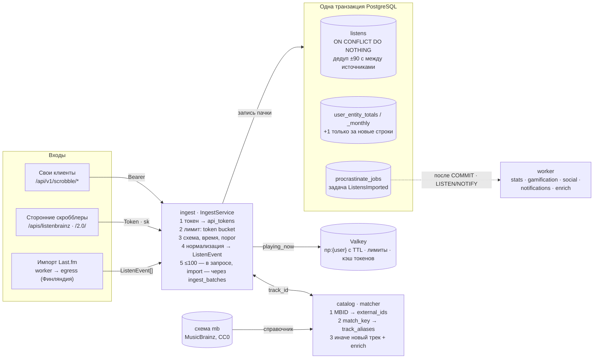
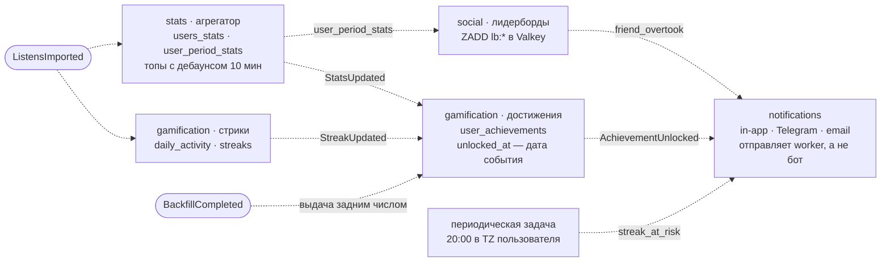
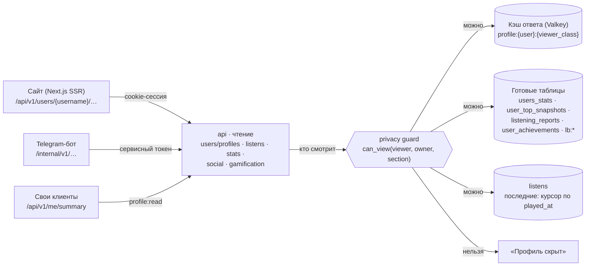

# Карта ядра бэкенда

> Статус: **черновик** (07.10.2026). Сводная карта по [architecture.md](architecture.md) после правок по [ревью](review.md): как скроббл проходит через бэкенд, какие события это запускает, как читаются данные и какой модуль чем владеет. Номера разделов (§) — из architecture.md. При расхождении прав architecture.md, а эту карту нужно обновить.

**Коротко.** Модульный монолит на FastAPI: три процесса из одного образа — `api`, `worker` и `bot` (`ROLE=…`), плюс разовый `migrate`. Ядро — путь скроббла: приём, сопоставление с каталогом, запись в `listens` вместе с задачей-событием в одной транзакции, затем обработчики считают статистику, стрики, достижения и лидерборды. Страницы читают только готовые таблицы и кэш.

| Хранилище | Что в нём |
|---|---|
| PostgreSQL 18 | Данные, очередь procrastinate, схема `mb` с копией core-данных MusicBrainz |
| Valkey 9 (один экземпляр) | Кэш, лимиты, now playing, лидерборды. Всё можно потерять |
| S3 в РФ | Аватары, баннеры, PNG-карточки, выгрузки |

Обозначения на схемах: сплошная стрелка — синхронно, внутри запроса или задачи; пунктирная — через очередь (задача procrastinate).

## 1. Запись скроббла

Все три входа сходятся в один `IngestService`. Строки `listens`, счётчики и задача `ListensImported` коммитятся вместе: событие не теряется и не приходит раньше данных. Повторная отправка той же пачки ничего не дублирует — ключ `(user_id, played_at, alias_id)`. Now playing в БД не пишется, только в Valkey с TTL. §5.4, §11.1, §11.2.

## 2. Цепочка событий после записи

Каждый обработчик пересчитывает своё из исходных данных и идемпотентен: очередь доставляет событие хотя бы один раз. Пока идёт backfill, достижения не выдаются; `BackfillCompleted` запускает один проход с настоящими датами и одно сводное уведомление. Смена таймзоны или правила стрика пересчитывает дни и стрики пользователя целиком. §8.1, §8.2, §11.3–§11.7.

## 3. Чтение

Видимость решает только бэкенд: любой ответ о чужом профиле — на сайте, в боте, в лидерборде — проходит через `can_view`. Кэш ответа разделён по классу зрителя (сам, подписчик, все), потому что приватность меняет содержимое. Last.fm при загрузке страницы не вызывается. §8.3, §9.1, §13.9.

## 4. Модули и таблицы

**Путь скроббла** — то, без чего нет продукта.

| Модуль | Назначение | Таблицы | События | § |
|---|---|---|---|---|
| `ingest` | Приём скробблов: родной API, ListenBrainz, `/2.0/`; токены устройств, лимиты, now playing | `api_tokens`, `device_auth_requests`, `ingest_batches` | публикует `ListensImported` | §3, §11.1, §18.3 |
| `catalog` | Артисты, альбомы, треки; matcher сырых строк; обогащение по копии MusicBrainz (задача `enrich`) | `artists`, `albums`, `tracks`, `track_aliases`, `external_ids`, `tags`, `entity_tags`, схема `mb` | — | §2.4, §5.3, §6.1 |
| `listens` | История прослушиваний: секции по месяцам (задача `partitions.ensure`), дедупликация между источниками, мягкое удаление | `listens`, `listen_dedup` | — | §2.3, §5.4, §9.3 |
| `stats` | Счётчики, топы за периоды, недельные отчёты | `users_stats`, `user_entity_totals`, `user_entity_monthly`, `user_period_stats`, `user_top_snapshots`, `listening_reports` | слушает `ListensImported`; публикует `StatsUpdated` | §9.1, §9.5, §11.4 |
| `gamification` | Стрики по локальным датам и достижения с реальной датой получения | `daily_activity`, `streaks`, `achievements`, `user_achievements` | слушает `ListensImported`, `StatsUpdated`, `BackfillCompleted`; публикует `StreakUpdated`, `AchievementUnlocked` | §8.1, §8.2, §11.3, §11.5 |
| `social` | Подписки, приватность, дружеские лидерборды, совместимость вкусов; здесь живёт `can_view` | `follows`, `privacy_settings`; Valkey `lb:*`; читает `user_period_stats`, `users_stats` | — | §8.3, §11.7 |

**Опора** — кто пользователь и что ему можно.

| Модуль | Назначение | Таблицы | § |
|---|---|---|---|
| `auth` | Вход через VK ID, Яндекс ID, телефон; сессии сайта; привязка устройств по RFC 8628 | `auth_identities`, `user_sessions` | §6.1, §17.4, §18.4 |
| `users/profiles` | Внутренний id, публичный @username с историей имён, профиль и аватар | `users`, `profiles`, `username_history`, `reserved_usernames` | §2.5, §9.9 |
| `settings` | Отображение, уведомления, правило стрика — JSONB со схемой Pydantic | `user_preferences` | §9.9 |

**Края ядра** — подключены к ядру, но ядро работает и без них.

| Модуль | Назначение | Таблицы | События | § |
|---|---|---|---|---|
| `integrations` | Импорт и опциональная синхронизация Last.fm через egress; события отдаёт в тот же `IngestService` | `external_accounts`, `sync_state` | публикует `BackfillCompleted` | §4, §11.2, §11.6 |
| `notifications` | In-app уведомления и доставка в Telegram и email по матрице «тип × канал» | `notifications`, `notification_deliveries` | слушает `AchievementUnlocked`, `StreakUpdated` | §9.8, §13.4 |
| `email` | Адреса, одноразовые ссылки, журнал писем, bounce и согласия | `user_emails`, `email_tokens`, `email_messages`, `email_events`, `email_suppressions`, `email_consent_log` | — | §17 |
| `billing` | Донаты и Pro через ЮKassa; права выдаются строками `entitlements` | `plans`, `payments`, `entitlements`, `webhook_events` | публикует `EntitlementsChanged` | §12.4 |
| `media` | Аватары и баннеры: presigned-загрузка в S3, проверка и ресайз воркером | ключи в `profiles` | — | §9.9 |
| `bot` (процесс) | Команды и привязка Telegram; в БД сам не ходит — только через внутренний API | `telegram_links` | — | §13 |

**Общая инфраструктура.** `jobs` — тонкий интерфейс очереди поверх procrastinate: задачи, блокировки, приоритеты, периодические задачи, постановка в транзакции. Таблицы: `procrastinate_*`, `jobs_dead`. §6.3.

## 5. Правила ядра

- **Данные и событие — одна транзакция.** Задача-событие ставится через `configure(connection=…)` в соединении приложения. §1
- **Обработчики идемпотентны.** Доставка «хотя бы один раз»: повтор не меняет результат. §1, §11
- **Время хранится в UTC.** Таймзона пользователя — только для агрегатов по дням и показа. §2.1
- **Видимость решает бэкенд.** Одна функция `can_view` во всех эндпоинтах и при сборке лидербордов. §8.3
- **Страница не ходит в Last.fm.** Всё читается из наших таблиц; Last.fm — только импорт и синхронизация. §9.1
- **Бот не ходит в БД.** Только внутренний API или те же сервисные функции, что у публичного API. §13.7
- **Код не знает о procrastinate.** Задачи — через модуль `jobs`, обработчики — обычные async-функции. §6.3
- **Сырые строки не теряются.** Исходные artist/track лежат в `track_aliases`: исправить матчинг можно без повторного импорта. §2.1

## 6. Открытые вопросы ядра

Из [ревью](review.md) — что стоит решить до первого кода приёма.

| Статус | Вопрос | § |
|---|---|---|
| Блокирует | Контракт `match_key`: `alias_id` входит в ключ `listens`, поэтому нормализацию нужно заморозить и версионировать. Сейчас код делит артиста по `&`, `,` и `x`, а текст говорит — только `feat./ft.` | §2.4 |
| Блокирует | Поля `listens` для клиента и коннектора: на них ссылаются экраны и родной API, а в DDL их нет | §2.3, §9.3, §18.3 |
| Блокирует | Гонка дедупликации: два одновременных запроса одного пользователя пройдут проверку окна. Лечится `pg_advisory_xact_lock(user_id)` | §5.4 |
| Спайк | procrastinate + SQLAlchemy async + psycopg 3 с постановкой задачи в транзакции приложения | §16, п. 47 |
| Уточнить | Откуда берётся `listens.album_id`: matcher сопоставляет только артиста и трек | §5.3 |
| Уточнить | Админка не спроектирована: dead-letter, слияния треков, переименование @username, модерация | ревью, §3 |
