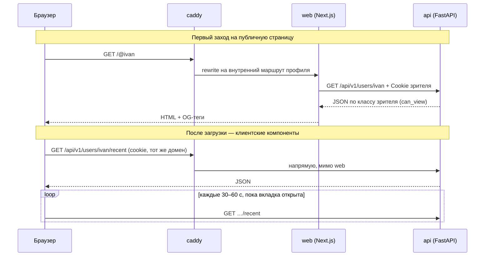
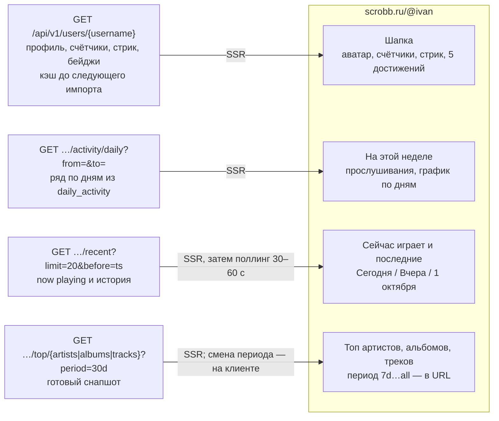
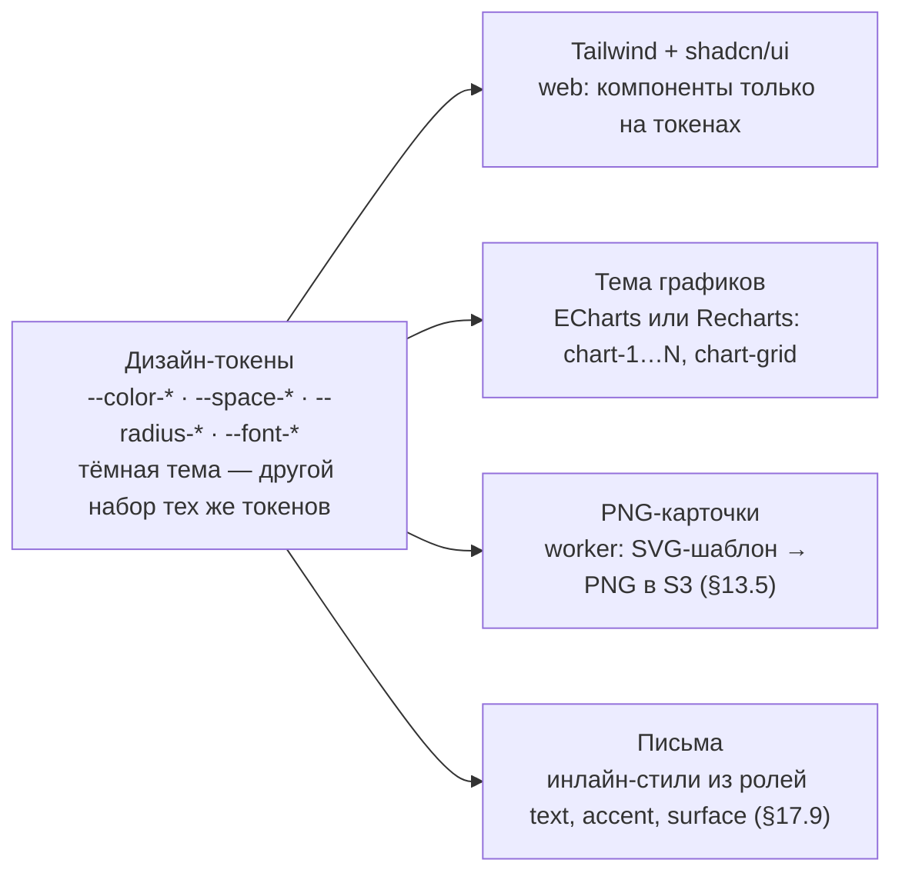

# Карта ядра фронтенда

> Статус: **черновик** (07.10.2026). Сводная карта веб-приложения по [architecture.md](architecture.md) (§1, §6.1, §9, §10, §17, §18) и [stack-rationale.md](stack-rationale.md): как страница получает данные, из чего собран профиль, маршруты, структура приложения и дизайн-токены. Номера разделов (§) — из architecture.md. Документы задают стек, экраны и правила, но почти не задают адреса страниц и раскладку по каталогам: всё, что добавлено здесь сверх документов, помечено «предложение». Парная карта бэкенда — [backend-core.md](backend-core.md).

**Коротко.** Веб-приложение на Next.js — только витрина над публичным API: в БД и во внешние сервисы оно не ходит. Публичные профили рендерятся на сервере ради превью ссылок и поиска, всё интерактивное живёт в клиентских компонентах на TanStack Query и клиенте, сгенерированном из OpenAPI. Видимость данных решает бэкенд, а вид — дизайн-токены.

| Часть | Выбор |
|---|---|
| Фреймворк | Next.js, App Router, TypeScript; Docker-образ `next start` на сервере в РФ, без Vercel |
| Данные | TanStack Query + TS-клиент из схемы OpenAPI бэкенда |
| Интерфейс | Tailwind + shadcn/ui на дизайн-токенах; графики — ECharts или Recharts |
| Тексты | ICU MessageFormat, русские склонения, даты в таймзоне зрителя |

## 1. Как страница получает данные



Два пути к одному API. Первый заход на публичную страницу рендерит Next.js на сервере — так работают превью ссылок и поиск. Дальше клиентские компоненты ходят в `/api/v1` сами, через тот же домен и ту же cookie-сессию. Приватность в обоих путях проверяет `api`, поэтому страница, отрендеренная для одного зрителя, не должна попасть в общий кэш для другого (§7, п. 2). §1, §6.1, §9.1.

## 2. Профиль: блок → эндпоинт



Каждый блок профиля читает свой готовый ответ: ни один блок не считает статистику на лету и не ходит в Last.fm. Устаревший снапшот топа отдаётся сразу, а пересчёт идёт фоном. Порядок и вид блоков берутся из `user_preferences.display` владельца профиля. Мобильная раскладка — базовая: одна колонка, ключевая цифра и главный блок видны без прокрутки. §9.1–§9.5, §9.9, §10.4.

## 3. Маршруты

Пути с номером раздела заданы документами, остальные — предложение по экранам из §9: сами экраны описаны, а адреса для них нет.

| Маршрут | Экран | Рендер | Кто видит | Этап | Источник |
|---|---|---|---|---|---|
| **Публичные** | | | | | |
| `/` | Вход через VK ID и Яндекс ID; первым шагом — «Установить Scrobb для браузера» | сервер | все | MVP | предложение, §3.4 |
| `/@username` | Профиль: шапка, неделя, последние, топы | сервер + клиент | по приватности | MVP | §2.5, §9.2–§9.5 |
| `/@old` | 301 на новое имя, пока старое в hold (90 дней) | — | все | MVP | §2.5 |
| `/@username/library` | Библиотека: артисты и треки, сортировка, поиск | клиент | по приватности | MVP | предложение, §9.6 |
| `/@username/reports/week/{date}` | Недельный отчёт | сервер | по приватности | MVP | предложение, §9.5 |
| `/@username/following`, `/followers`, `/loved` | Подписки, подписчики, любимое | клиент | по приватности | MVP | предложение, §9.6 |
| `/apps` | «Scrobb для браузера», «для компьютера», другие скробблеры | сервер | все | MVP | §18.11 |
| `/support` | «Поддержать проект»: донат, позже — Pro | сервер | все | MVP | предложение, §12.3 |
| **После входа** | | | | | |
| `/link` | Привязка устройства: код из клиента, кнопка «Подключить» | клиент | вошедший | MVP | §18.4 |
| `/settings/{tab}` | Профиль, время и стрики, приватность, отображение, уведомления, подключения, аккаунт, приложения | клиент | владелец | MVP | вкладки — §9.9, путь — предложение |
| `/settings/apps/connect/{client}` | «Как подключить плеер» и «Проверить подключение» | клиент | владелец | MVP | §3.4 |
| `/notifications` | Уведомления; счётчик непрочитанных в меню — поллинг раз в минуту | клиент | владелец | MVP | предложение, §9.8 |
| `/leaderboards` | Лидерборды друзей: неделя, месяц, всё время | клиент | вошедший | MVP | предложение, §11.7 |
| `/billing/return/{id}` | «Проверяем оплату…» с поллингом статуса платежа | клиент | плательщик | с ЮKassa | предложение, §12.4 |
| **Служебные, из писем** | | | | | |
| `/auth/email/verify#t=…` | Подтверждение адреса: токен во фрагменте, POST только по кнопке | клиент | все | MVP | §17.2 |
| `/auth/password/reset#t=…` | Новый пароль; включается флагом после ответа юриста | клиент | все | под флагом | предложение, §17.3 |
| `/u/<token>` | Отписка: GET — страница с кнопкой, POST — сразу | сервер | все | с рассылками | §17.6 |

## 4. Структура приложения (предложение)

```
web/
  app/
    page.tsx                     # главная
    profile/[username]/          # профиль; /@:username → rewrite (§7, п. 1)
    settings/[tab]/
    settings/apps/connect/[client]/
    link/  apps/  support/
    auth/email/verify/
    u/[token]/
  src/
    api/          # сгенерирован из OpenAPI, руками не правим
    features/     # profile, stats, social, settings,
                  # notifications, billing, devices
    ui/           # компоненты дизайн-системы
    i18n/ru/      # ICU-сообщения
  styles/tokens.css
```

| Слой | Что в нём |
|---|---|
| `app/` | Маршруты и серверный рендер. Тонкие: собирают страницу из `features` |
| `features/` | Экраны по модулям бэкенда: запросы TanStack Query, формы, состояния «пусто / загрузка / ошибка» |
| `api/` | Типизированный клиент из схемы OpenAPI. CI проверяет, что он совпадает со схемой бэкенда (`stack-rationale.md`, «Риски») |
| `ui/` | Карточка, кнопки, графики, списки топов, бейдж стрика, плитка достижения, выбор периода, скелетоны (§10.4). Только на токенах |
| `i18n/` | Строки и склонения в формате ICU; тот же каталог, что у писем (§17.9) |

## 5. Дизайн-система: одни токены — четыре потребителя



Токены — единственный источник значений. Два потребителя живут вне Next.js: карточки рисует worker, письма собирает модуль `email`. Поэтому токены должны лежать в формате, который читают и TypeScript, и Python-шаблоны. Конкретные цвета, гарнитуры и тёмная тема ещё не выбраны. §10.2–§10.7.

## 6. Правила фронтенда

- **Только через публичный API.** Никаких своих запросов к БД из Next.js — мобильное приложение получит те же возможности. `stack-rationale.md`, «Next.js»
- **Приватность решает бэкенд.** Фронт показывает то, что пришло, и ничего не скрывает сам. §8.3
- **Общий кэш — только для анонима.** Страница, отрендеренная для вошедшего, не попадает в кэш, общий для зрителей. Предложение по §9.1
- **Период и вкладка — в URL.** Выбор периода отражается в адресе: ссылкой можно поделиться. §10.4
- **Токены вместо значений.** Цвета, отступы, радиусы и шрифты — только из токенов; тёмная тема без переписывания компонентов. §10.4, §10.6
- **Склонения и даты — через ICU.** «1 прослушивание / 5 прослушиваний», время в таймзоне зрителя, табличные цифры. §9.1, §10.3
- **Каждый блок — три состояния.** Пусто с одним действием, скелетон в форме контента, ошибка с кнопкой «Повторить». §10.4
- **Токены из писем — во фрагменте.** Ссылка не срабатывает от сканера почты: действие только по кнопке и POST. §17.2
- **Сначала телефон.** Одна колонка, зоны касания от 44 px, сетка 4/8/12, `prefers-reduced-motion`, контраст AA. §10.4, §10.5

## 7. Открытые вопросы фронтенда

| Статус | Вопрос | § |
|---|---|---|
| Блокирует | Адрес `/@username`: папку `app/@username` создать нельзя — в App Router `@` означает слот параллельных маршрутов. Нужен rewrite `/@:username` на внутренний маршрут (не `/u/`: он занят отпиской) или динамический сегмент с проверкой `@`. Проверить прототипом | §2.5, §17.6 |
| Блокирует | Кэш SSR и приватность: `revalidate` для профиля допустим только для анонимного зрителя, вошедшему — динамический рендер. Проверить, как Next.js кэширует `fetch` с cookie | §9.1 |
| Выбрать | ECharts или Recharts | §6.1 |
| Выбрать | Цвета ролей, 1–2 гарнитуры с хорошей кириллицей, нужна ли тёмная тема сразу | §10.7, §16, п. 31 |
| Уточнить | Эндпоинт «Сравнить со мной» (совместимость вкусов) в API не описан | §8.3 |
| Уточнить | Как «Проверить подключение» ждёт первого скроббла: поллинг или поток событий — в документах не сказано | §3.4 |
| Позже | SSE `/api/v1/me/stream` вместо поллинга последних прослушиваний и уведомлений | §9.3, §9.8 |
