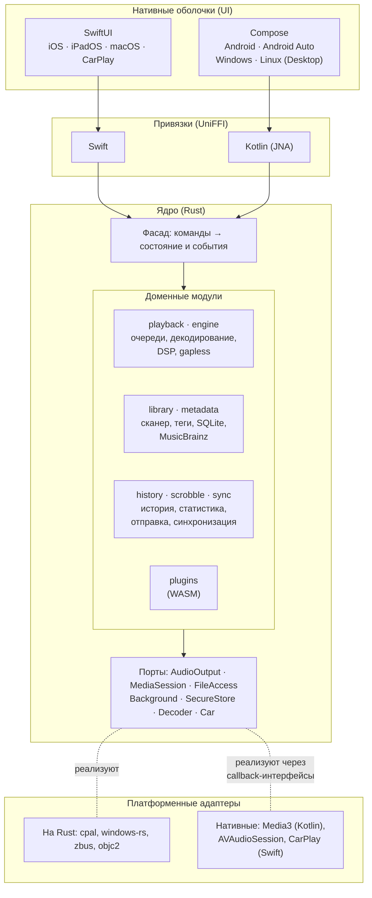

# Свой кроссплатформенный плеер: стек и архитектура (эскиз)

> Статус: **теоретический эскиз на 23.10.2026**, не план работ. Решение «свой плеер сейчас не писать» и его причины — [local-players-research.md](local-players-research.md) §6. Здесь — ответ на вопрос «если писать, то на чём и как»: одно ядро для Android, iOS, macOS, Windows и Linux, а поверх него — нативные адаптивные оболочки и модули.
> Пометка **(не проверено)** — факт не подтверждён первоисточником или требует прототипа.

## 0. Коротко

1. **Ядро — Rust.** Одна кодовая база для всех пяти ОС: движок воспроизведения, библиотека, очереди, история, скробблинг, синхронизация, метаданные, плагины. Rust даёт работу в реальном времени без сборщика мусора, сборку под все пять платформ и зрелые библиотеки для звука, тегов и SQLite.
2. **Архитектура — «порты и адаптеры» плюс однонаправленный поток данных.** Ядро ничего не знает об ОС: всё платформенное (вывод звука, медиасессия, фоновая работа, доступ к файлам, автомобиль) скрыто за интерфейсами-портами, а адаптеры реализуют их на каждой ОС. Интерфейс отправляет в ядро команды и получает снимки состояния и события.
3. **Звук — свой движок в ядре на всех платформах.** Так gapless, ReplayGain, кроссфейд и DSP работают одинаково везде. Платформенные модули отвечают только за вывод PCM и системную интеграцию: экран блокировки, гарнитуру, прерывания звонком, Android Auto, CarPlay.
4. **Интерфейс — нативные оболочки, рекомендуется две кодовые базы:** SwiftUI для iOS, iPadOS и macOS; Compose для Android (Jetpack Compose) и для Windows и Linux (Compose Multiplatform Desktop). Связь с ядром — привязки UniFFI для Swift и Kotlin. Альтернативы (§5.1): четыре полностью нативных UI (дороже всего), один UI на Flutter (дешевле всего, так сделан Rune), Tauri 2 (стек десктоп-клиента Scrobb, но слабее всего на мобильных).
5. **Главный риск — свой движок в фоне на телефоне** (батарея, прерывания, Bluetooth, Android Auto, CarPlay). Его проверяет первый спайк (§9), до любых экранов.

## 1. Требования

| # | Требование | Откуда |
|---|---|---|
| 1 | Одно ядро для Android, iOS/iPadOS, macOS, Windows, Linux | Вопрос |
| 2 | Нативный адаптивный интерфейс: телефон, планшет, складной телефон, десктоп, автомобиль | Вопрос |
| 3 | Модули и плагины: функции включаются по платформам, сторонние расширения — в песочнице | Вопрос |
| 4 | Одинаковое качество звука везде: gapless, ReplayGain, кроссфейд, эквалайзер; bit-perfect, где ОС позволяет | Базовый набор функций ([local-players-research.md](local-players-research.md) §3) |
| 5 | «Плеер с памятью»: полная история, статистика, синхронизация рейтингов и плейлистов через аккаунт | Пробелы рынка ([local-players-research.md](local-players-research.md) §5.1, §6.5) |
| 6 | Офлайн и приватность: всё работает без сети, файлы не покидают устройство | Принципы клиентов Scrobb ([architecture.md](architecture.md) §18.9) |
| 7 | Переиспользование со Scrobb: правила скроббла, офлайн-очередь, клиент родного API | [architecture.md](architecture.md) §18.3, §18.7, §18.8 |

## 2. Слои



Правило размещения кода: **данные, логика и всё, что требует производительности, — в Rust; жизненный цикл ОС и интеграции, которые ОС даёт только через свои фреймворки, — нативно** (Kotlin, Swift), реализуя порт ядра через callback-интерфейсы UniFFI.

## 3. Ядро (Rust)

### 3.1 Почему Rust

| Вариант ядра | Звук в реальном времени | Пять ОС | Минусы | Вывод |
|---|---|---|---|---|
| **Rust** | Да: нет сборщика мусора, можно гарантировать отсутствие аллокаций в аудиопотоке | Да, кросс-компиляция под все цели; [cpal](https://github.com/RustAudio/cpal) выводит звук на Android (AAudio), iOS и macOS (CoreAudio), Windows (WASAPI, ASIO), Linux (ALSA, PipeWire, PulseAudio, JACK) | Порог входа; привязки к UI — через генератор | **Рекомендуется.** Плюс совпадает с десктоп-клиентом Scrobb на Tauri ([architecture.md](architecture.md) §18.12) |
| C++ | Да | Да (Qt, JUCE, miniaudio, TagLib, FFmpeg) | Безопасность памяти, сложная сборка; JUCE — GPL или коммерческая лицензия | Путь foobar2000 и Strawberry; для новой команды дороже |
| Kotlin Multiplatform | Нет: сборщик мусора в аудиопути; своего движка нет — пришлось бы отдавать воспроизведение ExoPlayer, AVPlayer и т. д. | Да | Разное поведение gapless и DSP на разных ОС | Хорош для логики, но не для «одного движка» |
| Dart (только Flutter) | Нет своего движка; на десктопе обычно libmpv (Harmonoid) | Да | Звук всё равно нативный | Только как слой UI (§5.1, вариант C) |

### 3.2 Модули ядра

| Модуль | Что делает | Кандидаты в зависимости |
|---|---|---|
| `engine` | Декодирование, ресемплинг, ReplayGain, эквалайзер, кроссфейд, gapless: предзагрузка следующего трека и обрезка задержки и паддинга кодера | [Symphonia](https://docs.rs/symphonia/) (чистый Rust). Ограничения: gapless есть не во всех контейнерах (в 0.5 нет для MP4 и MKV), HE-AAC и Opus — за отдельными флагами и без явного статуса ([wiki](https://github.com/pdeljanov/Symphonia/wiki)). Поэтому нужен **порт `Decoder` с запасными платформенными декодерами** (MediaCodec, AudioToolbox, Media Foundation) и необязательный FFmpeg на десктопе. libfdk-aac не брать: лицензия несовместима с GPL **(не проверено юристом)** |
| `playback` | Очереди (в том числе несколько, как в Musicolet), перемешивание, повтор, автомат состояний, восстановление позиции | — |
| `library` | Сканер, чтение и запись тегов, обложки, база, поиск, умные плейлисты (свой язык запросов → SQL), слежение за изменениями через порт | `lofty` (теги), `rusqlite` + FTS5, `chardetng` / `encoding_rs` — определение cp1251 в старых тегах ([local-players-research.md](local-players-research.md) §4, п. 5) |
| `history` | События прослушивания (старт, пауза, перемотка, пропуск, конец), порог засчитывания, локальная статистика | Правила — как в [architecture.md](architecture.md) §18.7; формат, база и синхронизация — [player-history.md](player-history.md) |
| `scrobble` | Родной API Scrobb, ListenBrainz, Last.fm 2.0; офлайн-очередь, пачки, повторы | Логика — как в [architecture.md](architecture.md) §18.8 |
| `sync` | Синхронизация рейтингов, плейлистов, истории и позиций через аккаунт; сами файлы не передаются | «Последняя запись побеждает» по каждому полю с гибридными логическими часами; плейлисты — как упорядоченные списки с операциями. Нужны новые эндпоинты бэкенда |
| `metadata` | MusicBrainz, AcoustID-отпечатки, обложки, тексты (LRC) | Chromaprint или его порт на Rust **(не проверено)** |
| `plugins` | Сторонние расширения в песочнице (§6) | Wasmtime; на iOS — интерпретатор Pulley ([docs](https://docs.wasmtime.dev/examples-pulley.html)) |
| `ffi` | Фасад и привязки | [UniFFI](https://mozilla.github.io/uniffi-rs/): официально — Kotlin, Swift, Python; сторонние — C#, Go, Dart, Kotlin Multiplatform (Gobley) |

### 3.3 API ядра (фасад)

- **Команды:** `play(queue, index)`, `pause()`, `seek(ms)`, `enqueue(...)`, `set_rating(track, value)`, `scan(root)`, `query(filter, sort)`. Команды асинхронные и идемпотентные, ошибки — типизированные.
- **Состояние:** неизменяемый снимок `PlayerState` (что играет, очередь в окрестности текущего трека, громкость, режимы) — через callback-интерфейс или асинхронный поток. Позиция воспроизведения приходит не чаще 4 раз в секунду, интерфейс сам плавно интерполирует.
- **Большие списки не гонять через FFI целиком.** Библиотека на 100 тыс. треков отдаётся окнами: `library.page(query, offset, limit)` под виртуализированные списки интерфейса.
- **Модель — однонаправленный поток данных** (как Elm и MVI): интерфейс шлёт намерения, ядро меняет модель и публикует новый снимок. Так устроен [Crux](https://github.com/redbadger/crux) — ядро на Rust, оболочки на SwiftUI и Compose, побочные эффекты описываются значениями и исполняются оболочкой (Apache-2.0, пре-1.0). Его подход подходит для логики приложения, но **не для движка**: аудиопотоку нужны свои потоки и реальное время. Поэтому предложение: свой тонкий фасад на UniFFI в духе Crux, а движок — отдельный сервис внутри ядра.

### 3.4 Потоки и реальное время

| Поток | Правила |
|---|---|
| Аудиопоток (колбэк вывода) | Без блокировок, аллокаций и ввода-вывода. Берёт PCM из lock-free кольцевого буфера (один писатель, один читатель) |
| Декодер | Наполняет буфер на 2–5 с вперёд; заранее открывает следующий трек для gapless и кроссфейда. На мобильных декодирует крупными порциями и засыпает — меньше пробуждений и расход батареи |
| Сканер библиотеки | Пул рабочих потоков, запись в базу пачками |
| База | SQLite в режиме WAL: один писатель, параллельные читатели |
| Сеть | Асинхронный рантайм (tokio): скробблинг, метаданные, синхронизация |

## 4. Порты и платформенные адаптеры

| Порт | Android | iOS / iPadOS | macOS | Windows | Linux |
|---|---|---|---|---|---|
| **AudioOutput** | AAudio через cpal | CoreAudio через cpal или `AVAudioEngine` с `AVAudioSourceNode`, который читает PCM из ядра **(выбрать спайком)** | CoreAudio через cpal; bit-perfect — монопольный режим устройства и смена частоты (отдельный адаптер) | WASAPI через cpal; монопольный режим WASAPI cpal не заявляет — отдельный адаптер; ASIO — через cpal | ALSA, PipeWire, PulseAudio, JACK через cpal |
| **AudioSession** (фокус, прерывания, смена выхода) | Аудиофокус (берёт на себя Media3) | `AVAudioSession` с категорией `.playback`, обработка прерываний и отключения наушников | — | — | — |
| **MediaSession** (экран блокировки, медиаклавиши, гарнитура) | Media3 `MediaSessionService`; ядро оборачивается в свой `Player` через `SimpleBasePlayer` — базовый класс для своих плееров ([reference](https://developer.android.com/reference/androidx/media3/common/SimpleBasePlayer)) | `MPNowPlayingInfoCenter` + `MPRemoteCommandCenter` | То же (публиковать свою сессию можно; закрыто только чтение чужих) | SMTC через windows-rs; для десктопного Win32-приложения — через interop-интерфейс **(не проверено)** | MPRIS-сервер по D-Bus (zbus) |
| **Car** | Android Auto: `MediaLibraryService` отдаёт дерево библиотеки из ядра ([docs](https://developer.android.com/media/media3/session/serve-content)) | CarPlay: шаблоны `CPTemplate`, нужен entitlement `com.apple.developer.carplay-audio` по запросу в Apple ([docs](https://developer.apple.com/documentation/carplay/requesting-carplay-entitlements)) | — | — | — |
| **Background** | Foreground service типа `mediaPlayback` | Фоновый режим `audio` | — | Трей | Трей |
| **FileAccess** | MediaStore + Storage Access Framework с постоянными разрешениями на папки | Песочница + `UIDocumentPicker`, security-scoped bookmarks, видимость в «Файлах» | Обычная ФС; в Mac App Store — песочница и bookmarks | ФС | ФС; во Flatpak — порталы |
| **FileWatch** | Наблюдатель MediaStore | Пересканирование при запуске | FSEvents (`notify`) | `ReadDirectoryChangesW` (`notify`) | inotify (`notify`) |
| **SecureStore** (токены Scrobb) | Android Keystore | Keychain | Keychain | Credential Manager | Secret Service (`keyring`) |
| **Decoder** (запасные кодеки) | MediaCodec | AudioToolbox | AudioToolbox | Media Foundation | FFmpeg или GStreamer (необязательно) |
| **Cast** | Chromecast (Cast SDK) | AirPlay (системный выбор выхода) | AirPlay | DLNA (в ядре, UPnP) | DLNA |

Где писать адаптер:
- **На Rust** — когда есть зрелые привязки и нет жизненного цикла ОС: вывод звука (cpal), SMTC (windows-rs), MPRIS (zbus), FSEvents и inotify (`notify`), Keychain и Secret Service (`keyring`).
- **Нативно (Kotlin, Swift)** — когда ОС управляет жизненным циклом и даёт API только своим фреймворкам: Media3 и foreground service, `AVAudioSession`, CarPlay, Android Auto, выбор файлов. Нативный код реализует порт как callback-интерфейс UniFFI и пересылает события в ядро.

## 5. Интерфейс: нативные адаптивные оболочки

### 5.1 Варианты

| Вариант | Кодовых баз UI | Нативность | Цена | Риски | Кто так делает |
|---|---|---|---|---|---|
| **A. Четыре нативных UI:** Jetpack Compose (Android), SwiftUI (iOS, iPadOS, macOS), WinUI 3 на C# (Windows), GTK4 + libadwaita (Linux, прямо из Rust через gtk-rs) | 4, на 4 языках | Максимальная | Самая высокая | Привязки для C# — сторонние (uniffi-bindgen-cs); четыре набора экранов | — |
| **B. Две оболочки (рекомендуется):** SwiftUI для Apple; Compose — Jetpack Compose на Android и Compose Multiplatform Desktop на Windows и Linux | 2 | Нативно на Apple и Android; на Windows и Linux — Material-интерфейс Compose | Средняя | JVM на десктопе: размер установщика и время запуска; на Windows и Linux нет нативных виджетов | Pano Scrobbler: Compose Multiplatform на Android, Windows, Linux ([architecture.md](architecture.md) §18.13) |
| B′. Compose Multiplatform везде, включая iOS | 1 | iOS — отрисовка Skia, не UIKit | Ниже B | Rust-ядро нужно привязать к Kotlin/Native (сторонний Gobley) | Compose для iOS стабилен с 1.8.0, май 2025 ([JetBrains](https://blog.jetbrains.com/kotlin/2025/05/compose-multiplatform-1-8-0-released-compose-multiplatform-for-ios-is-stable-and-production-ready/)) |
| **C. Flutter + Rust** (flutter_rust_bridge или rinf) | 1 | Своя отрисовка, адаптивные виджеты Material и Cupertino | Самая низкая | Системные интеграции — через плагины или platform channels; вид «не родной» на Apple | **Rune** (Flutter + Rust, шесть платформ, [GitHub](https://github.com/Losses/rune)); flutter_rust_bridge 2.x поддерживает все пять ОС и веб ([docs.rs](https://docs.rs/crate/flutter_rust_bridge/latest)) |
| D. Tauri 2 везде (веб-интерфейс) | 1 | WebView | Низкая | На мобильных медиасессия, фоновая работа и CarPlay — всё равно нативные плагины; длинные списки в WebView | Museeks (только десктоп); стек десктоп-клиента Scrobb |

**Почему B.** Это лучший баланс «нативности» и цены. Две самые требовательные к нативности платформы, iOS и Android, получают родные SwiftUI и Jetpack Compose с системными жестами, навигацией и доступностью. Код Android-интерфейса почти целиком переиспользуется на Windows и Linux через Compose Multiplatform Desktop. SwiftUI-код общий для iPhone, iPad и Mac. Ядро подключается официальными привязками UniFFI: Swift на Apple; Kotlin (через JNA) и на Android, и на JVM-десктопе — без Kotlin/Native. **Если команда — один-два человека**, разумнее вариант C: один интерфейс, а работоспособность связки «Flutter + Rust» для плеера на шести платформах доказывает Rune.

### 5.2 Адаптивность

- **Раскладка по классам размера окна:**
  - компактный (телефон) — одна колонка, нижняя навигация, мини-плеер;
  - средний (планшет, складной телефон) — список и детали рядом;
  - широкий (десктоп) — боковая панель, список, детали; на десктопе — настраиваемая раскладка из виджетов в духе foobar2000 и fooyin.
- **Ввод:** касание, мышь, горячие клавиши, медиаклавиши, пульт, руль.
- **Конвенции платформ:** «назад» на Android, свайпы на iOS, строка меню на macOS, трей на Windows и Linux, динамические цвета Material You, крупный шрифт и VoiceOver/TalkBack.
- **Автомобиль** — не свой интерфейс, а системные шаблоны Android Auto и CarPlay, которые наполняются теми же запросами к библиотеке ядра.
- **Общие дизайн-токены** — из дизайн-системы Scrobb ([architecture.md](architecture.md) §10), генерируются в Swift и Kotlin.

### 5.3 Функции по платформам

Ядро сообщает оболочке, что доступно: `capabilities()` → `{ bit_perfect, tag_editor, converter, car, cast, plugins_install, ... }`. Интерфейс показывает только доступное. Например, установка сторонних плагинов на iOS выключена (§6), bit-perfect — только при поддержке устройства и ОС, конвертер и редактор тегов — в первую очередь на десктопе.

## 6. Модульность и плагины

- **Модули при сборке** — Cargo features: `ffmpeg`, `chromaprint`, `cast`, `plugins` и т. д. Сборка под каждую ОС включает свой набор.
- **Плагины во время работы** — WebAssembly-компоненты с интерфейсами на WIT, в песочнице и с явными разрешениями (например, «сеть: только `musicbrainz.org`»). Типы плагинов: источник метаданных, источник текстов, цель скробблинга, импорт из других плееров, функции для умных плейлистов.
- **Не в аудиопути.** Плагины не участвуют в обработке звука в реальном времени: интерпретатор WASM для этого слишком медленный и непредсказуемый. Нативные DSP-плагины (VST3, Audio Units, LV2) — только на десктопе и позже **(лицензии SDK не анализировались)**.
- **iOS:** правила App Store запрещают загружать код, меняющий функции приложения (п. 2.5.2 App Review Guidelines), а JIT сторонним приложениям недоступен. Поэтому на iOS — только плагины, встроенные в сборку, и интерпретатор (Pulley у Wasmtime).

## 7. Репозиторий, сборка, тесты

Каркас ядра уже лежит в репозитории: [`player/core`](../player/core/README.md) (структура, ярусы, правила зависимостей, проверки). Общие контракты Scrobb — в [`contracts/`](../contracts/README.md).

```
contracts/               # тест-векторы, общие для бэкенда, веба, расширения и Rust
player/
  core/                  # Rust workspace — есть каркас
    crates/
      scrobb-api/  scrobb-rules/  scrobb-client/  scrobb-sync/     # ярус Scrobb (wasm32)
      player-domain/  player-playback/  player-history/            # общий ярус плеера (wasm32)
      player-ports/  player-engine/  player-library/  player-store-sqlite/
      player-metadata/  player-plugins/  player-core/              # нативный ярус плеера
    bindings/
      ffi/                # UniFFI → Swift, Kotlin
      wasm/               # wasm-bindgen → веб-приложение Scrobb и расширение
  shells/                 # позже
    apple/               # Xcode: iOS, iPadOS, macOS (SwiftUI), CarPlay; ядро — XCFramework
    compose/             # Gradle: androidApp, desktopApp (Windows, Linux), общий UI
  tools/                 # позже: генерация привязок, дизайн-токены
```

- **Цели сборки ядра:** `aarch64-linux-android` и `x86_64-linux-android` (через `cargo-ndk`); `aarch64-apple-ios`, `aarch64-apple-ios-sim`, `aarch64-apple-darwin`, `x86_64-apple-darwin` (собираются в XCFramework); `x86_64-` и `aarch64-pc-windows-msvc`; `x86_64-` и `aarch64-unknown-linux-gnu`.
- **CI:** тесты ядра — на Linux на каждом PR (дёшево); мобильные и macOS-сборки — только на тегах релизов, как и для десктоп-клиента ([ci-cd.md](ci-cd.md)).
- **Тесты:**
  - движок — «золотые» тесты: декодирование → хэш PCM; стыки gapless с точностью до сэмпла; значения ReplayGain;
  - очереди и перемешивание — property-тесты;
  - база — тесты миграций;
  - FFI — контрактные тесты фасада;
  - оболочки — снимочные тесты экранов на каждой платформе.
- **Поставка:** Google Play, RuStore и APK; App Store; подписанные сборки Windows; нотаризация macOS; Flatpak и AppImage. Ограничения для разработчиков из РФ — [local-players-research.md](local-players-research.md) §6.4 и [architecture.md](architecture.md) §18.11.

## 8. Связь со Scrobb

В каркасе код, общий со Scrobb, выделен в отдельный **ярус Scrobb** (`scrobb-*`). Он не зависит от плеера и собирается под WebAssembly, поэтому его могут использовать плеер, десктоп-клиент на Tauri и — через `bindings/wasm` — веб-приложение и расширение.

- **Правило скроббла** ([architecture.md](architecture.md) §18.7) — крейт `scrobb-rules`, сверяется с языконезависимыми векторами [`contracts/scrobble-rules/v1.json`](../contracts/scrobble-rules/v1.json). Те же векторы должны проходить бэкенд (повторная проверка, §11.1, шаг 6) и TypeScript-код. Сейчас `scrobbler-core` запланирован на TypeScript (§18.12); каркас показывает альтернативу — одна реализация на Rust, в веб она попадает через wasm. Решение — вместе с выбором стека десктоп-клиента (§16, п. 42).
- **Протокол** ([architecture.md](architecture.md) §18.3–§18.4) — DTO в `scrobb-api`, клиент в стиле sans-IO в `scrobb-client`: он строит запросы и разбирает ответы, а сеть даёт вызывающий код. Поэтому один код протокола работает в плеере, в Tauri-клиенте и в браузере. Задержки повторов (§18.8) — там же. Позже DTO генерируются из OpenAPI бэкенда.
- **История и скробблинг** — [player-history.md](player-history.md): SQLite, неизменяемые записи с UUIDv7, очередь отправки по сервисам, привязка устройства по RFC 8628 и «сейчас играет», формат экспорта ListenBrainz. Всё, кроме синхронизации и экспорта, уже работает в фасаде.
- **Синхронизация рейтингов и плейлистов** — `scrobb-sync`: ключ трека, общий с сервером, и правки «последняя запись побеждает» на гибридных логических часах. Требует новых эндпоинтов, модели данных на сервере и общего с бэкендом `match_key` (§5.3) — вне этапа 1. Те же данные показывает и правит веб-приложение.
- **Изменения на бэкенде, когда плеер появится:** новое значение `player` в `source.kind` и `client_kind` (сейчас только `extension` и `desktop`).

## 9. Порядок работ (если когда-нибудь)

1. **Спайк, 2–4 недели — самое рискованное первым.** Движок на Rust с gapless и ReplayGain (первая версия уже есть: [`player/core`](../player/core/README.md), раздел «Звуковой движок»); Android-оболочка на Compose и iOS-оболочка на SwiftUI с одной кнопкой «играть». Проверить: воспроизведение в фоне, экран блокировки, прерывание звонком, Bluetooth-гарнитуру, Android Auto, CarPlay в симуляторе, расход батареи за час. Если свой движок на мобильных не проходит — запасной путь: на мобильных отдавать воспроизведение ExoPlayer и AVPlayer через порт `AudioOutput` высокого уровня, теряя часть одинаковости DSP.
2. **MVP на Android и десктопе (Compose):** библиотека, очереди, история, скробблинг в Scrobb.
3. **Apple-оболочка (SwiftUI):** iOS, iPadOS, macOS, CarPlay.
4. **Синхронизация через аккаунт, плагины, редактор тегов, конвертер.**

Порядок трудозатрат — [local-players-research.md](local-players-research.md) §6.1; вторая кодовая база UI добавляет к этой оценке ориентировочно 30–50% **(оценка, не измерено)**.

## 10. Главные риски

| Риск | Чем снимается |
|---|---|
| Свой движок в фоне на телефоне: батарея, прерывания, задержка Bluetooth, Android Auto, CarPlay | Спайк (§9, п. 1) и запасной путь через платформенные плееры |
| «Болтливая» граница FFI: тысячи мелких вызовов | Крупные команды, снимки состояния, окна вместо целых списков (§3.3) |
| Кодеки: зрелость HE-AAC и Opus в Symphonia, gapless в MP4 | Порт `Decoder` с платформенными декодерами (§3.2) |
| JVM на десктопе (вариант B): размер и запуск | Урезанный рантайм через jlink **(не проверено)**; запасной путь — вариант A для Windows и Linux |
| Три языка в команде: Rust, Swift, Kotlin | Вариант C (Flutter) при маленькой команде |
| Apple: CarPlay по запросу, правила App Store для плагинов, оплата взноса из РФ | Заранее запросить entitlement; на iOS — только встроенные плагины; [local-players-research.md](local-players-research.md) §6.4 |
| Google: верификация разработчиков и подсанкционные страны | [local-players-research.md](local-players-research.md) §6.4 — выяснить до вложений в Android |

## 11. Источники

- Ядро и привязки: [UniFFI](https://mozilla.github.io/uniffi-rs/), [cpal](https://github.com/RustAudio/cpal), [Symphonia (docs.rs)](https://docs.rs/symphonia/), [Symphonia (wiki)](https://github.com/pdeljanov/Symphonia/wiki), [Crux](https://github.com/redbadger/crux), [Wasmtime: Pulley](https://docs.wasmtime.dev/examples-pulley.html)
- Android: [Media3 SimpleBasePlayer](https://developer.android.com/reference/androidx/media3/common/SimpleBasePlayer), [MediaLibraryService](https://developer.android.com/media/media3/session/serve-content), [AOSP: bit-perfect для USB](https://source.android.com/docs/core/audio/preferred-mixer-attr)
- Apple: [CarPlay entitlements](https://developer.apple.com/documentation/carplay/requesting-carplay-entitlements), [com.apple.developer.carplay-audio](https://developer.apple.com/documentation/bundleresources/entitlements/com.apple.developer.carplay-audio)
- UI: [Compose Multiplatform 1.8.0](https://blog.jetbrains.com/kotlin/2025/05/compose-multiplatform-1-8-0-released-compose-multiplatform-for-ios-is-stable-and-production-ready/), [flutter_rust_bridge](https://docs.rs/crate/flutter_rust_bridge/latest), [Rune](https://github.com/Losses/rune), [архитектура Rune (DeepWiki)](https://deepwiki.com/Losses/rune)
